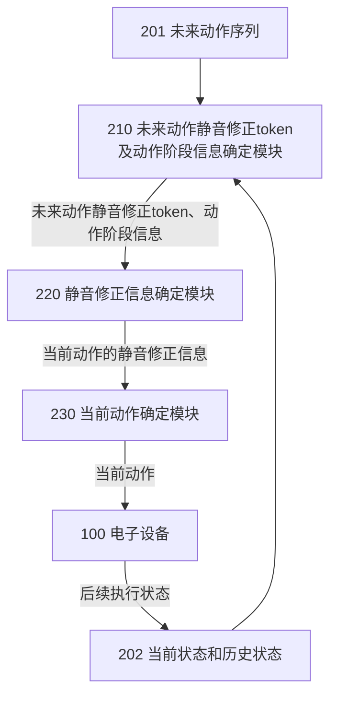
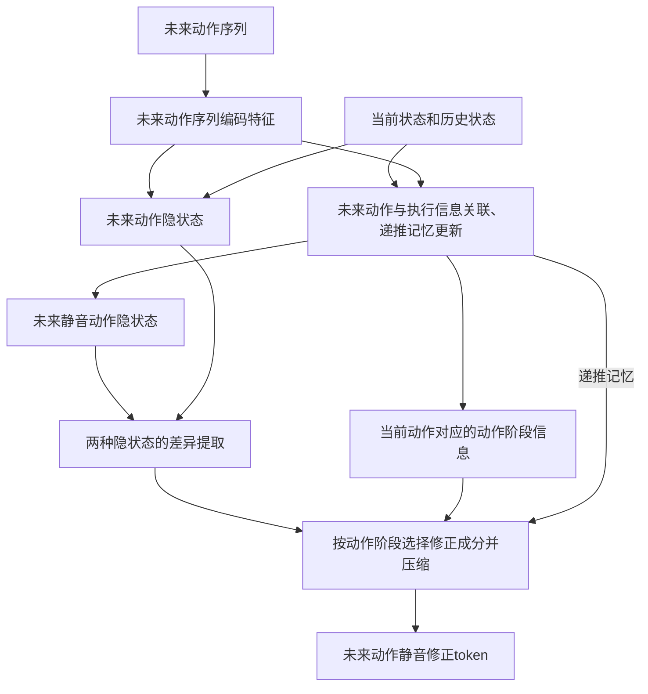
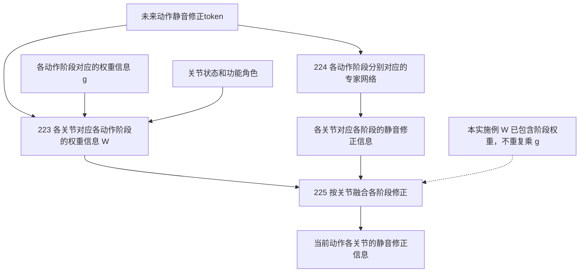
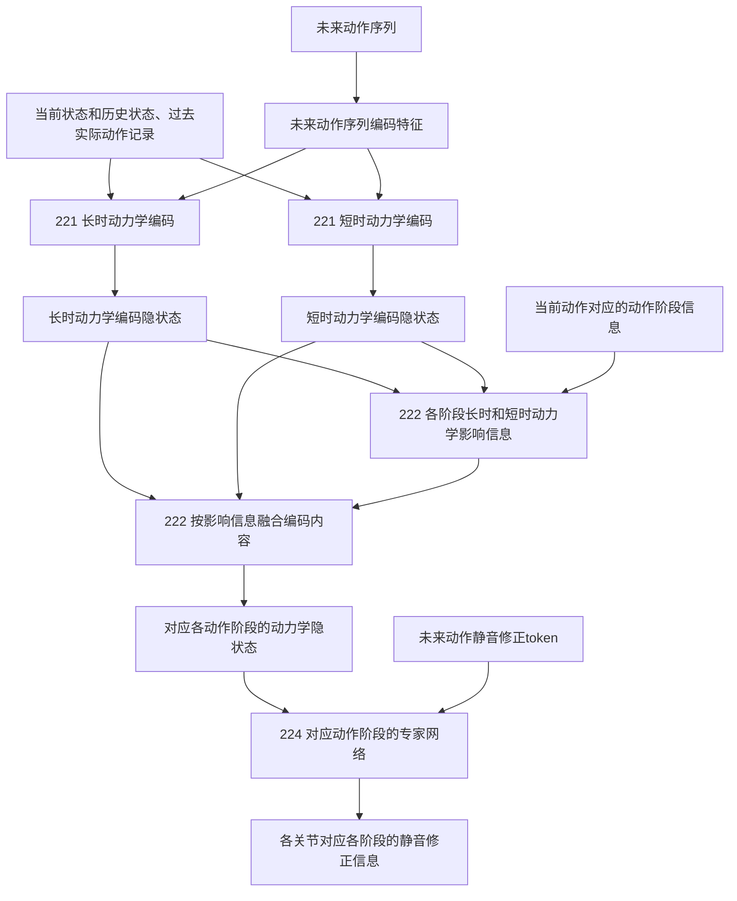
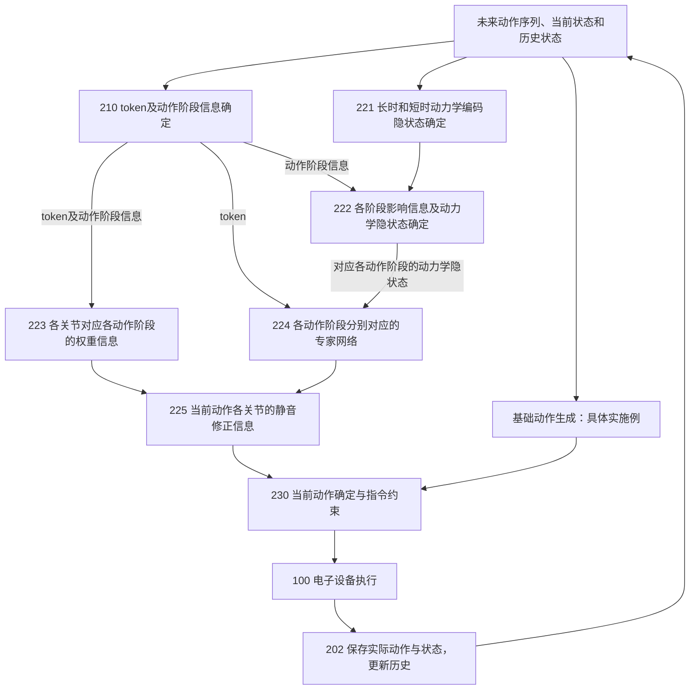
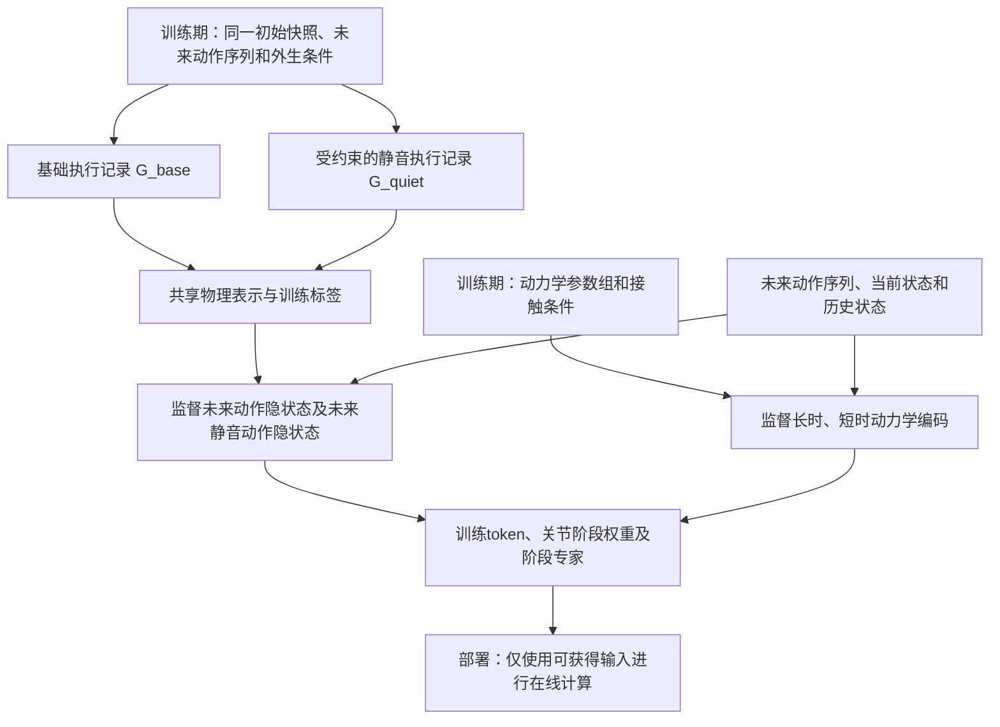

# 一种电子设备的静音动作控制方法

## Disclosure of Invention｜发明技术交底书

**文件编号：BST-CMMI-V3.0-TP028**  
**版本：中文Claim对齐修订稿 v2.0**  
**修订日期：2026年10月19日**  
**英文名称：Method for Quiet Motion Control of an Electronic Device**  
**主要实施对象：包括躯干、腿部结构以及足端结构的电子设备，以双足人形机器人为具体实施例。**

| Document Type | Language Code | Total page | Create | Exam | Approve | Registered Date | Item Code |
|---|---|---|---|---|---|---|---|
| 发明技术交底书（DOI） | 中文，保留Claim中的英文阶段名称与token写法 | Markdown不固定分页 | 待填写 | 待填写 | 待填写 | 待填写 | BST-CMMI-V3.0-TP028 |

> **用途与来源。** 本稿供具有专利撰写能力、但不熟悉机器人控制或神经网络的撰写人员理解方案。依据是发明人本轮提供的七条中文Claim，以及既有《BST-TP028_DOI_完善稿_20261019.md》。本轮统一术语并重组解释，不代替发明人修改Claim，也不对新颖性、创造性或法律保护范围作结论。建议采用上列名称以对应Claim 1的“电子设备”；原题目“一种相位感知的人形机器人安静行走控制方法”保留为历史名称，不据此将所有实施方式限定为某一人形机器人。
>
> **内容状态。** “Claim明确记载”只表示该关系已写入用户提供的Claim，不表示已完成工程验证。“既有DOI实施方式”表示旧稿已说明的技术实现，其中部分仍待发明团队确认。“本轮说明性展开”表示为解释数据关系、计算或实施过程而补充的具体写法。凡属示例参数、示例数值或拟实施训练方法，均不是实测结果；不能不加区分地转写为已经完成的实验事实。

## 发明概要

本发明提出一种控制电子设备的方法，所述电子设备包括躯干、腿部结构以及足端结构。该方法根据电子设备的未来动作序列、当前状态和历史状态，确定未来动作静音修正token以及当前动作对应的动作阶段信息；根据未来动作静音修正token和动作阶段信息，确定当前动作的静音修正信息；再根据静音修正信息，确定电子设备的当前动作。

所述动作阶段包括：卸载与质心准备阶段（unload & CoM preparation）、轻接触隔离阶段（light-contact isolation）以及平滑载荷接受阶段（smooth load acceptance）。三个阶段分别关注足端离地前的卸载及身体支撑准备、足端接近地面及初触地时的接触缓冲、接触建立后的渐进承重。动作阶段信息用于描述当前动作与这些阶段的关系，可包含各动作阶段对应的权重信息。

在一种实施方式中，首先确定未来静音动作隐状态和当前动作对应的动作阶段，并取得未来动作隐状态。未来动作隐状态表示未来动作序列在基础执行方式下的预计运动情况；未来静音动作隐状态表示在保持相应动作任务的条件下、为减轻接触冲击所期望的运动情况。二者不是未来真实传感器数据。结合这两种隐状态以及当前动作阶段，可以提取当前需要处理的差异，形成未来动作静音修正token。

进一步地，确定各关节对应各动作阶段的权重信息；使用各动作阶段分别对应的专家网络，生成各关节对应各阶段的静音修正信息；依据所述权重信息融合专家网络的输出，得到当前动作各关节的静音修正信息。

在另一进一步实施方式中，基于未来动作序列、当前状态和历史状态，确定长时动力学编码隐状态和短时动力学编码隐状态。长时动力学表征电子设备缓慢变化的动力学相关参数，短时动力学表征电子设备受环境变化和/或交互接触影响变化的动力学相关参数。结合当前动作阶段信息，确定长时动力学和短时动力学对应各阶段的影响信息，形成对应各动作阶段的动力学隐状态，并将其用于相应专家网络的静音修正计算。

在既有DOI所采用的动作执行实施例中，基础动作生成模块先产生基础动作，当前动作确定模块将静音修正信息转换为同一动作空间中的关节修正量，与基础动作合成，并经必要的指令约束后下发。实际执行状态进入后续历史，用于下一控制周期的更新。基础动作叠加是本稿详细展开的实施方式，不将其误写为Claim 1已经逐字规定的唯一动作确定方式。

本方案拟在完成原有动作任务的同时，通过动作阶段相关的关节修正以及长、短时动力学信息的利用，减轻足端接触冲击及相关脚步噪声。这里的“静音”表示以降低相关运动噪声为目标，不表示动作完全无声；实际效果须由机械响应与声学测试分别确认。

**关键词：** 电子设备；未来动作序列；未来动作静音修正token；动作阶段信息；静音修正信息；专家网络；长时动力学编码隐状态；短时动力学编码隐状态；足端接触；质心。

---

# 代理人优先阅读：先理解这四件事

## R1. 我们到底要解决什么问题？

以一个携物行走的双足电子设备为例。它已经有一段“右脚抬起、向前摆动、落地、随后承重”的未来动作序列。序列中的足端运动看起来可以很轻柔，但真正执行时，负载、关节响应或地面接触发生变化，可能导致右脚还没有准备好，身体就过早向右脚转移载荷，或右脚触地后过快接受载荷。

因此，本发明不是只给设备一个“轻一点走”的指令，而是持续判断：**未来要做什么、当前实际做到了哪一步、哪些地方需要静音修正、当前应怎样由各关节完成修正。**

## R2. 为什么要有token、隐状态和静音修正信息三个层次？

可以将它们分别理解为“内部描述”“修正需求摘要”和“可执行调整”，但正式正文仍使用Claim中的完整名称：

| 信息层次 | 本稿中的完整名称 | 撰写人员应怎样理解 | 不能误写成什么 |
|---|---|---|---|
| 描述预计执行 | 未来动作隐状态 | 对基础执行方式下后续运动情况的数值表示 | 已经发生的未来动作或未来实测数据 |
| 描述期望静音执行 | 未来静音动作隐状态 | 对后续静音执行所需运动情况的数值表示 | 当前物理状态本身，或必然可行的精确轨迹 |
| 归纳修正需求 | 未来动作静音修正token | 从上述信息中提取出的、与当前控制有关的紧凑修正特征 | 文本提示词，或直接发给电机的角度命令 |
| 落实到动作 | 当前动作的静音修正信息 | 由token和动作阶段信息确定的调整内容；具体实施例中为关节修正量 | token的另一个名称 |

**最关键的区别：token回答“需要修正什么”，静音修正信息回答“当前具体怎样修正动作”。**

## R3. 为什么要区分三个动作阶段？

足端还在承重、即将触地、已经触地并开始承重时，需要解决的问题不同。若把同一种修正不加区分地用于所有时刻，可能在本应减速接触时过早加大承重，也可能在需要平滑接受载荷时仍只处理离地准备。

动作阶段信息把同一个静音目标分解为当前可执行的阶段目标。专家网络和关节权重据此生成、选择和分配静音修正，而不是把动作阶段仅作为显示标签。

## R4. 三类权重分别控制什么？

| Claim用语 | 符号 | 控制的问题 | 一个直观例子 |
|---|---|---|---|
| 各动作阶段对应的权重信息 | $g_t^k$ | 当前整体应使用多少第k阶段的处理 | 当前主要处于轻接触隔离阶段 |
| 各关节对应各动作阶段的权重信息 | $W_{t,j}^k$ | 第k阶段的修正对第j关节作用多少 | 轻触地时目标腿相关关节参与更多修正 |
| 长时/短时动力学对应各阶段的影响信息 | $\beta_{L,t}^k,\beta_{S,t}^k$ | 第k阶段应怎样利用两类动力学信息 | 初触地时更重视近期接触响应 |

这三者不能合并为一个没有定义的“注意力权重”。第2.7节明确说明阶段权重怎样进入关节阶段权重，避免遗漏或重复相乘。

---

# 1. 发明背景介绍

## 1.1 技术领域与适用对象

本发明涉及电子设备运动控制技术，尤其涉及根据未来动作序列、当前状态和历史状态，按动作阶段确定静音修正信息并控制当前动作的方法。

电子设备具有躯干、腿部结构和足端结构，并具有执行相应运动控制所需的处理、驱动和状态获取能力。本稿以双足人形机器人说明具体实施过程；“人形机器人”“左右腿”是实施例中的具体对象和结构，不替换Claim 1中的“电子设备”“腿部结构”“足端结构”。

本稿详细说明足端支撑及支撑转移相关动作。对于腾空跑跳、手部显著承重或主动跌倒保护等动作，既有材料没有完整给出相应阶段定义与控制约束，不能直接宣称已由本实施例全面覆盖。

## 1.2 使用需求

在家庭、医院、酒店或办公环境中，具有腿部结构的电子设备可能在人们休息或交谈时移动。除完成移动任务之外，还希望其足端接触地面时不要产生过强的冲击和相关声音。

设备携带物品后，惯性和关节响应可能变化；进入不同地面后，足端接触响应也可能变化。因此，同一未来动作序列在不同执行条件下，不一定产生相同的触地效果。本发明关注这种条件变化下的静音动作控制。

本方案主要针对足端接触冲击相关的噪声，不将风扇、齿轮、电机或外壳的全部声音都归因于足端接触，也不承诺单靠本控制方法消除所有声源。

## 1.3 原方案的技术出发点

既有DOI采用“未来动作序列加动作跟踪执行”的控制结构作为出发点：先取得接下来要执行的动作，再根据电子设备当前状态生成实际控制动作。对于已存在的基础动作生成能力，本发明可以通过增加静音修正处理进行配合，而不必重新生成整段未来动作序列。

单纯提高动作跟踪精度与减小接触冲击是相关但不同的目标。未来动作序列可以规定足端位置、速度和躯干姿态，却不单独决定真实触地时各足端怎样分担载荷。因此，还需要结合实际执行状态处理足端接触及载荷接受过程。

这里不作“其他控制器没有阶段判断”“普通残差只能均匀作用所有关节”或“已有学习方法不能适应环境”的绝对判断。原稿列举的公开资料仅在附录E保留为后续核对入口，本轮不新增针对其技术能力或法律状态的结论。

## 1.4 待解决的两个技术问题

### 问题一：未来动作描述与实际支撑转移之间存在差异

未来动作序列描述设备准备怎样运动；实际执行还涉及身体载荷怎样从一个足端转移到另一个足端，以及接触力以怎样的速度建立。

例如，目标足端尚在承重时就要求其离地，其他结构可能需要快速补偿；又如，足端已经按较低速度接近地面，但身体运动没有为后续承重做好准备，初触地后仍可能快速接受较大载荷。

因此，需要把未来动作序列、当前状态和历史状态转换为与静音执行有关的信息，并依据当前动作阶段提取需要立即处理的修正内容。

### 问题二：执行条件变化使同一动作需要不同修正

负载、惯性和执行器响应等持续性因素，会影响动作应该怎样提前准备；环境变化和交互接触引起的近期响应，会影响轻触地及后续载荷接受。

因此，即使动作阶段相同，也不能始终采用同一组修正。需要根据长时、短时动力学相关信息，改变相应阶段的修正计算。

## 1.5 发明目的与技术主线

本发明的技术主线为：

**未来动作序列、当前状态和历史状态 → 未来动作静音修正token及动作阶段信息 → 当前动作的静音修正信息 → 当前动作。**

在进一步实施方式中，通过两种动作隐状态生成token，通过阶段专家和关节阶段权重形成静音修正，通过长、短时动力学编码及各阶段影响信息适应执行条件变化。

---

# 2. 发明的详细说明

## 2.1 技术层级与模块命名

**来源：Claim 1—7的层级；模块编号和功能性模块名称为本稿说明性展开。**

本稿将原DOI三个研究型模块名称改为与Claim输出一致的功能名称。模块只是说明功能关系的划分，可以在同一处理器或网络中实现，不表示必须有三个独立硬件。

| 功能模块 | 说明书附图标记建议 | 对应内容 |
|---|---|---|
| 电子设备 | 100 | 具有躯干110、腿部结构120、足端结构130及相应驱动/状态获取组件140 |
| 控制装置 | 200 | 执行下述功能；可位于电子设备内 |
| 未来动作序列获取模块 | 201 | 获取当前时刻已经可用的未来动作序列 |
| 当前状态和历史状态获取模块 | 202 | 获取状态，维护有时间顺序的执行历史 |
| 未来动作静音修正token及动作阶段信息确定模块 | 210 | Claim 1的第一步骤；可按Claim 2、3展开 |
| 静音修正信息确定模块 | 220 | Claim 1的第二步骤；可按Claim 4—7展开 |
| 当前动作确定模块 | 230 | Claim 1的第三步骤；在具体实施例中合成基础动作和关节修正量 |

静音修正信息确定模块220可进一步包括：长时/短时动力学编码单元221、各动作阶段的动力学隐状态确定单元222、关节阶段权重确定单元223、各动作阶段分别对应的专家网络224、静音修正信息融合单元225。

原名称“相位感知的安静CoM先验校正器”对应210的具体实现；原名称“相位门控的动态关节责任解码器”对应223、224、225；原名称“相位感知的快慢动力学路由器”对应221、222。正文不再并行使用这三组旧名称作为另一套对象。旧新术语映射见附录A。

### Claim层级不能被一张整体结构图覆盖

用户提供的从属关系是：Claim 2依附Claim 1；Claim 3依附Claim 1；Claim 4依附Claim 3；Claim 5依附Claim 4；Claim 6和Claim 7分别依附Claim 5。

因此，后文展示“包含全部七条技术内容的组合实施例”，不表示Claim 2的全部细节已自动成为Claim 3—7的前置步骤，也不表示Claim 6与Claim 7互相从属。

## 2.2 输入、输出与状态的统一定义

设当前控制时刻为t，受控关节数为J，阶段索引为k，且k属于A、B、C。A、B、C只是三个既有动作阶段的符号代号。

| Claim规范名称 | 符号 | 物理或计算含义 | 来源、去向及使用时点 |
|---|---|---|---|
| 未来动作序列 | $M_t$ | 当前已知、描述接下来一段时间要执行动作的序列 | 来自上层动作接口；进入210及采用Claim 5的221 |
| 当前状态 | $O_t$ | 当前关节、躯干、足端或接触等可获取的物理状态及其估计 | 来自设备传感和状态估计；不是网络隐状态 |
| 历史状态 | $H_t$ | 截至当前时刻以前、有时序关系的设备状态记录 | 由202维护；可结合相应时刻的实际执行动作记录 |
| 未来动作隐状态 | $z_t^F$ | 对未来动作序列的内部表示；本实施例以基础执行的预计运动/支撑转移情况为其语义 | 在210内确定；用于Claim 2的token生成 |
| 未来静音动作隐状态 | $z_t^Q$ | 对保持任务条件下期望静音执行的内部表示 | 根据未来动作序列、当前状态、历史状态确定；用于token生成 |
| 当前动作对应的动作阶段信息 | $g_t$等阶段表示 | 当前动作与三个阶段的对应关系；在Claim 3实施例中为三个阶段权重 | 210输出；用于token、关节阶段权重和动力学计算 |
| 未来动作静音修正token | $z_t^{corr}$ | 当前所需静音修正的紧凑数值特征 | 210输出；输入220；不是电机控制量 |
| 长时动力学编码隐状态 | $z_t^L$ | 表征长时动力学相关参数及其执行影响的编码表示 | 221输出；供222使用 |
| 短时动力学编码隐状态 | $z_t^S$ | 表征环境变化和/或交互接触相关参数及其响应的编码表示 | 221输出；供222使用 |
| 长时/短时动力学对应各阶段的影响信息 | $\beta_{L,t}^k,\beta_{S,t}^k$ | 两类动力学信息在第k阶段如何参与计算 | 222内部确定；用于形成该阶段的动力学隐状态 |
| 对应各动作阶段的动力学隐状态 | $z_t^{D,k}$ | 针对第k阶段融合后的动力学表示 | 222输出；输入第k阶段的专家网络224 |
| 各关节对应各动作阶段的权重信息 | $W_{t,j}^k$ | 第k阶段专家输出对第j关节的有效作用权重 | 223输出；供225融合使用 |
| 各关节对应各阶段的静音修正信息 | $\Delta a_{t,j}^k$ | 第k阶段专家对第j关节提出的修正 | 224输出；供225使用 |
| 当前动作各关节的静音修正信息 | $\Delta a_{t,j}$ | 各阶段专家输出融合后的关节修正 | 225输出；对应220的输出，送入230 |
| 当前动作 | $a_t^{exec}$ | 当前控制周期确定并用于设备执行的动作 | 230输出；经驱动组件执行，后续响应进入历史 |

### 规范名称与解释性简称

本稿在正式定义、输入输出和逐条对应表中使用Claim完整名词。解释段中的“阶段权重”仅指“各动作阶段对应的权重信息”；“关节阶段权重”仅指“各关节对应各动作阶段的权重信息”；“token”仅指“未来动作静音修正token”；“阶段专家”仅指“各动作阶段分别对应的专家网络”。这些是已定义对象的简称，不另行引入与Claim竞争的术语。

### 必须区分的四类“状态”

“当前状态和历史状态”是设备的物理状态记录或可获得的状态估计。“未来动作隐状态”和“未来静音动作隐状态”是网络内部表示。“长时/短时动力学编码隐状态”是对执行条件影响的表示。递推网络自身的记忆h_t则是实现这些计算时使用的中间变量。

**h_t不能因为也称为“隐状态”，就直接替代未来静音动作隐状态。** 本稿选用h_t维持事件记忆，再通过投影产生z_t^Q；这是既有DOI的一种对应方式。若实际网络使用h_t直接承担z_t^Q的功能，须重新确认其输出语义和监督，而不能仅改符号。

### 数据获取的一种实施方式

当前状态可包括关节角、关节角速度、IMU获得的躯干运动、运动学计算的足端位置和速度、已有传感器测得或估计器提供的接触状态。历史状态与过去实际下发动作按时间戳关联，用于判断“发出了什么动作、设备实际上怎样响应”。历史动作记录是实施辅助输入，不将其定义为Claim“历史状态”一词已经逐字包含的内容。

未来动作序列可以包含关节参考、躯干运动、足端轨迹及可用的接触意图。参考坐标、状态坐标、单位及时间轴需对齐。真实质量、摩擦、接触刚度或未来真实轨迹可以作为仿真训练标签，但不被假定为在线已知输入。

## 2.3 三个动作阶段的物理含义

**来源：阶段名称来自Claim 1；物理解释沿用既有DOI，并将中文名称统一为下表。**

| 阶段代号 | Claim中的名称及中文解释 | 当前重点 | 典型需要修正的情况 |
|---|---|---|---|
| A | **unload & CoM preparation：卸载与质心准备阶段** | 目标足端仍承重时逐步卸载；结合未来动作准备躯干、质心和剩余支撑 | 目标足端未妥善卸载，或身体运动未为后续接触准备好 |
| B | **light-contact isolation：轻接触隔离阶段** | 足端接近地面时减速；初触地时缓和接触建立，并避免过早快速转移主要载荷 | 触地速度偏大、触地早于/晚于预期、接触建立与承重不同步 |
| C | **smooth load acceptance：平滑载荷接受阶段** | 在接触具备相应支撑条件后，渐进调整各足端承重 | 新接触足端过快接受载荷，或原支撑过早解除 |

“CoM”是质心，即设备及其所携负载的等效质量中心。本方案以质心相关信息组织支撑准备，但质心一个量不能唯一决定两脚分别承受多大接触力。

“卸载”指减少仍在承重的足端的载荷；不把已在空中的足端继续描述为正在卸除地面载荷。“轻接触隔离”不是足端触地但完全没有力，而是将初始接触缓冲与大幅接受载荷在控制上加以区分，防止二者过早耦合。“平滑载荷接受”也不要求每个任务最终都变成新足端单独承重。

B阶段内区分“尚未触地”和“已经初触地”两种接触条件，但它们仍使用B阶段的处理，不新增第四个动作阶段或第四个专家网络。阶段与腿的功能角色随实际动作变化，不以固定左腿或右腿永久代表某一角色。

阶段判断同时参考未来动作意图和当前、历史执行证据。若参考已经到达计划触地时刻，而实际足端尚未接触，不能仅凭参考时间就认为已进入可承重的C阶段。

## 2.4 总体控制方法——对应Claim 1

**来源：三个总体步骤直接对应Claim 1；输入缓存、驱动和反馈为既有DOI中的实施展开。**

### S101：确定未来动作静音修正token和动作阶段信息

读取未来动作序列M_t、当前状态O_t和历史状态H_t。由模块210确定未来动作静音修正token z_t^{corr}，以及当前动作对应的动作阶段信息。采用Claim 2实施方式时，按第2.5节通过动作隐状态完成计算；采用Claim 3实施方式时，阶段信息包含各动作阶段对应的权重信息。

### S102：确定当前动作的静音修正信息

模块220读取z_t^{corr}和动作阶段信息，输出当前动作的静音修正信息。采用Claim 4实施方式时，输出是按关节组织的修正信息，并利用不同阶段的专家网络和关节阶段权重形成。采用Claim 5—7实施方式时，还利用对应各动作阶段的动力学隐状态。

### S103：确定电子设备的当前动作

模块230根据静音修正信息确定当前动作，并交由相应驱动组件执行。在第2.10节的实施例中，当前动作由基础动作与关节修正量合成。执行后的状态在后续控制周期成为历史的一部分，从而形成反馈。

**图1：Claim 1总体方法与执行反馈。** 图1只表示总体关系，不把Claim 2、4、5中的具体网络全部提升为总体步骤不可替换的定义。

## 2.5 未来动作静音修正token的确定——对应Claim 2

**来源：两步关系来自Claim 2；递推记忆、未来—执行关联、成对表示与差异编码来自既有DOI。未来动作隐状态的具体取得步骤在此补明。**

### 2.5.1 先说明两种隐状态的区别

未来动作隐状态z_t^F用于描述：从当前状态出发，依据未来动作序列按基础执行方式继续运动，预计会形成怎样的后续运动情况。未来静音动作隐状态z_t^Q用于描述：在保留相应动作任务和可行约束的前提下，为减轻接触冲击，希望形成怎样的后续运动情况。

这是本实施例对两个Claim名词的具体语义安排：分别承接既有DOI中的基础支撑转移表示与静音支撑转移表示。它们可以以质心、足端接触和载荷转移相关状态作为监督对象，但不因此在全部实施方式中都只允许包含质心位置。

**未来动作序列的初步编码特征与未来动作隐状态不混称。** 例如z_t^M只是对序列的初步数值编码；本稿再由z_t^M及执行信息形成z_t^F，使z_t^F与z_t^Q在共同表示空间中可比较。Claim 2没有单列z_t^F的取得步骤，此处是对已有数据来源的显式补全。

### 2.5.2 取得未来静音动作隐状态和动作阶段

一种计算过程如下：将未来动作序列按采样点编码为特征，保留相对时间、足端运动及可用的接触意图；将当前状态和历史状态编码为执行特征；关联这两类特征，选取对当前修正相关的未来动作信息；利用递推记忆h_t记录该次动作执行已经推进到何处；再分别输出未来静音动作隐状态z_t^Q和动作阶段信息。

未来—执行交叉注意力可以用于建立上述关联。撰写人员可以理解为：用“当前实际执行情况”从“接下来计划做的事情”中挑选当前最相关的部分。GRU可以用于维护h_t。它们都是本实施例选用的计算工具，不是另立的Claim术语。

阶段输出可进一步结合实际接触有效性处理。例如，足端尚未接触时，限制以已建立接触为前提的承重处理。该处理不等同于重新生成上层未来动作序列。

### 2.5.3 取得未来动作隐状态

在同一控制周期中，将未来动作序列的编码与当前、历史执行信息输入未来动作隐状态预测分支，得到z_t^F。该分支使用与z_t^Q兼容的坐标、预测范围和尺度。

此处分支预测的是基础执行情况下的预计状态，不是在线运行一个完整物理仿真，也不是读取未来真实状态。基础执行的定义需与训练时生成相应监督的基础动作生成模块保持一致。

### 2.5.4 根据两种隐状态及动作阶段生成token

将z_t^F、z_t^Q以及二者的差异输入差异编码器；结合当前动作阶段及递推记忆，选择当前需要处理的成分；再压缩成未来动作静音修正token。

一种沿用原DOI的表达为：

$$
d_t=E_{diff}\big([z_t^F,z_t^Q,z_t^F-z_t^Q,z_t^F\odot z_t^Q]\big),
$$

$$
z_t^{corr}=P\big(\sigma(G(h_t,g_t))\odot d_t\big).
$$

E_diff处理两种表示及其差异；G根据事件记忆和动作阶段产生门控；σ将门控系数限制在0到1；P压缩保留下来的特征；⊙为对应元素相乘。差值符号表示网络输入的约定，不直接表示某关节应正转或反转。

例如，A阶段可能更需要突出身体和支撑准备的差异；B阶段突出足端减速与接触建立的差异；C阶段突出载荷接受的差异。token在每个控制周期重新确定，既利用未来动作的信息，又用于当前动作的修正，并不意味着把整段未来动作全部改写。

**图2：Claim 2的隐状态与token关系。** 图中的递推记忆、两种动作隐状态和token是不同层次的信息，不可互换名称。

## 2.6 各动作阶段对应的权重信息——对应Claim 3

**来源：权重信息来自Claim 3；三个非负归一化权重及事件有效性处理为既有DOI实施方式。**

设动作阶段信息包括：

$$
g_t=[g_t^A,g_t^B,g_t^C],\qquad g_t^k\geq0,\qquad \sum_k g_t^k=1.
$$

三个权重分别对应A、B、C阶段。它们用于计算，不只是输出一个文字阶段标签。在阶段过渡区间，可同时使用相邻阶段的部分处理，以减少硬切换造成的突变。

权重较高表示当前更重视该阶段的处理，不表示该阶段占一个步态周期的时间百分比，也不能未经标定就将其解释为精确的概率或置信度。实际接触条件仍要参与动作可用性的判断。

当没有适用的支撑转移动作或输入无效时，本实施例可通过事件使能量降低静音修正的作用，或进入已定义的控制处理。此时不把一个网络默认阶段输出当作真实接触事实，也不增加Claim之外的第四种静音动作阶段。

## 2.7 当前动作各关节的静音修正信息——对应Claim 4

**来源：关节阶段权重、阶段专家及融合关系来自Claim 4；动态角色、阶段软融合来自既有DOI。本节对两层权重作明确的计算约定。**

### 2.7.1 为什么既有阶段权重，又有关节阶段权重？

阶段权重决定当前整体怎样组合A、B、C的处理，但还不能说明每个关节应参与多少。例如，目标足端接近地面时，目标腿与原支撑腿可能都需要修正，但承担的功能不同，不能仅靠同一个阶段权重完成这种分配。

因此，基于未来动作静音修正token和动作阶段信息，确定各关节对应各动作阶段的权重信息。在本实施例中，还结合当前关节状态、所属腿的功能角色和既有运动特征，计算具体分配。

### 2.7.2 将阶段权重显式包含在关节阶段权重中

本稿选定以下约定，避免Claim 3的阶段权重在Claim 4的融合过程中失去用途：先确定关节分配系数r_{t,j}^k，再形成有效权重：

$$
W_{t,j}^k=g_t^k r_{t,j}^k.
$$

其中，W_{t,j}^k就是本稿所称的“各关节对应各动作阶段的权重信息”。r_{t,j}^k是实现该计算时的中间系数，不用它替换Claim中的最终权重名称。一种实现将r限制在0到1，并允许多个关节同时参与。

于是阶段权重g通过W参与后续融合，而不需要在使用W以后再乘一次g。原DOI“先乘关节分配系数，再乘阶段权重”的写法与此等价，但原来的纯关节分配系数应对应本稿的r，而不是在改名后仍当成已经包含g的W。

**这是本稿采用的一种显式融合实现，不表示Claim 4原文已经规定了W必须以乘法生成。** 该具体约定单列在第7章供确认，原始Claim保持不变。

### 2.7.3 专家网络分别生成阶段修正

A、B、C三个动作阶段分别对应专家网络E_A、E_B、E_C。各专家基于未来动作静音修正token，分别输出所有受控关节在该阶段的静音修正信息。Claim 4本身不要求必须已经使用长、短时动力学编码；在采用Claim 5的进一步实施方式时，才加入对应阶段的动力学隐状态。

专家网络输出可以记为长度为J的向量$\Delta a_t^k$。其第j个元素是$\Delta a_{t,j}^k$。在本稿详细展开的位置目标接口中，它是关节目标角度的修正，单位与基础动作一致。

A专家侧重卸载和质心准备，B专家侧重轻接触隔离，C专家侧重平滑载荷接受。这里的“专家”是按阶段分工的网络输出分支，不是三名外部人员，也不要求三个完全不共享参数的大模型。

### 2.7.4 融合各阶段修正

对每个关节，按其对应各阶段的有效权重融合：

$$
\Delta a_{t,j}=\sum_{k\in\{A,B,C\}}W_{t,j}^k\Delta a_{t,j}^k
=\sum_k g_t^k r_{t,j}^k\Delta a_{t,j}^k.
$$

由全部J个关节的结果组成当前动作各关节的静音修正信息$\Delta a_t$，再用于当前动作确定。

这种计算把“哪个阶段更相关”和“该阶段哪些关节更相关”同时落实到输出。它有助于形成有针对性的修正，但不单独构成稳定性保证，也不能仅凭关节权重较大就证明该关节对降噪的因果贡献较大。

**图3：Claim 4的关节阶段权重、专家输出和融合。** 图3不把Claim 5的动力学支路作为Claim 4必有的输入；加入动力学的组合实施例见图4。

## 2.8 动力学编码及专家网络的条件输入——对应Claim 5、7

**来源：输入关系与专家输入来自Claim 5；动力学含义来自Claim 7。窗口和条件编码的具体连接为既有DOI基础上的说明性展开。**

### 2.8.1 从哪些信息确定长时和短时动力学编码隐状态？

Claim 5明确要求基于未来动作序列、当前状态和历史状态，确定长时动力学编码隐状态与短时动力学编码隐状态。因此，本稿不再仅写“从长短历史编码得到”，而将未来动作序列对编码的影响明确接入。

一种具体实现为：从同一历史状态记录中取得较长时间范围H_t^L和较短时间范围H_t^S；将未来动作序列编码特征z_t^M、当前状态O_t、对应时间范围的历史状态，以及与历史状态对齐的过去实际动作记录，输入相应编码器。

$$
z_t^L=E_L(z_t^M,O_t,H_t^L,A_{<t}^L),\qquad
z_t^S=E_S(z_t^M,O_t,H_t^S,A_{<t}^S).
$$

A_{<t}表示当前时刻之前已经下发的动作记录，不包含尚未确定的当前动作。长、短历史可以重叠；短历史通常较密集地采样，长历史可以适当下采样并保留时间间隔。两个窗口长度不同，是提供不同信息范围的手段，而不是自动保证两个隐状态学到了不同物理含义。

未来动作序列在这里用于提供动作条件：接下来要侧移、抬脚还是准备承重，决定哪些历史响应更有助于当前修正。例如，曾经反复出现的关节响应滞后，应结合接下来的动作需求加以利用。未来动作序列不提供尚未接触地面的真实刚度或尚未发生的接触力。

本稿使用z_t^M作为共同动作条件，不要求必须先执行Claim 2的全部成对隐状态步骤，才能实现Claim 5。若完整实施例同时采用Claim 2，可共享相应序列编码特征，但共享实现不改变各条Claim本来的从属关系。

### 2.8.2 长时、短时动力学分别表示什么？

严格沿用Claim 7的分工：

| Claim定义 | 本实施例的理解 | 可采用的训练或检查依据 |
|---|---|---|
| 长时动力学表征电子设备缓慢变化的动力学相关参数 | 长期或缓慢变化的负载、惯性分布、执行器响应等参数对运动响应的影响 | 仿真中相应参数或参数组、持续响应变化以及预测误差 |
| 短时动力学表征电子设备受环境变化和/或交互接触影响变化的动力学相关参数 | 地面、足端接触、摩擦或柔顺性变化所引起的相关参数及执行响应 | 仿真接触条件、环境变化标签与近期接触响应 |

“编码隐状态”不要求每个元素都分别等于质量、摩擦系数或刚度；但训练与验证应能支持其与相应参数或参数影响有关，不能仅因为一个向量来自长窗口就宣称它已表征长时动力学。

与旧稿的区别是：本稿不将Claim 7改写成“任意持续变化都属于长时、任意突然变化都属于短时”。历史中可能有重叠信息，相关因素也不总能完全分离，但两个编码分支在正文中的目标含义仍以Claim 7为准。对于刚拿起物体导致的突变，如何由现有两分支过渡处理属于需训练覆盖的实施问题，不能据此悄然重新定义短时动力学。

### 2.8.3 为什么还要形成“对应各动作阶段的动力学隐状态”？

长时动力学编码隐状态和短时动力学编码隐状态是两类输入表示；不同动作阶段对它们的利用方式可能不同。

A阶段可能需要提前考虑持续负载和执行器响应；B阶段可能更重视刚出现的接触变化；C阶段可能同时需要两类信息来安排载荷接受。因此，需要结合当前动作阶段信息，得到分别用于A、B、C专家网络的动力学隐状态，而不是把同一个未区分阶段的向量固定送给全部专家。

这些是用于解释设计动机的典型情形，不将A固定为只用长时、B固定为只用短时，也不强制C采用各一半的权重。

### 2.8.4 动力学隐状态怎样参与专家网络？

对于第k阶段，将未来动作静音修正token以及对应各动作阶段的动力学隐状态中的第k个表示z_t^{D,k}输入该阶段专家，输出各关节对应该阶段的静音修正信息：

$$
\Delta a_t^k=E_k(z_t^{corr},z_t^{D,k},\text{可选的当前状态及动作特征}).
$$

既有DOI采用FiLM作一种具体实现：先形成共享特征f_t，再根据z_t^{D,k}生成缩放和偏置，调制成第k阶段使用的特征。可以写为：

$$
f_t^k=\gamma_k(z_t^{D,k})\odot f_t+b_k(z_t^{D,k}),
\qquad \Delta a_t^k=D_k(f_t^k).
$$

FiLM改变的是网络内部特征，不直接等于改变电机刚度、阻尼或力矩上限。只有控制接口另外实际输出相关物理参数时，才应作这种描述。采用条件拼接等其他有依据的实现时，同样需要维持“该阶段动力学隐状态参与该阶段静音修正计算”的关系。

## 2.9 各阶段动力学影响信息及融合——对应Claim 6

**来源：两类影响信息和各阶段动力学隐状态来自Claim 6；非负归一化加权是既有DOI的一种具体实现。**

### 2.9.1 先确定每一阶段的两类影响信息

对于各阶段k，相关性计算单元读取长时动力学编码隐状态z_t^L、短时动力学编码隐状态z_t^S和当前动作阶段信息g_t，产生长时动力学对应该阶段的影响信息，以及短时动力学对应该阶段的影响信息。

例如，第k阶段的输出可写为：

$$
(\beta_{L,t}^k,\beta_{S,t}^k)=R_k(z_t^L,z_t^S,g_t),
\qquad \beta_{L,t}^k,\beta_{S,t}^k\geq0,
\qquad \beta_{L,t}^k+\beta_{S,t}^k=1.
$$

R_k可由共享网络加不同阶段输出头实现，也可将阶段标识作为输入。这里的归一化仅是本实施例选择的影响信息表达，不宣称Claim 6将“影响信息”限定成两个标量。

### 2.9.2 再用影响信息选择、融合真实的编码内容

若采用上述加权实现，先将两类隐状态投影到兼容维度，再形成：

$$
z_t^{D,k}=\beta_{L,t}^k P_L(z_t^L)+\beta_{S,t}^k P_S(z_t^S).
$$

P_L与P_S为数值映射。**影响信息决定怎样使用动力学内容，但不替代动力学内容本身。** 即使两个阶段的影响系数相同，若长时或短时动力学编码隐状态不同，形成的动力学隐状态仍可不同。

因此，Claim 6最后一步在具体实施方式中应明确保留z_t^L和z_t^S到融合单元的数据路径。不能只在图中画两个权重输入，就宣称已得到完整动力学隐状态。本稿对此补全技术解释，不自行修改Claim 6文字。

**图4：Claim 5、6的动力学信息流。** 长时/短时编码、影响信息和各阶段融合表示是三个不同计算层次。未来动作序列到动力学编码，以及两类编码到融合单元的路径均明确保留。

## 2.10 当前动作怎样确定——Claim 1第三步的一种实施方式

**来源：Claim 1要求根据静音修正信息确定当前动作；基础动作叠加、同单位接口和限幅沿用既有DOI，不作为Claim 1已写明的唯一实现。**

基础动作生成模块依据未来动作序列及当前状态生成基础动作a_t^{base}。对于关节位置目标接口，基础动作的第j个元素为第j关节的目标角度；静音修正信息对应同一关节顺序、同一角度单位的增量。

名义条件下，当前动作按下式确定：

$$
a_t^{exec}=a_t^{base}+\Delta a_t.
$$

在加入事件使能、整体强度和指令约束的实施方式中，可写为：

$$
a_t^{exec}=\mathcal Q\left(a_t^{base}+
\operatorname{clip}_{\delta}\left(\eta_t e_t\Delta a_t\right)\right).
$$

e_t表示事件使能程度，η_t表示整体修正强度，clip_δ表示各关节修正幅值限制；Q进一步限制最终目标与相邻周期变化率。它们是为具体控制接口补充的实现措施，不改变前述token、阶段信息和静音修正信息的计算含义。

骨盆/躯干的位置是设备状态的一部分，不能把自由浮动的骨盆直接当成可下发命令的电机关节。若需要改变躯干或质心运动，应通过设备实际存在的关节协同实现。

本实施例不将“限幅”描述为已经完成严格的全身动力学可行域投影。动作限幅不能保证携物姿态、落点或平衡在所有条件下都不被破坏；这些任务条件还需训练约束、在线监测和已有异常处理配合。

## 2.11 一个控制周期的完整顺序

**来源：采用全部七条技术内容的组合实施例；不是重新定义七条Claim的从属关系。**

| 顺序 | 处理 | 本步输出 | 必须说明的信息边界 |
|---|---|---|---|
| 1 | 读取未来动作序列、当前状态，更新截至当前的历史 | M_t、O_t、H_t及有效性信息 | 不读未来实测状态；过去实际动作与状态对齐 |
| 2 | 编码未来动作，并结合执行信息更新事件记忆 | z_t^M、h_t | h_t只是中间记忆，不与任何Claim隐状态混名 |
| 3 | 确定未来静音动作隐状态和动作阶段信息，取得未来动作隐状态 | z_t^Q、g_t、z_t^F | 两种动作隐状态在兼容表示中描述不同执行情况 |
| 4 | 按阶段提取差异并压缩 | z_t^{corr} | 输出token，不直接驱动关节 |
| 5 | 基于未来动作序列及长短历史编码动力学 | z_t^L、z_t^S | 未来动作提供条件，不提供未来接触真值 |
| 6 | 确定各阶段影响信息并融合 | β_L^k、β_S^k、z_t^{D,k} | 影响信息与编码内容都进入融合 |
| 7 | 确定各关节对应各动作阶段的权重；各专家计算阶段修正 | W_{t,j}^k、Δa_{t,j}^k | W已包含本实施例的g，不能再次重复乘g |
| 8 | 融合各阶段修正，得到当前动作的静音修正信息 | Δa_t | 同一关节顺序、同一动作单位 |
| 9 | 根据静音修正信息确定当前动作，经驱动执行 | a_t^{exec} | 基础动作与残差叠加为本例接口 |
| 10 | 保存实际下发动作，接收后续状态并更新历史 | 下一周期所需数据 | 保存经限幅实际下发的动作，不只保存网络候选 |

满足数据依赖时，基础动作计算及部分编码可以并行；“先说明模块”不意味着必须将所有模块严格串行放到一个CPU线程。

**图5：全部技术内容组合实施例的在线闭环。** 图5中回到输入端的历史更新发生在后续控制周期，不构成同一时刻使用尚未确定动作的循环依赖。

## 2.12 动作事件、初始化与异常情况

**来源：既有DOI的配套实施措施；并非七条Claim额外增加的动作阶段。**

初始化时，建立历史缓冲和递推记忆，并提供实际可用历史长度。历史不足可按训练约定填充，同时标记填充部分无效，不把复制的状态当作真实观察到的多步历史。

正常换步时更新目标足端、原支撑足端等功能角色，保持电机通道顺序不变。输入参考不连续、任务重启或状态异常时，按明确规则重置事件记忆，而不是每一次左右换边都无条件删除全部历史。

接触提前时，根据实际证据处理轻接触隔离；接触延后时，不凭参考时刻强行进行可靠接触之后才可执行的载荷接受。如果原支撑无法继续维持，应进入设备已有的恢复、停止或保护处理，允许暂时让稳定目标优先于静音目标。

对首次接触未知地面，在没有相关感知或历史证据时，不能宣称短时动力学编码已提前知道地面参数。接触前依靠已有信息安排足端减速和姿态；接触后新增的响应只能影响之后仍可调节的动作，不能撤回已经发生的首次冲击。

降低修正强度也不天然保证安全：若基础动作生成模块本身已经不能应对当前条件，必须使用设备真实具备的异常处理，而不能继续盲目执行原基础动作。

---

# 3. 隐状态、token和专家网络如何获得

## 3.1 为什么DOI必须说明训练，而不只说明网络连接？

“未来静音动作隐状态”不是取一个网络并给输出命名就能得到；需要说明网络依据什么学习出与静音执行相关的信息。同理，两个窗口不同的编码器，也不会自动学会Claim 7所描述的两类动力学含义。

本章保留既有DOI中的训练期监督和具体训练展开，使撰写人员可以解释网络如何形成所需功能。七条Claim没有把所有训练工具写成方法步骤，因而本章不将某一求解器、GRU层数、FiLM或PPO算法提升为每条Claim都必需的限定。

以下是**拟实施训练路径**。成对物理回放的具体生成方法、真实训练代码和结果仍需发明团队核实。

## 3.2 未来动作隐状态与未来静音动作隐状态的监督来源

### T201：形成可比较的两条物理执行记录

在仿真中保存当前完整快照，包括设备位置、速度、执行器内部状态、已有历史、参考起点以及影响执行的缓存状态。从该起点展开两条执行记录：

**基础执行记录G_base：** 由固定的基础动作生成模块继续执行同一未来动作序列，用于给z_t^F提供训练目标。

**静音执行记录G_quiet：** 在相同任务和外生条件下，通过已验证的静音教师或受约束动作优化寻找低冲击执行，用于给z_t^Q提供训练目标。

两条记录共用初始条件、参考任务和外生扰动设置，但展开之后的状态、触地时刻和接触力分别由各自的动作产生，不把基础分支接触力直接灌入静音分支。两条记录不是部署时同时运行的两个机器人。

### T202：一种可选的静音执行记录生成方法

既有DOI给出的拟实施方式是有限时域动作优化：以基础动作序列为起点，在允许的修正范围内生成候选，分别进行动力学执行，筛除跟踪误差、任务进度、动作或接触条件不满足要求的候选，再从合格候选中选择冲击代理目标更优者。

代理目标可以包含固定接触窗口内的法向力峰值和正向加载率，尺度及权重在同批数据中固定。目标接触必须在规定的时序容差内发生，并完整覆盖相关观察窗口，防止通过一直不落脚或把触地拖到窗口之外获得表面改善。

如果在约束下没有找到更好的候选，应记录该情况。可以保留基础执行作为零改进目标，或屏蔽相应改善监督，不能为了使两种隐状态不同而人为捏造静音标签。

**状态标注：** 本方法是旧稿提出、仍需工程确认的实施方式。若已有真实使用的静音教师，应据其实际输入、约束和输出替换这一段，并保持其余信息定义一致；不能在正式文本中同时写成互相矛盾的“已采用”事实。

### T203：将两种执行记录编码到共同表示

训练标签可以使用质心位置和速度、足端接触、分脚载荷趋势、足端接近速度等与静音执行有关的物理量。采用统一坐标、预测范围和归一化，使两种动作隐状态可以比较。

一种实施方式是先训练共享物理编码器和解码器，使编码结果能重建相应物理状态；验证后冻结编码器，分别得到G_base和G_quiet的固定目标特征。再训练在线分支根据未来动作序列、当前状态和历史状态预测z_t^F与z_t^Q。

重建解码器不能绕过隐状态直接读取完整原轨迹，以免隐状态没有学到有用内容。若教师编码器与在线预测器同时无约束地变化，可能出现无意义的表示共同对齐；因此需要物理监督、冻结或其他经验证的防退化措施。

也可以直接预测明确的物理状态向量，但应按实际设计统一两个Claim隐状态的含义，不能一边称z_t^F为任意动作token，另一边却要求与物理轨迹编码逐元素相减。

## 3.3 动作阶段信息与token怎样训练？

动作阶段监督来自样本实际执行的事件进展和接触情况，而不只是参考时间。在共同配对起点，两条执行记录具有相同的当前状态与事件历史；后续样本则必须使用各自分支已经发生的状态、动作和接触作为依据。

token生成分支可以通过两种动作隐状态的差异学习、后续静音修正任务以及相关辅助损失共同训练。token不必直接给出每个关节的修正数值；它保留可被下游网络利用的修正特征。

训练阶段头时，需明确阶段标签和允许过渡的规则；训练门控与压缩时，需检查token在不同状态下是否具有有效变化，以及移除差异或阶段条件后控制效果是否改变。仅看网络输出一个向量，不足以说明它已实现静音修正功能。

## 3.4 长时、短时动力学编码怎样获得目标含义？

以Claim 7为依据组织参数变化和监督。为长时分支设置缓慢变化或在一段执行中持续存在的设备相关动力学参数；为短时分支设置环境变化和/或交互接触引起的相关参数及响应变化，并保存其变化条件。

训练中可使用参数组标签、由参数组编码形成的固定目标、或与相关参数影响有明确联系的响应预测任务。两分支仍读取可部署的未来动作序列、当前状态和历史状态，不能在部署输入中夹带参数真值。

不同地面宜按空间区域和实际接触位置组织。负载变化应使用与实际携物过程相符的建模方式，避免任意更改质量却不说明动作和交互过程。具体随机化范围、参数保持时间和变化时点均需工程记录。

长时与短时的编码内容可能部分重叠，也可能无法从有限历史唯一辨识某个参数。本发明需要的是对相应动力学条件有控制意义的编码，不据此承诺每个时刻准确识别全部真实参数。

## 3.5 关节阶段权重与专家网络怎样训练？

一种初始化方式是使用静音教师当前步动作与基础动作之差，作为最终合成关节修正的监督。随后以完整闭环执行训练专家、权重和其他可训练模块，并共同评价任务完成、接触冲击、滑移、修正幅值及动作变化。

**教师给出的总修正量并不能唯一决定三个专家和关节权重分别应是多少。** 因此，不能把教师总修正机械地当作三个专家各自唯一的真实标签。本实施例可以监督最终加权合成结果，并利用实际阶段标签、阶段样本或阶段相关目标组织专家训练；具体辅助损失和训练日程需记录。

关节阶段权重可通过最终控制目标学习，也可加入与关节角色相关的先验约束。权重可视化是理解网络的一种工具，不代表已经得到各关节对声音影响的真实因果标签。

强化学习只是可采用的训练工具；既有DOI列举PPO作为一种选择。该选择不替换Claim“各动作阶段分别对应的专家网络”的输入输出关系，也不保证训练必然收敛或三个专家绝无相互影响。

## 3.6 训练与部署分离

| 项目 | 训练时 | 部署时 |
|---|---|---|
| 未来动作序列、当前状态和历史状态 | 作为在线分支输入；按部署时可获取范围构造 | 作为实际输入 |
| 未来真实轨迹、真实动力学参数 | 可用于标签和验证 | 不作为尚未发生的在线输入 |
| G_base、G_quiet | 用于构造两种动作隐状态的监督 | 不要求在线生成两条完整物理回放 |
| 共享特权编码器/物理解码器 | 可构造目标或辅助检查 | 可移除，除非实际实现另有明确用途 |
| 长时、短时动力学编码隐状态 | 最终训练阶段应使用在线预测结果 | 根据实际输入预测 |
| token及专家网络 | 通过监督和/或闭环训练获得功能 | 直接进行前向计算 |
| 麦克风或外部测力系统 | 可用于效果测试 | 不因用于测试而自动成为控制必备硬件 |

**图6：训练监督与在线输入的分离。** 图中训练标签用于学习，并非部署时可直接读取的真实未来信息。

## 3.7 可填写的实施配置

以下数值沿用旧稿作为解释性的候选配置，不表示已经选定或达到相应实机性能。实际值可不同，但需要写明，使撰写人员能够完成至少一套内部一致的实施例。

| 配置项 | 解释性候选配置 | 应由发明团队提供的最终记录 |
|---|---|---|
| 上层控制周期 | 20 ms | 实际推理、通信与动作生效时间 |
| 底层驱动周期 | 2 ms | 真实驱动接口和目标保持/插值方式 |
| 未来动作序列范围 | 约1 s | 帧数、采样间隔、更新时间及有效范围 |
| 短历史范围 | 0.2 s，较密集采样 | 实际采样与滤波延迟、有效性处理 |
| 长历史范围 | 2 s，可下采样 | 采样间隔、历史不足处理、状态与动作对齐方式 |
| 动作阶段 | A、B、C三个阶段 | 实际标签、接触判据和过渡规则 |
| 动作接口 | 关节位置目标 | 关节顺序、单位、驱动限制及修正上限 |
| 网络参数 | 本稿不虚构已采用的层数与维度 | 编码器、隐状态、token及专家的尺寸和归一化 |
| 数据和训练 | 配对监督与闭环训练的拟实施路径 | 教师来源、优化方法、损失、随机化和真实结果 |

给出候选控制频率不等于证明该频率能处理所有碰撞瞬态。效果边界仍取决于提前准备、传感延迟、驱动能力和实际接触过程。

---

# 4. 贯穿实施例：携物后右足端的一次静音动作控制

## 4.1 场景和前提

**以下为流程说明，不是实测成功案例。** 电子设备100具有左右腿和足端，携带物品，准备按未来动作序列迈出右脚并再次落地。设备已有基础动作生成能力和本体状态反馈，控制系统使用第2章所述组合实施方式。

设右足端是本次目标接触足端，左足端是原支撑足端。右足端离地前可能仍承重；离地后进入摆动；再次触地后逐步参与承重。左右电机通道不因角色变化而交换。

## 4.2 第一步：从未来动作和实际状态看出需要调整什么

未来动作序列给出右足端的离地、摆动、触地及后续动作安排。当前状态和历史状态显示，在携物条件下，相似控制动作产生的身体运动及关节响应与原来不同。

模块210生成未来动作隐状态z_t^F，用于表示按基础执行继续运动时的预计情况；生成未来静音动作隐状态z_t^Q，用于表示相同任务下期望的静音执行情况。二者经比较，形成需要对支撑准备、足端接近或承重建立进行调整的特征。

此时的差异不是“应立即将全部关节向同一方向移动”。模块210还要结合当前动作阶段，从中选择当前有关的部分，输出未来动作静音修正token。

## 4.3 第二步：在卸载与质心准备阶段组织当前修正

当右足端仍承重且准备离地时，动作阶段信息主要对应A阶段。token突出卸载和身体支撑准备方面的修正需求。

长时动力学编码根据较长历史及未来动作条件，提供持续负载或响应变化相关的表示；短时动力学编码提供已有环境和接触相关的近期信息。模块222形成A阶段的动力学隐状态。A专家据此生成各关节静音修正，关节阶段权重决定这些修正对左右腿及其他实际可控关节的作用。

期望结果是使后续离地与支撑准备更协调，而不是不顾运动方向统一要求质心前移，也不是让本来承担主要支撑的结构突然失去承重。

## 4.4 第三步：在轻接触隔离阶段处理足端接近和初触地

右足端接近地面时，B阶段的作用增加。token突出与足端减速和接触建立有关的修正需求；专家网络生成相应关节调整，而不是直接把token当作角度值下发。

如果此时地面条件变化，但设备没有预先感知该变化，则第一次触地前只能利用已有信息和训练经验。触地后，新出现的机体、关节和接触响应进入短历史，短时动力学编码据此更新。B阶段的动力学影响信息决定如何利用这些新信息，改变后续仍可控制的动作。

即使参考序列已进入承重时间，只要真实接触尚不足以支撑相应载荷，就不能仅按参考时钟强行增加C阶段的承重处理。

## 4.5 第四步：在平滑载荷接受阶段渐进承重

当右足端接触已具备相应支撑条件时，C阶段的作用增加。C阶段的动力学隐状态同时利用持续设备条件和当前接触信息，C专家生成对应各关节的静音修正。

关节阶段权重组织新旧支撑腿的参与，当前动作确定模块将融合后的静音修正与基础动作合成，逐周期执行。目标是减轻突兀的载荷建立，同时保持参考任务允许的速度、落点和携物姿态。

之后，实际动作和状态回到历史，下次需要左脚迈出时更新功能角色，而不是重新从完全没有历史的状态开始。

## 4.6 一个不涉及实验结论的数值例子

以下数值**仅演示权重和专家输出怎样变成一个关节的当前动作，不表示推荐控制量、设备参数或已验证结果**。为便于检查，只列一个关节，实际按所有J个关节同时计算。

设某周期阶段权重为A=0.10、B=0.80、C=0.10。某关节的关节分配系数、有效权重和专家输出如下：

| 项目 | A阶段 | B阶段 | C阶段 |
|---|---:|---:|---:|
| 各动作阶段对应的权重g | 0.10 | 0.80 | 0.10 |
| 中间关节分配系数r | 0.20 | 1.00 | 0.30 |
| 各关节对应各动作阶段的有效权重W=g×r | 0.02 | 0.80 | 0.03 |
| 本关节对应各阶段的静音修正信息，单位rad | +0.010 | −0.020 | +0.004 |

融合结果为：

$$
\Delta a_j=0.02\times0.010+0.80\times(-0.020)+0.03\times0.004
=-0.01568\ \mathrm{rad}.
$$

若本关节的基础动作目标为0.35000 rad，事件使能和整体强度为1，且未触发动作限制，则当前动作目标为：

$$
a_j^{exec}=0.35000-0.01568=0.33432\ \mathrm{rad}.
$$

这个例子说明，**token先被专家网络解释为分阶段关节修正，再按关节阶段权重融合，最后用于确定当前动作**。它不证明把某关节角度减小就一定更静音；修正的实际物理效果依赖关节定义、姿态及全身协同。

---

# 5. 技术效果、验证与适用边界

## 5.1 技术特征—处理原因—预期效果

本表全部为预期作用，不作为已经取得的实验结论。

| Claim关系或实施安排 | 处理的具体问题 | 为什么可能有效 | 应记录的证据 |
|---|---|---|---|
| Claim 1：未来动作序列、当前/历史状态共同确定token及阶段 | 只按瞬时误差处理，缺乏下一动作的准备信息 | 当前修正既关联后续计划，也关联已经发生的响应 | 修正开始时刻、状态/参考对齐、任务误差 |
| Claim 2：未来静音动作隐状态、未来动作隐状态及阶段用于token | 缺少对基础执行和静音执行差异的显式表达 | 从共同表示中的差异筛选当前有关的修正需求 | 两种表示的监督误差及去除差异的对照 |
| Claim 3、4：阶段权重、关节阶段权重和阶段专家 | 阶段目标及关节角色不同，单一组织方式不够明确 | 按阶段生成修正，再分配到对应关节 | 权重与动作日志、固定权重和共享专家消融 |
| Claim 5、6：两类动力学编码及各阶段影响信息 | 变化条件下同一种修正不再合适 | 不同阶段按当前信息调节对两类动力学条件的利用 | 不使用动力学、固定融合、单编码器对照 |
| Claim 7：明确两类动力学的目标含义 | 编码分支可能只学到无关特征 | 使用有物理联系的监督和条件变化进行训练/检查 | 参数组或响应预测验证、变化工况表现 |
| 配套动作约束与异常处理 | 静音修正可能损害任务或超过执行能力 | 将修正用于既定可行工作范围，并记录异常 | 动作限制触发、任务成功、稳定性与恢复记录 |

## 5.2 “静音”怎样验证？

机械验证记录目标足端触地前速度、接触建立时的力峰值、正向加载率、分脚载荷趋势和滑移等。接触窗口、采样和滤波保持一致，避免因为统计方法不同而造成表面改善。

声学验证在实机进行，记录使用的声学指标、测距、背景、地面和足端材料、实际速度及重复次数。仿真机械代理改善不直接等同于实机声音降低；用于测试的麦克风也不自动成为在线方法的必要输入。

本稿不填写未经测量的dB变化、冲击降低百分比或成功率，也不将示例数值表当作效果数据。若仅降低脚步冲击而增大其他运动噪声，最终结果需如实分别记录。

## 5.3 至少需要哪些对照？

至少比较基础动作生成、基础动作加简单触地调节、相近输入与训练目标的普通修正网络，以及本组合实施例。进一步分别去掉两种动作隐状态差异、动态关节阶段权重、独立阶段专家或按阶段融合动力学的安排，检查各关系是否有实际作用。

比较时尽量保持未来动作序列、执行接口、任务进度、扰动、传感器及训练预算一致。明显停顿、不落脚或降低任务完成度取得的低冲击，不应当成保持任务条件下的有效静音改善。

首次遇到未知接触条件的一步与已经获得接触历史后的后续步应分开记录，避免将事后适应写成首次接触前已经准确预测。

## 5.4 尚未提供的证据

目前提供的Claim与既有DOI没有完整实机结果、经确认的训练代码或声学测量记录。本稿能提供技术解释和拟实施路径，但不能据此填写“显著降低噪声”等已验证结论。

正式移交时建议同时提供一套真实平台配置、一段带状态和动作的连续执行记录、一组训练标签示例，以及失败或回退情况。具体要补哪些资料见第7章，不以虚构参数补齐。

---

# 6. 与七条Claim的逐条对应及撰写接口

## 6.1 对应关系总表

下表用于说明DOI中哪里解释了给定Claim，不作“这些特征必然可授权”的判断，也不代替对正式权利要求文本的审阅。

| Claim及对应步骤 | DOI中的输入→处理→输出 | 对应章节 | 撰写时的主要边界 |
|---|---|---|---|
| 1：设备包括躯干、腿部结构及足端结构 | 设备100及其组件110、120、130 | 1.1、2.1 | 不把全部设备限定为实施例中的某品牌或固定双足平台 |
| 1：确定token及动作阶段信息 | M_t、O_t、H_t→模块210→z_t^{corr}及阶段信息 | 2.2、2.4 | token不是直接关节命令 |
| 1：确定当前动作的静音修正信息 | token、阶段信息→模块220→静音修正信息 | 2.4 | Claim 1的总体步骤不自动等于全部从属网络细节 |
| 1：确定当前动作 | 静音修正信息→模块230→当前动作 | 2.10 | 基础动作叠加是具体实施例 |
| 2：确定未来静音动作隐状态及阶段 | M_t、O_t、H_t→关联/记忆→z_t^Q及阶段 | 2.5.2 | h_t与z_t^Q区分；阶段按实际信息确定 |
| 2：确定token | z_t^Q、阶段、z_t^F→差异与选择→z_t^{corr} | 2.5.1、2.5.3—2.5.4 | z_t^F来源补明；两种隐状态含义兼容 |
| 3：阶段信息包含各阶段权重 | 阶段处理→g_t^A、g_t^B、g_t^C | 2.6 | 权重不等同于时间比例或未经标定的概率 |
| 4：确定关节阶段权重 | token、阶段信息→分配→W_{t,j}^k | 2.7.1—2.7.2 | 本例W包含g，避免最终融合漏用或重复使用g |
| 4：专家分别确定阶段修正 | token→E_A、E_B、E_C→Δa_{t,j}^k | 2.7.3 | Claim 4本身不强制Claim 5的动力学输入 |
| 4：确定当前各关节修正 | Δa_{t,j}^k及W_{t,j}^k→加权融合→Δa_{t,j} | 2.7.4、4.6 | 关节顺序及动作单位明确 |
| 5：确定两类动力学编码隐状态 | M_t、O_t、H_t→长短时间范围条件编码→z_t^L、z_t^S | 2.8.1 | 未来动作序列参与编码，不只画历史输入 |
| 5：确定各阶段动力学隐状态 | z_t^L、z_t^S、阶段信息→阶段相关融合→z_t^{D,k} | 2.8.3、2.9 | 不以同一固定上下文代替全部阶段相关关系 |
| 5：用动力学隐状态参与专家计算 | token及z_t^{D,k}→第k阶段专家→Δa_{t,j}^k | 2.8.4 | 动力学影响网络输出，不凭FiLM名称声称直接改变电机物理参数 |
| 6：确定各阶段影响信息 | z_t^L、z_t^S、阶段信息→R_k→β_L^k、β_S^k | 2.9.1 | 影响信息与动作阶段权重不是同一个量 |
| 6：确定各阶段动力学隐状态 | 影响信息作用于两类编码内容→z_t^{D,k} | 2.9.2 | 保留两类编码内容，不以权重本身冒充动力学内容 |
| 7：长时动力学含义 | 缓慢变化的动力学相关参数及其编码表征 | 2.8.2、3.4 | 不仅用窗口长来证明物理含义 |
| 7：短时动力学含义 | 环境变化和/或交互接触影响的参数及其编码表征 | 2.8.2、3.4 | 不改写成与环境/接触无关的任意快速变化 |

## 6.2 区分“Claim明确关系”和“实施工具”

| 本次给定层级 | 该层明确记载的内容 | 本稿如何具体实现，但不作机械绑定 |
|---|---|---|
| Claim 1 | 规定设备结构、三个动作阶段以及token→静音修正信息→当前动作的总体关系 | 功能模块210、220、230；一个逐周期控制实现 |
| Claim 2 | 两种动作隐状态及阶段用于token | 递推记忆、交叉注意力、共同表示、差异编码、门控与压缩 |
| Claim 3 | 各动作阶段对应的权重信息 | 三个非负归一化系数及实际接触约束 |
| Claim 4 | 关节阶段权重、阶段专家和修正融合 | 关节角色编码、r与g形成W、加权求和 |
| Claim 5 | 条件编码长/短时动力学，形成阶段动力学隐状态并用于专家 | 长短窗口、未来动作条件、FiLM或其他有依据的条件处理 |
| Claim 6 | 各阶段的两类动力学影响信息及其使用 | 两类非负影响系数和兼容维度上的融合 |
| Claim 7 | 长时/短时动力学的含义 | 与相应参数及执行影响相关的监督和变化工况 |
| 既有DOI配套实现 | 不作为新增Claim条款 | 教师优化、参数冻结、动作限幅、实例频率及异常处理 |

替代实施方式应有真实技术依据，并保持相应输入、处理和输出关系。不能因为GRU或FiLM是可替换的，就只保留“用AI实现静音”的结果性表述，也不能把所有网络结构无依据地扩张为已充分验证的替代方案。

## 6.3 专利撰写的组织建议

本稿的作用是让撰写人员理解技术并找到实施依据，不要求把教学式解释全部原样搬入正式文稿。可按以下顺序转述：先说明电子设备结构与总体控制步骤，再说明两个动作隐状态和token，随后解释动作阶段及各类权重，最后说明动力学条件、训练来源和一个完整执行实例。

背景部分集中说明技术问题，不用竞品宣传代替技术缺陷。具体实施部分以“输入是什么、怎样处理、输出给谁”为主，不仅罗列网络名称。效果部分逐项对应技术关系，并将预期效果与已验证结果分开。

附图使用图1—图6的关系及统一模块编号。表格中的辅助变量、框图中的术语与正文保持一致。“本轮说明性展开”“待确认”等内部状态标记，可在技术事实确认后由撰写团队决定怎样整理；在确认前不能删掉标记，把拟实施内容改成既成事实。

## 6.4 供撰写人员复述的完整技术表述示例

以下段落是从本稿组合实施例提炼的技术说明，不是对用户Claim的修订文本：

电子设备获取未来动作序列、当前状态和历史状态，基于上述信息确定未来静音动作隐状态及当前动作对应的动作阶段信息，并取得与未来动作序列对应的未来动作隐状态。电子设备根据两种动作隐状态及动作阶段信息，提取与当前动作有关的静音修正特征，形成未来动作静音修正token。

电子设备根据未来动作静音修正token和动作阶段信息，确定各关节对应各动作阶段的权重信息；基于未来动作序列、当前状态和历史状态，确定长时动力学编码隐状态和短时动力学编码隐状态；再根据这两类隐状态与动作阶段信息，确定长时动力学和短时动力学对应各阶段的影响信息，并据此形成对应各动作阶段的动力学隐状态。

各动作阶段分别对应的专家网络使用未来动作静音修正token及对应阶段的动力学隐状态，输出各关节对应各阶段的静音修正信息。将该修正信息按照各关节对应各动作阶段的权重信息融合，得到当前动作各关节的静音修正信息，并据此确定电子设备的当前动作。采用基础动作叠加的实施例时，静音修正与基础动作在统一动作空间中合成后执行。

---

# 7. 不能默默改写的事项与移交清单

## 7.1 本稿明确采用、需要与真实设计核实的解释

| 事项 | 本稿采用的解释或实现 | 为什么要单独记录 |
|---|---|---|
| 未来动作隐状态的来源与语义 | 由未来动作序列及执行信息形成，承接旧稿基础执行支撑转移表示z_base | Claim 2提到其使用，但没有单列生成步骤；不能默认它就是原始动作token |
| 未来静音动作隐状态与递推记忆的关系 | h_t维持事件记忆，经投影得到z_t^Q | 两者在旧稿中属于不同层次，不能仅因都叫隐状态就混用 |
| 关节阶段权重的定义 | 采用W=g×r，最终只对W与专家输出求和 | 保留阶段权重的用途，并避免重复相乘；这是计算约定，不擅自改Claim 4 |
| Claim 5中的未来动作序列输入 | 用未来动作序列编码特征对两个历史编码分支提供条件 | 旧稿的单纯历史编码表述不足以直观看出该输入关系；具体接入点需与实现一致 |
| 动力学影响信息与动力学内容的关系 | β调节z_t^L和z_t^S的融合，不以β代替两类编码内容 | Claim 6末步的具体实施数据流需讲完整 |
| 长时/短时动力学含义 | 按Claim 7分别组织参数语义和监督 | 不沿用旧稿把任何持续/突变一概归类的过宽说明 |
| 当前动作确定接口 | 以关节位置目标加同单位修正为详细实施例 | Claim 1没有限定唯一接口；实际位置/速度/力矩接口须确认 |
| 静音标签生成与共同表示 | 采用成对回放、受约束教师及共享物理表示的拟实施路径 | 旧稿中仍待确认，不能因为写得详细就变成已完成事实 |

上表并不据此断言用户Claim存在法律缺陷。它指出的是：撰写人员需要使用哪个具体含义，哪些实现细节仍需由发明团队核实。

## 7.2 对Claim文字的提示，不在本稿中自动修改

**Claim 2：** 建议撰写团队确认“未来动作隐状态”的前文来源是否需要在正式文本中更显式地交代。本稿已在第2.5.3节补充取得方式。

**Claim 4：** 需要确认正式文本采用哪一种权重表达。若“各关节对应各动作阶段的权重信息”已包含阶段作用，可采用本稿W的定义；若希望它仅表示纯关节分配系数，则最终融合公式和相应表述应明确另行使用阶段权重。两种写法不能在同一文稿里交替使用。

**Claim 6：** 在加权融合实施例中，最终动力学隐状态需要两类编码内容以及相应影响信息。撰写团队可考虑是否需要在正式文本中更直接写明这一数据来源；本稿仅补全实施解释，不替用户修改末步文字。

**中文阶段名称：** 本稿将三个英文名称分别解释为“卸载与质心准备”“轻接触隔离”“平滑载荷接受”，并在首次出现处保留英文。正式中文Claim是否替换或并列中文名称，由用户及撰写团队确定；附录D仍保留用户原文。

## 7.3 实施资料的最小移交包

| 需要发明团队补齐的材料 | 撰写人员用它确认什么 |
|---|---|
| 一张真实设备的结构/关节列表及动作接口说明 | 电子设备100及躯干、腿部、足端、驱动和控制器怎样对应 |
| 一套实际输入列表、采样周期、状态与动作时间戳示例 | 当前状态、历史状态、未来动作序列能否实际取得及对齐 |
| z_t^F、z_t^Q、z_t^{corr}的一组来源与输出示例 | 两种动作隐状态的区别及token的计算链是否符合真实网络 |
| 动作阶段标签、接触判据和正常/异常切换记录 | 三阶段信息怎样从实际执行得到，不是只按参考时钟命名 |
| 长时/短时编码的输入和监督说明 | 未来动作序列怎样参与，Claim 7语义怎样落实 |
| 一组g、r、W、β、阶段专家输出及最终动作记录 | 三类权重怎样分别作用，是否漏算或重复计算 |
| 静音教师或优化目标、约束和样本生成记录 | 期望静音执行的监督不是任意虚构的平滑轨迹 |
| 仿真/实机结果及失败样本 | 哪些效果已经观察到，哪些仍是预期 |

这里不要求将所有可能网络结构都实现一遍，但至少需要给出一套真实、前后一致的配置或经发明团队确认的可实施配置。尚未取得实测结果时，可以继续完善技术交底，不以虚构结果补缺。

## 7.4 面向非机器人专业撰写人员的复述验收

本轮完成的是内部文档检查，尚未进行真实第三方撰写人员盲测。建议交接时请撰写人员不看公式，复述下面的问题；每个问题都已在正文提供定位。

| 应能回答的问题 | 本稿可找到的答案 |
|---|---|
| 电子设备究竟有哪些必要结构，为什么用机器人举例？ | 1.1及2.1：结构沿用Claim 1，双足机器人是具体实施例 |
| 未来动作序列与未来真实状态有什么区别？ | 2.2及3.6：前者当前已知，后者仅可作训练标签 |
| 未来动作隐状态和未来静音动作隐状态为什么不是同一个量？ | 2.5：预计基础执行与期望静音执行的共同空间表示 |
| token是否直接给电机？ | R2及2.4：先变成静音修正信息，再确定当前动作 |
| 三个阶段为什么需要不同处理？ | 2.3及4.3—4.5：卸载准备、轻接触隔离、平滑载荷接受目标不同 |
| 三类权重分别控制什么？ | R4、2.7、2.9：阶段组合、关节作用、动力学信息利用 |
| 未来动作序列怎样用于动力学编码？ | 2.8.1及图4：提供动作条件，与当前和历史状态共同参与编码 |
| 影响信息是否就是动力学隐状态？ | 2.9.2：不是，需要它作用于两类编码内容后形成融合表示 |
| 最后怎样得到实际动作？ | 2.10与4.6：同接口合成、限制后执行；示例给出完整数值计算 |
| 哪些信息只在训练时出现？ | 第3章及图6：未来真值、参数真值、物理回放和教师标签 |
| 哪些术语是Claim中的，哪些只是实现工具？ | 6.2及附录A：规范名称与GRU、FiLM等工具明确分离 |
| 哪些地方还需要问发明人？ | 7.1—7.3：来源、权重约定、动力学接入、训练和实际验证 |

**文档交接结论：** 本稿已提供从技术问题、Claim术语、数据流、计算关系到完整实例的阅读路径，撰写人员可以据此起草结构清楚的说明书草稿。对真实网络、训练目标和控制接口仍待确认的内容，不能保证完全不与发明人沟通就能形成最终准确文本；更不能把内部自查等同于真实非专业读者已经通过验收。

---

# 附录A. 旧稿用语与本稿Claim规范用语的映射

此表用于迁移旧稿和旧附图，正文之外保留旧名称以便查找；不将旧名词继续作为第二套并行术语。

| 旧稿主要用语 | 本稿规范用语或对应关系 | 替换注意 |
|---|---|---|
| 人形机器人、机器人本体 | 电子设备 | 机器人只作为具体实施对象，不删除Claim 1结构条件 |
| 机体、身体 | 躯干；涉及全身时明确为电子设备整体 | 不能将躯干与整个设备总质量混为一谈 |
| 脚部、脚掌、足部 | 足端结构 | 具体左右脚说明只在实施例中使用 |
| 未来参考运动、未来运动、Future Motion | 未来动作序列 | 明确是当前已知的计划输入 |
| 当前观测、执行历史 | 当前状态和历史状态 | 观测/估计与历史实际动作仍可在来源说明中细分 |
| 支撑相位、支撑转移相位、当前相位 | 当前动作对应的动作阶段信息 | 支撑转移用于物理解释，输出名称统一用动作阶段信息 |
| 相位权重 | 各动作阶段对应的权重信息 | 对应g，不与关节权重或动力学影响信息混用 |
| 安静CoM先验、安静支撑转移先验、z_quiet | 未来静音动作隐状态z_t^Q的一种具体实现 | 可含CoM及辅助物理状态；不直接等同于递推记忆h_t |
| 基础CoM先验、基础支撑转移先验、z_base | 未来动作隐状态z_t^F的一种具体实现 | 对应关系需与真实表示和监督确认 |
| 基础运动令牌、z_motion | 未来动作序列编码特征z_t^M | 不机械替换为z_t^F；本稿区分初步编码与可比较隐状态 |
| 安静校正令牌、quiet correction token、z_corr | 未来动作静音修正token | 保留Claim中的token写法，不改称静音修正信息 |
| 安静关节残差、总静音残差 | 当前动作各关节的静音修正信息 | 在残差接口实施例中可对应Δa_t |
| 各相位残差、阶段专用残差 | 各关节对应各阶段的静音修正信息 | 对应专家输出Δa_t^k，尚未融合 |
| 关节责任权重、旧w_t^k | 需区分中间关节分配系数r与有效关节阶段权重W | 本稿W已含g；不能把旧纯关节权重直接改名后再漏乘g |
| 快动力学特征、z_fast | 短时动力学编码隐状态z_t^S | 内容定义以Claim 7为准，不只按“快”字判断 |
| 慢动力学特征、z_slow | 长时动力学编码隐状态z_t^L | 表征缓慢变化的动力学相关参数 |
| 动力学上下文、z_dyn^k | 对应各动作阶段的动力学隐状态z_t^{D,k} | 是阶段融合结果，不是原始长时或短时表示 |
| 快/慢相关性权重、β_fast/β_slow | 短时/长时动力学对应各阶段的影响信息 | 本稿用β_S/β_L；不等于动作阶段权重 |
| 相位专用安静残差专家 | 各动作阶段分别对应的专家网络 | 阶段名称和输出名称与Claim保持一致 |
| 最终机器人动作 | 电子设备的当前动作 | 明确本周期实际使用的动作及其执行接口 |

---

# 附录B. 符号、维度与计算检查

以下维度关系用于保证公式能连接，不是已经采用的具体网络尺寸。

| 符号 | 一种维度约定 | 含义 |
|---|---|---|
| M_t | N个未来采样点，各点D_M个描述量 | 未来动作序列 |
| O_t | D_O | 当前状态 |
| H_t^L、H_t^S | T_L×D_H、T_S×D_H | 长短时间范围的历史；可重叠 |
| h_t | D_h | 递推记忆；实施中间量 |
| z_t^F、z_t^Q | 都为D_z | 两种动作隐状态，采用兼容表示 |
| d_t | D_d | 由两种隐状态及差异形成的特征 |
| z_t^{corr} | D_c | 未来动作静音修正token |
| g_t | 3 | 三个动作阶段对应的权重 |
| z_t^L、z_t^S | D_L、D_S | 两类动力学编码隐状态 |
| P_L(z_t^L)、P_S(z_t^S) | 都为D_D | 用于阶段融合的兼容特征 |
| β_L、β_S | 每阶段各一个系数，共3×2 | 本实施例的动力学影响信息 |
| z_t^{D,k} | 每阶段D_D | 对应各动作阶段的动力学隐状态 |
| r、W | J×3 | 关节分配系数与有效关节阶段权重 |
| Δa_t^k | 每阶段J | 各关节对应该阶段的静音修正信息 |
| Δa_t、a_t^{base}、a_t^{exec} | 都为J，且同一单位 | 融合修正、基础动作、当前动作 |

检查时至少确认：两种动作隐状态相减前维度和语义兼容；门控与d_t维度对应；两类动力学特征融合前投影兼容；FiLM的缩放、偏置与共享特征维度一致；关节顺序从专家到驱动始终相同；W若已包含g，最终融合不再乘g。

---

# 附录C. 本轮修改记录与资料状态

| 修改类别 | 本轮具体处理 | 是否改写用户Claim |
|---|---|---|
| 名称统一 | 以电子设备、未来动作序列、动作阶段信息和静音修正信息为正文名称 | 否 |
| 隐状态澄清 | 区分z_t^F、z_t^Q、h_t、z_t^M和token | 否；具体语义映射在7.1注明 |
| 阶段名称统一 | 保留三个英文名称，给出稳定中文解释，B内不新增阶段 | 否 |
| 关节权重计算明确 | 以W=g×r保留两层作用，消除重复相乘歧义 | 否；是说明性实现约定 |
| 动力学输入补全 | 明确未来动作序列参与两类编码 | 否；对齐Claim 5要求 |
| 动力学融合补全 | 同时保留编码内容与影响信息到融合单元 | 否；对Claim 6作实施展开 |
| 训练与部署分离 | 保留原DOI训练依据及其待确认状态 | 否 |
| 撰写可读性 | 增加阅读指南、贯穿实例、数值计算和逐条对应表 | 否 |
| 证据边界 | 不加入虚构试验结果，不重新确认旧稿公开资料 | 否 |

本稿未覆盖GitHub中的旧版文件。修订稿可与旧版并列审阅，待确认术语、实现约定和真实配置后再进行版本替换或归档。

---

# 附录D. 用户提供的中文Claim原文

下列文字作为对齐基准保留，除增加段落间空行外，不在这里作术语替换或实质修改。

1，一种控制电子设备的方法，所述电子设备包括躯干、腿部结构以及足端结构，所述方法包括：
基于所述电子设备的未来动作序列、所述电子设备的当前状态和历史状态，确定未来动作静音修正token以及当前动作对应的动作阶段信息，其中所述动作阶段包括：unload & CoM preparation； light-contact isolation；smooth load acceptance；
基于所述未来动作静音修正token和所述动作阶段信息，确定当前动作的静音修正信息；
基于所述静音修正信息，确定所述电子设备的当前动作。

2, 如权利要求1所述的方法，其中，确定未来动作静音修正token以及当前动作对应的动作阶段，包括：
基于所述电子设备的未来动作序列、所述电子设备的当前状态和历史状态，确定未来静音动作隐状态和当前动作对应的动作阶段；
基于未来静音动作隐状态、当前动作对应的动作阶段、未来动作隐状态，确定未来动作静音修正token。

3, 如权利要求1所述的方法，其中，所述当前动作对应的动作阶段信息包括各动作阶段对应的权重信息。

4, 如权利要求3所述的方法，其中，确定当前动作的静音修正信息，包括：
基于所述未来动作静音修正token和所述动作阶段，确定所述电子设备各关节对应各动作阶段的权重信息；
基于所述未来动作静音修正token，使用各动作阶段分别对应的专家网络，分别确定各关节对应各阶段的静音修正信息；
基于各关节对应各阶段的静音修正信息以及各关节对应各动作阶段的权重信息，确定当前动作各关节的静音修正信息。

5, 如权利要求4所述的方法，其中，基于所述未来动作静音修正token，使用各动作阶段分别对应的专家网络，分别确定各关节对应各阶段的静音修正信息，包括：
基于所述电子设备的未来动作序列、所述电子设备的当前状态和历史状态，确定所述电子设备的长时动力学编码隐状态和短时动力学编码隐状态；
基于所述长时动力学编码隐状态，短时动力学编码隐状态和当前动作对应的动作阶段信息，确定对应各动作阶段的动力学隐状态；
基于所述未来动作静音修正token以及对应各动作阶段的动力学隐状态，使用各动作阶段分别对应的专家网络，分别确定各关节对应各阶段的静音修正信息。

6， 如权利要求5所述的方法，其中，确定对应各动作阶段的动力学隐状态，包括：
基于所述长时动力学编码隐状态，短时动力学编码隐状态和当前动作对应的动作阶段信息，确定长时动力学对应各阶段的影响信息以及短时动力学对应各阶段的影响信息；
基于长时动力学对应各阶段的影响信息以及短时动力学对应各阶段的影响信息，确定对应各动作阶段的动力学隐状态。

7， 如权利要求5所述的方法，其中，所述长时动力学表征所述电子设备缓慢变化的动力学相关参数；
所述短时动力学表征所述电子设备受环境变化和/或交互接触影响变化的动力学相关参数。
BST-CMMI-V3.0-TP028

---

# 附录E. 来源与既有公开资料目录

## E1. 本轮直接使用的技术来源

**[S1]** 发明人本轮提供的七条中文Claim，原文见附录D。它们是本稿规范术语与层级的直接依据。

**[S2]** 既有《BST-TP028_DOI_完善稿_20261019.md》。本轮已读取GitHub `baolinv0/Tool` 的 `main` 分支同名文件，并读取会话中的原Markdown；原稿是网络、训练、约束和验证内容的技术来源。历史链接：[原DOI](https://github.com/baolinv0/Tool/blob/main/BST-TP028_DOI_%E5%AE%8C%E5%96%84%E7%A8%BF_20261019.md)。

## E2. 从旧稿保留的公开资料入口

以下仅保留旧稿的标题和入口，便于撰写团队追溯；**本轮未重新检索或核验这些外部资料的版本、日期、内容或适用性，不将其视为本轮新增的现有技术分析，更不据此作授权结论。** 正文中的技术关系以S1、S2及已标明的说明性展开为依据。

| 旧稿编号 | 旧稿列出的资料 | 入口 |
|---|---|---|
| 1 | SONIC: Supersizing Motion Tracking for Natural Humanoid Whole-Body Control | https://arxiv.org/abs/2511.07820 |
| 2 | QuietWalk: Physics-Informed Reinforcement Learning for Ground Reaction Force-Aware Humanoid Locomotion Under Diverse Footwear | https://arxiv.org/abs/2604.23702 |
| 3 | Learning Quiet Walking for a Small Home Robot | https://arxiv.org/abs/2502.10983 ；https://sony.github.io/QuietWalk/ |
| 4 | Sony aibo步态功能及5.00升级资料 | https://aibo.sony.jp/feature/walking.html ；https://info.aibo.sony.jp/info/2023/03/systemsoftware-500.html |
| 5 | 1X NEO Home Robot产品资料 | https://www.1x.tech/discover/neo-home-robot |
| 6 | Whole-body compliance control method applied to rapid walking of biped robot | https://patents.google.com/patent/WO2024146206A1/en |
| 7 | Method for controlling biped robot, biped robot, and readable storage medium | https://patents.google.com/patent/US20240051121A1/en ；https://patents.google.com/patent/KR20240021674A/en |
| 8 | Online Friction Coefficient Identification for Legged Robots on Slippery Terrain Using Smoothed Contact Gradients | https://arxiv.org/abs/2502.16843 |
| 9 | TactileStep: Sole Tactile Learning for Regulating Foot-Terrain Interaction in Humanoid Locomotion | https://arxiv.org/abs/2609.28959 ；https://tactilestep.github.io/ |

**文稿结束。**