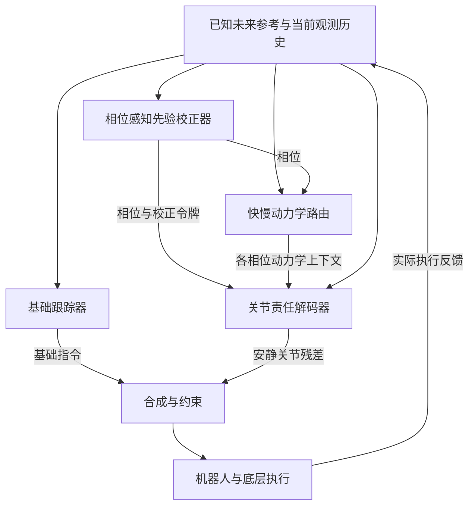
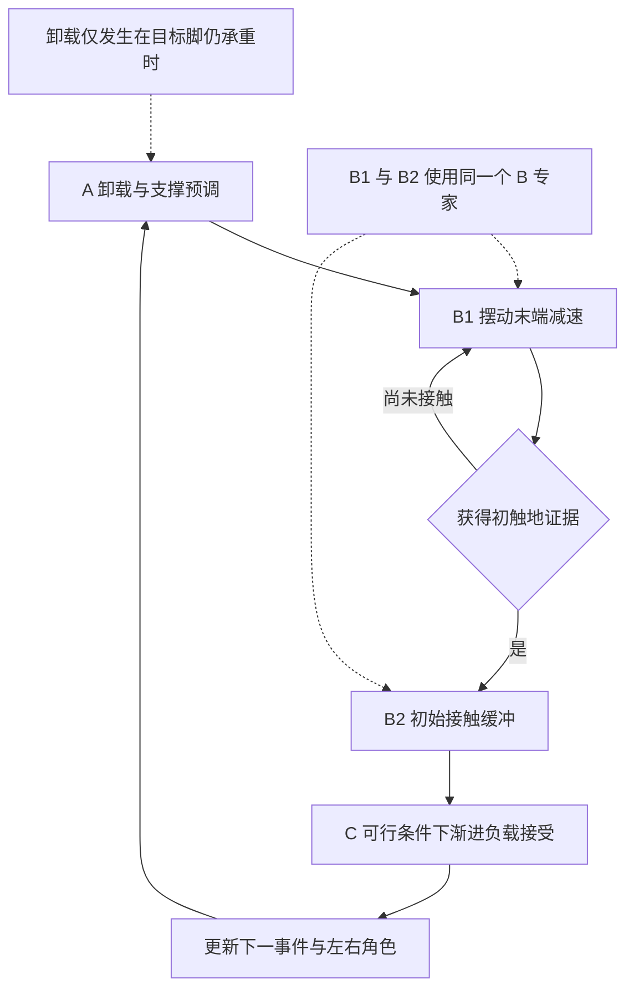
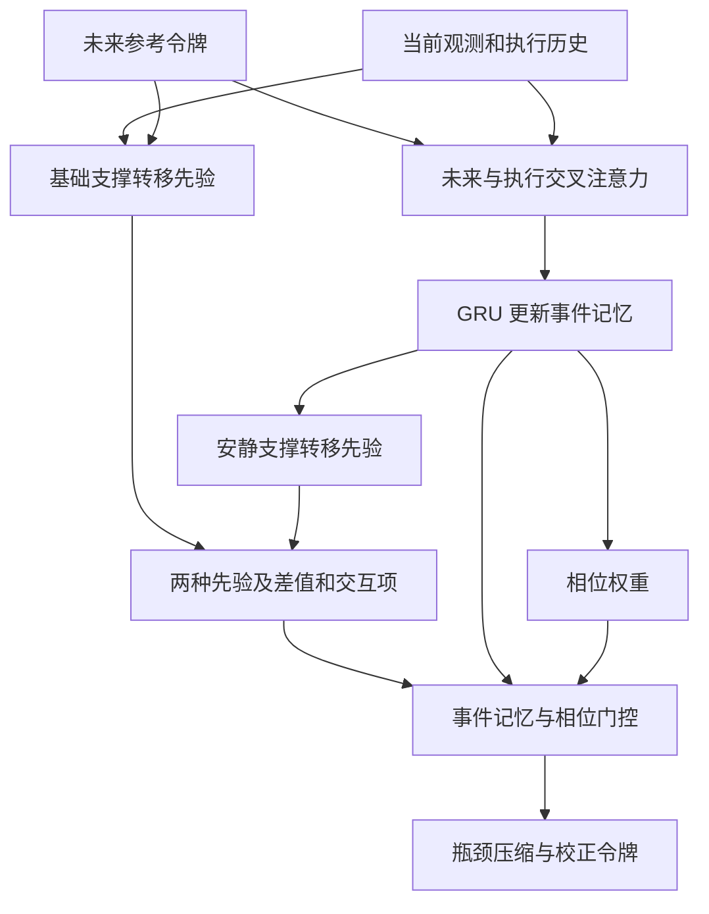
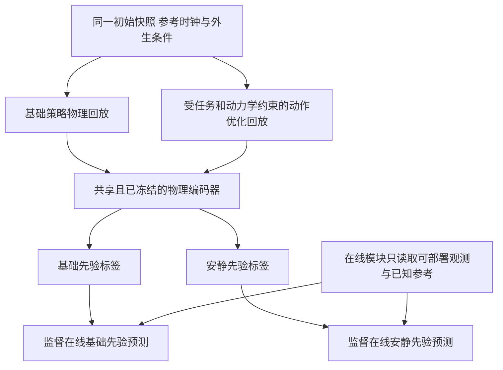
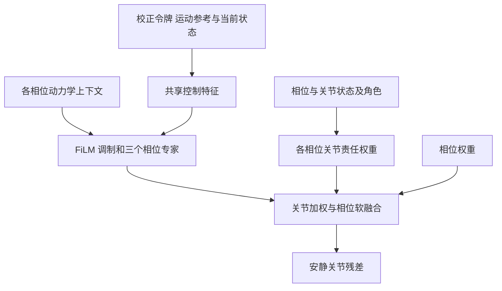
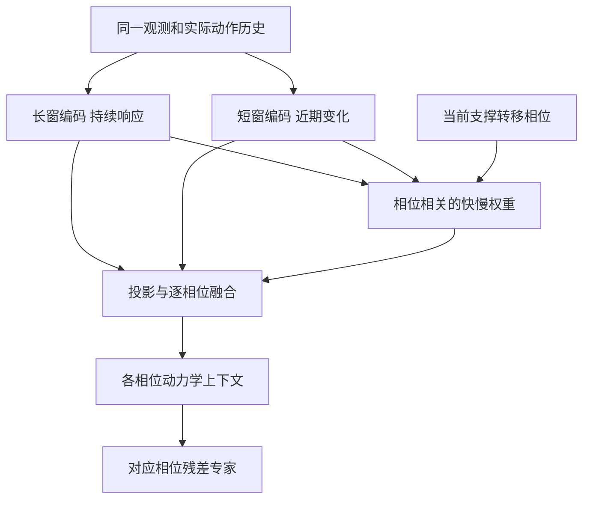

# 一种相位感知的人形机器人安静行走控制方法

Disclosure of Invention

**英文名称：** Phase-Aware Quiet Locomotion Control for Humanoid Robots Using Support-Transfer Correction

**文件编号：** BST-CMMI-V3.0-TP028  
**修订日期：** 2026年10月19日

| Document Type | Language Code | Total page | Create | Exam | Approve | Registered Date | Item Code |
|---|---|---|---|---|---|---|---|
| 发明公布说明书（技术交底） | 中文，附英文名称 | 见Word页码 | 待填写 | 待填写 | 待填写 | 待填写 | 待填写 |

## 发明概要

本发明涉及一种人形机器人安静行走控制方法，用于减轻机器人在负载、执行器响应和足地接触条件变化时出现的触地冲击及相关脚步噪声。其基本思路是：利用未来参考运动提前判断下一次支撑转换的需要，结合实际执行历史判断支撑转换已经进行到哪一步，再协调身体重心、足部接触和关节动作，使机器人在完成原有行走任务的同时，以较平缓的方式建立接触并接受载荷。

本发明在通用运动跟踪策略之外设置安静校正分支。通用运动跟踪策略根据未来参考运动和当前机器人状态生成基础关节指令；安静校正分支围绕同一次支撑转移事件，完成三项相互衔接的处理：第一，相位感知的安静质心先验校正器，预测基础执行方式与安静执行方式分别可能形成的支撑转移状态，并将差异编码为校正信息；第二，相位门控的动态关节责任解码器，根据当前阶段和左右腿的实际功能角色，将校正分配给适当的关节；第三，相位感知的快慢动力学路由器，从不同长度的执行历史中提取持续性动力学偏差与近期接触变化，并按阶段调节两类信息对校正动作的影响。

各相位专家生成的关节校正量，经关节权重和相位权重融合后，与基础关节指令在相同的动作空间中叠加，通过指令幅值和变化率限制后执行，并结合任务误差监测进行异常处理。机器人执行后的状态与实际下发指令重新进入历史，形成连续反馈。该方法不要求重新生成上层参考序列，但允许实际关节运动、质心运动及接触时序在规定的任务误差范围内调整。

本发明拟达到的技术效果，是在可行的行走速度、落脚和稳定性约束下，协调离地前卸载、接触前减速、初始接触缓冲和接触后的载荷接受，减小不必要的触地瞬态冲击及相关振动。实际脚步噪声改善由实机声学测量确认。本交底所述训练和部署流程为拟实施方案；仿真、实机和定量声学效果尚待实验记录补充。

**关键词：** 人形机器人；安静行走；未来运动跟踪；支撑转移；相位感知；质心先验；关节残差控制；动力学适应；强化学习。

## 阅读说明

本文供专利说明书撰写人员理解技术问题、模块之间的关系和一种可实现的实施方式。第1章介绍背景和待解决问题；第2章给出输入输出、相位定义、三个模块、训练及部署流程；第3章说明预期效果和验证方法；附录说明技术特征层次、需要发明团队确认的新增实施细节及参考资料。

理解本方案可以先抓住一个具体过程：机器人准备迈出右脚时，先让左脚具备足够支撑，再使右脚离地；右脚即将再次触地时，提前控制接近地面的速度；右脚初触地后，左脚继续提供必要支撑，右脚逐步接受新的载荷。负载增加或电机响应变慢时，上述过程需要相应调整。控制器的职责就是将这种调整转成各关节可以执行的指令。

# 1 发明背景介绍

## 1.1 技术领域与适用对象

本发明属于机器人运动控制技术领域，具体涉及一种在未来运动跟踪过程中，通过相位感知的支撑转移校正，实现人形机器人低冲击行走的方法，以及用于执行该方法的控制装置和机器人系统。

主要适用对象为具有左右腿关节驱动和本体状态反馈的人形机器人。基本实施例以双足交替支撑的行走为对象，可根据参考运动适用于起步、停止、侧移、转向及携物行走。对于跑跳腾空、手臂对环境提供显著支撑或需要主动摔落保护的动作，需要另外定义接触事件和可行性约束，不能直接套用本实施例的双足载荷关系。

## 1.2 用户需求与行业背景

家庭、医院、酒店和办公空间中的服务机器人，可能在人员休息、交谈或工作时持续移动。此时，足部反复触地产生的冲击、结构振动与脚步声，直接影响机器人与人共享空间的体验。携物后质量分布改变、执行器响应变化以及软硬地面切换，会进一步增加低冲击执行的一致性要求。

公开产品资料和研究已经体现这种需求。索尼针对aibo提供过降低足部落地声音的步态更新，并开展了小型家用机器人安静行走研究；1X在NEO官方资料中强调安静运行与肌腱驱动等硬件设计。[3][4][5] 这些材料说明安静运行具有产品价值，但不同产品的声压级、机器人形态和测试条件不能直接比较，也不能据此认定本发明优于某一产品。

本发明主要处理足地冲击相关的噪声。电机啸叫、风扇、齿轮传动和外壳共振等声源可能需要其他措施。若关节修正降低了脚步冲击却增加了执行器噪声，最终仍应以实机总声学表现评价。

## 1.3 现有技术的基本路线

现有机器人行走控制可以采用模型控制、直接策略学习以及运动参考跟踪等路线，也可以结合足底材料、柔性机构或驱动设计进行降噪。这些路线并非互斥，也不是对全部现有技术的穷尽分类。

| 技术路线 | 已有能力 | 与本发明对照时应关注的内容 |
|---|---|---|
| 基于模型的步态、全身与柔顺控制 | 根据动力学、质心、接触力和足端状态调节行走；可在触地时进行缓冲 | 已经存在质心修正、接触反馈和分阶段柔顺控制，不能将这些单独视为本发明独有 |
| 直接策略学习 | 从速度或任务指令直接输出动作，可通过奖励、历史观测和随机化学习低冲击及适应性 | 关注是否显式构造同一未来任务下的基础与安静支撑转移差异，以及差异如何进入分阶段关节控制 |
| 未来运动条件跟踪 | 先给出未来参考，再由控制策略实现全身运动，便于支持不同动作和任务 | 运动跟踪和通用鲁棒性并不自动等同于每次触地的低冲击目标 |
| 硬件与材料降噪 | 通过柔性驱动、足底材料或结构缓冲减轻噪声 | 可与本方案结合；本方案的控制效果仍依赖具体机械结构和执行能力 |

在人形机器人QuietWalk研究中，作者利用带逆动力学约束的网络，从本体感受信号估计每只脚的竖直地面反作用力，再将预测的冲击惩罚用于策略训练，并报告了特定测试设置下的声学结果及跨鞋类接触变化实验。[2] 因而，不宜笼统地说直接策略学习只能固化训练动作，或者不能适应接触条件变化。

索尼等作者的《Learning Quiet Walking for a Small Home Robot》研究对象为aibo小型四足机器人，论文发表于ICRA 2025，其项目也使用QuietWalk名称。[3] 它与前述2026年的人形机器人QuietWalk是不同研究，交底和附图中应分别标注。

## 1.4 代表性运动跟踪技术及相关技术对照

SONIC是通用人形机器人全身运动跟踪的一项代表性研究。该方法将不同形式的运动指令编码到统一表示，通过控制解码器结合本体状态生成关节控制目标，并支持运动规划、遥操作和其他上层任务接口；其训练包含鲁棒性设计与域随机化。[1] 本文以它说明“未来运动参考加跟踪执行”的控制结构，不将它未经专项比较就指定为安静行走领域的最接近现有技术或唯一最优方法。

与本发明机制更接近的公开资料还包括：利用足底反馈修正质心、足高和足姿，并按落地阶段设置柔顺特性的双足机器人控制专利；以及结合时间和足底竖直力判断支撑阶段切换、调节质心运动的控制专利。[6][7] 因此，背景技术应如实承认，支撑相位、质心反馈、柔顺落地和参考修正本身已有研究和公开方案。

本发明希望进一步明确的技术关系是：围绕同一未来接触任务，预测基础执行与低冲击执行的支撑转移差异；根据真实执行进展筛选当前需要的差异；将差异按照关节角色和相位分配，并用不同时间尺度的执行响应共同调节残差。能否形成充分的技术区分，需要结合完整公开文本与后续实验继续核对，不能只依靠增加网络模块名称判断。

## 1.5 待解决的两个技术问题

### 1.5.1 计划动作与实际支撑转移之间的差距

未来参考运动通常描述关节姿态、身体运动、足端位置及其时间变化。经过重定向或生成的参考可以具有良好的运动学外观，但是否能形成合适的接触力和载荷转移，还取决于机器人的质量分布、关节执行能力和当前支撑状态。参考也可能已经包含部分动力学或接触约束，因此问题不是“未来运动必然不满足动力学”，而是仅跟踪这些运动量通常不足以保证本方案要求的接触瞬态。

例如，计划摆动脚仍承担较大载荷时，如果直接要求它离地，可能需要由另一只脚及全身快速补偿；若这种补偿与参考运动不同步，便可能产生过大的姿态变化或冲击。又如，足部轨迹虽然安排了较小的触地速度，但身体动量与承重分配没有准备好，真实触地后仍可能被迫快速接受载荷。

本发明要解决的是：如何利用未来参考和当前执行状态，提前识别接下来需要的低冲击支撑转移，并确定基础动作与这一目标之间的差异。

### 1.5.2 标称执行与变化条件下实际执行之间的差距

相同的参考运动，在负载、执行器延迟或接触条件改变后，可能产生不同的实际响应。更重或偏置的负载会改变所需力矩、质心估计和全身动量；执行器延迟会使实际动作落后于参考；软硬地面及足底接触状态会改变初始碰撞和接触力建立过程。

例如，参考已要求向右脚转移支撑，但右脚受执行器延迟影响尚未可靠触地。若控制器仍按计划时间推进承重，可能加剧失衡风险或迫使后续触地更加剧烈。此时，合理的修正必须取决于真实接触证据、当前平衡余量和执行能力，不能预设为一律加快或一律放慢。

本发明要进一步解决的是：如何从已有执行历史中提取持续性偏差与近期接触变化，并使这些信息在不同阶段对相应关节产生不同影响。

## 1.6 发明目的

本发明的目的是在保留上层行走任务意图的前提下，对实际支撑转移进行提前准备和闭环校正，使低冲击接触与必要的平衡、速度和任务完成要求得到协调。

技术目标包括：在尚有调整余量时开始准备质心和支撑状态；使相位判断随实际执行更新；将不同阶段的校正作用到相应关节；根据不同时间尺度的执行响应调整校正；并约束修正幅度，避免通过失去稳定性、明显降低任务速度或破坏携物姿态换取表面上的安静。

# 2 发明的详细说明

## 2.1 关键术语

| 术语 | 在本方案中的含义 |
|---|---|
| 未来参考运动 | 当前时刻已经取得的、描述接下来如何运动的一段计划序列，不是未来真实传感器数据 |
| 通用跟踪策略 | 根据参考和当前状态生成基础关节指令的控制器；本方案不要求它必须采用SONIC或某一特定网络 |
| 质心 CoM | 机器人及其所携负载的等效质量中心；在线通常由模型和状态估计获得，可能存在误差 |
| 支撑转移 | 各接触足之间的承重责任随动作变化的过程，涉及质心与动量、离地、触地以及接触力建立 |
| 支撑转移事件 | 围绕某一目标脚下一次接触及随后的承重调整建立的事件；可向前追溯到该脚离地前的准备 |
| 相位 | 当前事件中的控制阶段；由参考意图与实际执行证据共同判断，不等同于固定周期百分比 |
| 先验 | 控制器在当前信息条件下对短期执行状态的预测；“安静先验”是学习得到的可行低冲击目标表示 |
| 令牌 Token | 编码器输出的一组紧凑数值，用于传递运动或校正信息；不需要解释成文本单词 |
| 残差校正 | 在基础指令上增加的有界修正量；须与基础指令使用相同的单位和关节顺序 |
| 关节责任权重 | 决定某关节接受多少当前阶段校正的控制权重；不等同于该关节造成噪声的因果贡献 |
| 动力学隐特征 | 从动作和响应历史提取的数值表示，反映执行条件的影响；不要求与质量、摩擦等参数逐一对应 |
| 特权信息 | 仿真训练时可获得、实机在线不一定可获得的真实质量、接触力或未来状态，仅作训练监督 |

## 2.2 总体构成与控制闭环

系统包括未来参考输入接口、机器人状态与历史缓冲、基础跟踪器、安静校正分支以及指令合成与约束模块。安静校正分支内部保持三个模块：相位感知的安静CoM先验校正器、相位门控的动态关节责任解码器、相位感知的快慢动力学路由器。

在一个控制周期内，基础跟踪器和校正分支使用同一时刻对齐的状态与参考。基础跟踪器生成基础动作；先验校正器生成当前相位和校正信息；快慢路由器根据相位提供动力学上下文；解码器输出关节校正；指令合成与约束模块生成最终下发动作。下一周期再用真实执行响应更新上述判断。

**图1 本发明总体结构与执行反馈闭环**

这里的“提前”是指读取已经可用的未来参考，并利用历史判断当前条件下的后续需要；不需要在线运行两个完整物理世界，也不使用尚未发生的真实接触信息。

## 2.3 输入输出和可用信息

### 2.3.1 未来参考与实际观测

设当前控制时刻为t。未来参考窗口记为M_t，可包含若干未来采样点的关节参考、根部位姿、足端位置和速度，以及可用的接触计划。当前观测记为O_t，历史记为H_t，保存截至t的观测和此前实际下发的动作。

如果上层只提供人体关节点，需要先通过既有重定向或运动接口转换成可用于机器人控制的表示。如果上层没有显式接触计划，可以依据参考足端轨迹、接近地面的运动趋势和实际接触估计推断事件，但需要保留不确定性。未来窗口长度应覆盖相关事件的必要准备段；不足时应标记窗口有效范围，不能用未来真实观测补齐。

| 数据 | 一种可用来源 | 在线使用方式 |
|---|---|---|
| 关节角与角速度 | 关节编码器和驱动器反馈 | 基础输入，反映当前位置与响应 |
| 机体姿态、角速度和加速度 | IMU及状态估计器 | 反映身体运动，使用前进行时序对齐与必要滤波 |
| 历史关节指令 | 控制器实际下发记录 | 应保存限幅后的实际指令，不只保存网络候选值 |
| 接触状态、足部承重趋势 | 已有足底力传感器，或基于本体信号的接触估计器 | 区分测量与估计，提供可信度和有效标志 |
| 足端位置、速度及质心估计 | 运动学模型、惯性参数与状态估计 | 统一坐标系；未知负载和模型误差会影响结果 |
| 电流、力矩估计及温度 | 平台已有驱动器接口，可选 | 可增强响应辨识；缺失时不假定其可得 |
| 真值质量、摩擦、接触刚度及未来实际轨迹 | 仿真器 | 只用于训练标签或验证，不进入实机在线输入 |

“不增加传感器”应理解为：在选定平台已有信号足以支持相应估计的情况下，可以仅使用其本体观测部署。本方案不保证仅凭关节角就能准确得到每只脚的接触力。无足力传感器时，接触/受力估计器及其训练、误差和失效处理均需纳入实施记录。

### 2.3.2 控制器输出

优选实施方式采用关节位置目标接口：基础动作和校正量均表示对应电机关节的目标角度及其修正，单位为弧度；最终目标交给已有的底层关节控制器。关节力矩或速度接口也可采用同样关系，但需要分别训练和验证，不能将位置残差直接加到力矩指令上。

骨盆位置是全身运动状态，不应将自由浮动骨盆当成可直接下发指令的驱动关节。对骨盆运动的调节，通常通过髋、膝、踝及实际存在的腰部等驱动关节协同实现。

### 2.3.3 质心与接触状态的关系

本方案将质心先验作为组织全身运动和载荷转移的线索，同时结合足端运动、接触状态和关节响应。以平地、无其他外部竖直支撑为例，两脚竖直力的总和由总质量及质心竖直加速度决定；但总和不能唯一决定每只脚的分力，更不能唯一决定碰撞瞬态。

因此，安静校正不以“让总支撑力越小越好”为目标，而是减少不必要的触地峰值、过快的载荷建立和振动，同时满足承重及运动要求。用于训练先验的支撑转移状态，除质心位置与速度外，宜包含辅助的分脚载荷、接触状态、足端接近速度和接触时序信息。

## 2.4 支撑转移事件和相位定义

### 2.4.1 先定义腿的角色

以本次右脚将要落地为例，右腿称为“目标落地腿”，左腿称为“原支撑腿”。在右脚离地准备时，右脚可能仍在承重；进入摆动后，右脚通常已不与地面接触；再次触地后，右脚逐步成为新支撑脚。下一次事件中，左右腿可交换角色。

左右电机的物理通道编号始终不变。角色变化由状态和事件表示提供给关节权重计算模块，不能简单交换电机指令数组。双脚支撑时应允许两脚同时具有承重角色。

### 2.4.2 保留三个专家并区分四种物理状态

| 控制相位 | 对应的物理状态 | 当前主要目标 | 需要避免的错误 |
|---|---|---|---|
| A 卸载与支撑预调 | 目标脚离地前，以及离地后的支撑准备 | 目标脚仍承重时逐步卸载；离地后根据下一接触任务调节质心、动量和原支撑 | 不将“卸载”继续用于已离地的脚；不统一要求质心向前移 |
| B1 摆动末端减速 | 接近计划接触，尚未确认实际触地 | 调节足端接近速度和姿态，为初触地留出缓冲余量 | 不把尚未触地的脚当成可靠承重支点 |
| B2 初始接触缓冲 | 已获得初触地证据，接触正在建立 | 利用可用反馈缓和后续接触响应，维持原支撑所需的支撑能力 | 不要求新脚“触地但完全无力”；不让支撑责任过早整体转移 |
| C 渐进负载接受 | 新接触已具备足够可信度，并满足当前支撑可行性 | 根据任务逐步调整新旧脚承重和全身运动 | 不仅凭参考时间进入C；不强制每次都完成到新脚单独承重 |

B1和B2属于同一个B相位专家的两种接触条件，不增加第四个专家。A、B、C权重可以软过渡，但实际接触与尚未接触仍需区分。

**图2 支撑转移相位与接触事件关系**

### 2.4.3 相位如何更新

相位估计同时使用未来参考中的接触意图、当前足端运动和接触证据、近期执行偏差及事件历史。可以由递推网络输出A、B、C三个分数，再用事件有效性和接触条件限制可使用的阶段，最后归一化为相位权重。

进入C不宜只依赖参考触地时刻。触地延迟时，若原支撑仍可维持，则保留必要支撑并调整当前动作；提前触地时，依据实际证据转入接触缓冲。对于接触抖动，可使用不同的进入/退出阈值和持续若干采样的确认条件；确认长度应与控制周期和可用反应时间匹配。

相位A、B、C不必等长，也不要求全部动作严格循环经过三者。启动、停止和双支撑动作可以从中间阶段进入或结束。在不涉及相应支撑转移事件时，可通过事件使能量将安静残差减小至零。事件重叠时，一种基本实现优先完成当前载荷接受，再更新到下一目标接触；若任务确实要求两个事件重叠控制，则需维护相应的多事件状态和一致的合成规则。

### 2.4.4 对未知地面的因果边界

对于此前未接触过、也没有其他感知信息的地面，控制器不能保证在首次触地前准确知道刚度或摩擦。初次触地的风险降低主要依靠接触前减速、姿态和可用顺应性；触地后的反馈只能调节其后仍在发生的缓冲和负载接受，也可为后续步态提供经验。已经发生的首次冲击不能被事后的估计撤回。

## 2.5 模块一 相位感知的安静CoM先验校正器

### 2.5.1 模块任务与输入输出

本模块回答两个问题：当前支撑转移进行到哪一步；如果仍按基础控制方式继续执行，与当前需要的低冲击支撑转移相比，哪些地方需要调整。

输入为未来参考M_t、当前观测O_t、执行历史H_t、基础运动表示以及上一时刻的递推状态。输出为当前递推状态h_t、相位权重g_t，以及安静校正令牌z_corr。g_t包含A、B、C三个非负权重；在有效事件内，其和为1。z_corr为一组紧凑数值，由下游解码器转换为实际关节修正。

**图3 相位感知的安静CoM先验校正器**

### 2.5.2 未来参考与执行历史如何对应

先将未来参考窗口内各采样点转换为运动特征，并保留相对时间和接触任务信息。历史编码器则将近期机器人状态与实际执行指令转换为执行特征。

未来—执行交叉注意力以执行特征为查询，以未来参考特征为被查询对象，选择对当前调整最有用的部分。例如，机器人实际动作落后于参考时，网络需要结合仍未完成的准备和即将发生的触地要求，判断应优先修正什么。该注意力操作建立信息关联，不直接改变上层参考时钟，也不自动代表已经纠正了接触时刻。

随后使用门控循环单元GRU更新递推状态h_t。其输入包括当前观测、上一周期实际下发动作和上述参考关联特征；其记忆保留事件在连续控制步中的发展。相位头利用h_t及接触上下文产生相位权重，再由第2.4节的事件规则约束。GRU可以由其他具有记忆能力的序列模型替代，核心要求是当前校正能够利用同一事件的连续执行历史。

### 2.5.3 基础先验与安静先验分别表示什么

基础先验z_base表示：从当前状态出发，在当前可推断的执行条件下，基础跟踪器继续执行该参考，可能形成怎样的短期质心与支撑转移趋势。安静先验z_quiet表示：在同一任务意图和可行约束下，采取低冲击执行方式时，期望形成怎样的趋势。

两个先验必须具有共同的表示坐标、预测范围和尺度。优选使用以当前预测起点为基准、重力对齐且航向固定的局部坐标系；在该短窗中不随左右支撑脚切换而突然更换原点。训练数据可同时包含质心位置与速度、分脚载荷趋势、触地状态以及足端接近速度等辅助信息，因而这里的CoM先验是“以质心为核心的支撑转移先验”。

若网络只能预测较粗略的隐特征，应按其实际能力表述，不把z_quiet说成精确的未来质心轨迹，也不把隐向量中的某一数值直接解释为需要移动多少厘米。需要物理解释时，可使用训练期的物理解码器恢复对应状态供检查。

### 2.5.4 如何从两种先验得到当前校正信息

差异编码器同时读取z_base、z_quiet、两者之差以及逐元素乘积。前两项保留两种状态本身；差值提供相对偏差线索；乘积提供两种表示之间的交互线索。采用共同且固定的物理表示后，这些量才具有稳定的学习语义。

差异表示还不能直接作为所有时刻相同的动作。上下文门控进一步利用h_t和g_t选择当前阶段相关的信息。例如，同一事件早期可以突出支撑预调偏差，临近触地时突出接触准备偏差，触地后突出载荷接受偏差。最后通过瓶颈投影压缩为z_corr，送往下游解码器。

瓶颈的作用是限制校正通道只保留有助于当前控制的紧凑信息；它本身不保证解释性或降噪效果。差值的正负方向由统一定义和训练约定确定；由于它是送入网络的特征，不应直接当成无需变换的电机增减指令。

### 2.5.5 安静先验的训练来源

安静先验不能仅通过名称指定，也不能将参考中的质心轨迹人工画得更平滑就认为获得了可执行的安静目标。本文给出一种训练期实施方式：从同一仿真快照出发，分别生成基础策略回放G_base和满足约束的低冲击回放G_quiet。

G_base由固定的基础跟踪器在当前参考下执行产生。G_quiet可通过有限时域的动作序列优化获得：以基础动作序列为初始解，在有界修正范围内搜索动作；每个候选必须经过动力学执行，满足任务跟踪、运动进度、关节和接触可行性约束；在合格候选中，选择接触冲击代理目标更优的轨迹。

一种明确的排序方式是：以接触建立窗口内、经固定尺度归一化的法向力峰值与正向加载率的固定加权和作为目标。窗口定义、归一化和权重在同批数据中保持一致；仅接受该目标低于基础回放且满足其余约束的候选。目标接触必须在规定的时序容差内发生，并在展开范围内完成相应观察窗口，避免通过推迟到窗口之外或不触地取得表面改善。

两种回放共用初始位置和速度、执行器内部状态、参考起点、展开时长、动力学参数、地面空间分布及外生扰动设置。展开后各自的状态、接触时刻和接触力由各自动作产生，不强行保持一致。尤其不能把基础分支的接触力当成安静分支的外加输入。

配对起点还保存并复用已有观测与实际动作历史，以及影响本次展开的状态估计、滤波和延迟缓冲状态；基础跟踪器若带有递推状态，也应保持一致。分支展开后的历史随各自执行结果独立更新。

若约束下找不到更好的可行轨迹，应记录“未找到可行安静改进”。可保留基础轨迹并给出零残差目标，或屏蔽该样本的安静改进监督。不能为使两种先验不同而捏造一条安静标签。

**图4 基础与安静回放的训练监督结构**

### 2.5.6 共享特权编码器如何避免无意义表示

首先，用仿真可得的物理状态轨迹训练共享编码器和物理解码器，使编码结果能够恢复变化的质心、载荷与接触状态。解码器不能绕过隐向量直接读取完整原轨迹。确认物理重建误差和隐向量变化达到设定要求后，冻结该编码器，生成固定的基础与安静监督特征。

然后，让在线先验投影器只根据可部署观测、执行历史和已知参考去预测上述固定特征。训练可以同时采用隐向量预测误差和物理量重建误差。这样可以避免两个在线投影器与教师编码器一起输出常数，从而在没有学到实际物理信息时取得很小的对齐损失。

训练时实际未来轨迹、真实接触力和真实动力学参数仅作为标签。部署时移除物理回放、特权编码器及标签通路；在线网络仍只读取截至当前时刻可获得的信息。也可以采用直接预测物理状态向量的替代实施方式，不要求必须使用特定维度的隐空间。

### 2.5.7 对应的技术作用

本模块将校正依据从单一瞬时跟踪误差，扩展为“当前实际执行进度下，基础支撑转移与低冲击支撑转移的条件差异”。预期作用是在接触前尚有调整余量时提出支撑准备修正，并随事件推进改变当前优先关注的偏差。该作用需通过先验预测误差、提前校正时刻及去除成对差异的对照实验验证。

## 2.6 模块二 相位门控的动态关节责任解码器

### 2.6.1 模块任务与输入输出

本模块回答：当前校正应由哪些实际驱动关节承担，各关节应修正多少。输入包括z_corr、相位权重g_t、未来运动表示、机器人状态、关节角色和每个相位的动力学上下文。输出为与基础动作同维度、同单位的安静关节残差。

普通全身残差网络也能够学习不同关节的不同输出。本模块进一步显式组织“阶段—关节角色—残差”之间的关系，目的是使卸载准备、初始接触和载荷接受的调节有明确的结构分工，而不是假定其他方法会对全身均匀修正。

**图5 相位门控的动态关节责任解码器**

### 2.6.2 相位条件关节责任分配

关节/角色编码器为每个驱动关节建立表示，包含关节身份、所属身体部位、当前关节状态，以及本次事件中所属腿的功能角色。角色可包含原支撑、摆动、初始接触和新承重等概率或标记。

相位查询编码器将当前相位与校正信息转换为查询特征；相位—关节注意力根据查询与各关节表示，输出A、B、C各自的关节责任权重w^A、w^B、w^C。每组权重与动作向量逐关节对应。

一种实现可将每个关节的权重限制在0到1，使多个关节同时参与。若采用跨关节归一化，需要明确其尺度补偿，避免因关节数增加而无意缩小整体残差。权重较大表示允许更多该阶段的修正通过，但实际作用仍由残差的方向、幅值和全身协同共同决定。

例如，在A相位，髋、膝、踝以及腰部可以协同调整支撑和机体姿态；在B相位，目标腿关节共同影响足端接近速度与初始接触；在C相位，新旧支撑腿协同调整承重。上述是功能示例，不将某一阶段固定绑定为只使用某一个关节，也不把骨盆状态误认为独立电机通道。

### 2.6.3 相位专用残差专家

共享特征编码器将未来运动、机器人状态和z_corr融合为控制特征f_t。每个相位设置一个残差专家：A专家侧重卸载与支撑预调，B专家侧重摆动末端减速及初始接触缓冲，C专家侧重渐进负载接受。

对于相位k，对应的动力学上下文z_dyn^k通过特征调制层FiLM对f_t进行缩放和偏置，形成适应当前响应条件的阶段特征，再由该相位的解码头输出残差动作。FiLM在这里改变的是网络内部特征，不直接代表改变电机刚度或阻尼；只有底层接口另外输出或设置这些参数时，才可描述为直接进行阻抗参数调节。

三个专家共享部分输入，同时各自学习阶段目标。这样的结构预期有助于减少不同阶段目标互相影响，但不能预先保证互不干扰或训练必然收敛；其作用应通过共享专家与分相位专家的对照验证。

### 2.6.4 相位与关节权重的合成

先将各相位专家的残差与该相位的关节责任权重逐元素相乘，再按相位权重求和，得到总安静残差。也就是：相位权重决定当前使用多少某一阶段的策略，关节权重决定该策略对各关节的作用程度。

在没有额外限幅触发的名义情况下，最终动作等于基础动作加上总安静残差。完整部署还应加入事件使能、残差强度、动作幅值和变化率限制，具体公式见附录A。

软融合有助于减少专家切换的跳变，但不自动保证相邻控制周期的指令连续，也不构成闭环稳定性证明。实施时应对残差幅值、最终目标变化率和接触切换进行约束。携物场景中，还需限制手部与物体姿态偏差，避免下肢修正通过躯干或手臂破坏操作任务。

### 2.6.5 对应的技术作用

本模块将先验差异转为关节层面的可执行调节，显式体现同一关节在不同支撑阶段承担不同角色的关系。预期作用是减少对当前任务无关关节的扰动，改善全身支撑与足端接触的协调。应通过残差分布、任务误差和固定关节权重消融进行验证，不能只用注意力图证明物理贡献。

## 2.7 模块三 相位感知的快慢动力学路由器

### 2.7.1 模块任务与输入输出

本模块回答：机器人近期的执行响应与标称情况有何不同，这些差异在当前阶段应如何影响动作。输入为同一本体观测与执行指令流中截取的长历史、短历史，以及当前相位；输出为A、B、C各自的动力学上下文z_dyn^A、z_dyn^B、z_dyn^C。

**图6 相位感知的快慢动力学路由器**

### 2.7.2 长短历史分别提供什么信息

长历史编码器侧重识别持续的响应偏差。例如，相似动作反复出现跟踪滞后，或在携物后需要持续更大的关节补偿，这些线索可以反映负载、惯性分布、执行器响应及长期不对称等因素，形成z_slow。

短历史编码器侧重近期快速变化，例如初触地时机偏移、机体加速度突变、足部接触状态变化以及滑移迹象，形成z_fast。短窗宜较密集地采样；长窗可采用较宽时间范围和适当下采样，但需保留真实采样间隔及动作响应关系。

快慢是建模所关注的时间尺度，并不严格等同于“机器人参数”和“地面参数”。刚拿起物体造成的载荷突变可以先进入快特征，持续的软地面响应也可以进入慢特征。两个分支不要求互不包含信息，只需各自具有稳定的建模侧重，并由路由机制学习如何使用。

### 2.7.3 按相位选择信息

相关性估计器读取快特征、慢特征、当前相位及必要的观测有效性标记，为每个相位输出两类特征的融合权重。在一种实现中，先将快慢特征投影至相同维度，再按归一化权重加权融合，获得对应相位的动力学上下文。

物理直觉可以作为初始化或训练分析依据：A相位往往需要提前考虑持续存在的负载和执行器响应；B相位对近期接触变化更敏感；C相位可能同时需要两类信息。这些是常见倾向，不是硬性规则。比如在A相位突然拾起物体，快响应也可能非常重要。

动力学上下文送往相应残差专家的FiLM层，也可同时参与关节权重的生成。由此，相同参考和相位在不同实际响应条件下，可以形成不同的关节校正幅度和协同方式。

### 2.7.4 训练时如何区分快慢响应

仿真中可将随机化设置分为：在一段回放中持续存在的参数变化、缓慢漂移，以及在特定事件发生的突变。质量、载荷位置、执行器延迟、足底材料和接触条件等，按要验证的时间变化过程组织，而不是机械地按参数名称分组。

持续参数可在回放开始设置；载荷突变应通过与实际任务相符的附着或外部作用模型产生，避免任意改质量却忽略伴随的动力学过程；不同地面应按空间区域和接触位置设置，避免每个控制周期随机改变地面属性而造成不真实的力跳变。

可使用已知参数组、事件标签和短期动力学响应作为辅助监督，使两个编码器分别提取所需特征。如果采用可学习的特权动力学编码器，同样需要固定物理监督或冻结教师，防止在线编码器与教师共同形成无信息的表示。

### 2.7.5 可辨识性和适应范围

有限历史不一定能唯一分辨负载、地面刚度、足底柔性和执行器误差。没有发生滑动时，运动历史通常也不足以精确确定可用摩擦上限；相关摩擦辨识研究明确区分了不同接触状态的信息条件。[8]

因此，本模块的主要输出定义为“有助于当前控制的动力学响应特征”。只有经过相应验证后，才把某些输出进一步解释为具体参数估计。历史不足或接触证据不可靠时，可以降低残差强度、使用训练得到的保守响应或依照已有控制规则运行。

### 2.7.6 对应的技术作用

本模块把持续性偏差与近期变化通过同一相位接口连接到关节校正。预期作用是提高携物、响应变化和接触变化下的执行一致性。需与单历史编码器、固定快慢融合及不使用动力学上下文的版本比较，确认收益来自时间尺度和相位之间的关系。

## 2.8 在线执行步骤

以下步骤采用关节位置目标作为统一动作接口，描述一个完整控制周期。具体控制频率根据平台能力确定；所有模块使用相同时间戳约定。

**S101 初始化或更新状态。** 首次启动时，将递推状态初始化为训练约定的初值，建立历史缓冲，并记录有效历史长度。每个周期采集当前关节、IMU和可用接触等信号，与上一周期实际下发动作对齐。历史不足可以按既定方式填充，但同时提供有效性掩码。

**S102 读取未来参考并生成基础动作。** 读取截至当前时刻已经可用的参考窗口M_t，统一参考与机器人的坐标、动作单位和时钟；基础跟踪器生成a_base。对参考末端、丢帧或过期情况按明确规则处理。

**S103 更新事件记忆。** 历史执行特征查询未来参考特征，取得当前有关的参考信息；使用当前观测、上一周期实际动作和参考关联特征更新GRU状态h_t。普通换步保留连续记忆并更新事件角色；任务重启、参考不连续或状态异常后的重置条件另外规定。

**S104 估计相位并生成校正令牌。** 根据实际接触证据及未来接触意图估计g_t；预测z_base与z_quiet；编码二者的差异和交互，经当前状态与相位门控生成z_corr。无有效事件时减小事件使能量。

**S105 估计快慢响应。** 从长短历史计算z_slow和z_fast，按相位融合为各自的动力学上下文。记录历史有效性及必要的估计质量信息。

**S106 生成各关节残差。** 根据固定关节身份与动态功能角色生成各相位的关节权重；利用各相位动力学上下文调制共享特征，由相位专家输出对应残差，再进行关节加权和相位融合。

**S107 合成并下发动作。** 依据事件使能和可靠性设置整体强度，对缩放后的残差限幅，再与基础指令叠加；约束最终关节目标及其变化率，通过已有底层控制器执行。驱动器的电流、力矩和速度限值使用平台既有保护机制。

**S108 接收反馈并更新下一周期。** 保存实际下发指令和后续观测，在下一周期更新相位、先验和快慢响应。接触事件结束后更新下一目标接触及左右角色；正常换边不交换电机通道。若当前目标超出可行范围，按预定规则降低校正或进入已有稳定/安全控制，并向上层报告任务偏差。

## 2.9 训练流程与部署分离

以下流程是对原有训练期监督思路的一种可执行展开，具体求解器、网络尺寸和参数需要结合拟使用机器人确定。

### T1 建立基础控制和有效任务范围

建立机器人、执行器、足底和地面的仿真模型，明确关节接口、底层控制、通信延迟、状态估计与采样处理。接入或训练基础跟踪器，确定可以稳定执行的参考范围。先保存基础运动表现，作为后续校正的比较对象。

为参考设置任务允许误差，例如根部运动、步速、落脚位置和携物姿态误差。对在给定执行条件下本身不可行的动作，不通过强行提高残差幅度实现；应记录为任务不可行或需要上层重新规划。

### T2 生成配对物理回放并训练共享表示

按第2.5节从同一快照展开G_base和G_quiet。优化只在实际可执行的动作范围内进行，并约束相同的参考时钟、任务进度和展开时间。保存轨迹、真实接触事件、优化是否成功、机械代理目标以及相应首步动作。

将物理轨迹转换到统一局部坐标和尺度，训练可以重建物理量的共享编码器及解码器，验证后冻结，生成固定先验标签。噪声、随机化和外部扰动须可复现，配对分支使用相同的外生设置。

### T3 训练在线状态和动力学预测模块

使用可部署观测、执行历史和已知未来参考，训练事件记忆、相位预测、基础/安静先验预测及长短窗动力学编码。实际相位标签由产生该样本的执行轨迹计算，不直接复制参考时钟上的接触状态，也不将基础分支事件复制到安静分支。

同一配对起点的当前相位，由共同的当前观测和事件历史确定；两分支不同的未来接触用于各自的轨迹标签。从后续时刻抽取训练样本时，应使用该分支截至该时刻的动作和观测历史，不给完全相同的当前输入配置互相矛盾的当前相位标签。

辅助训练目标包括相位/接触预测误差、基础先验和安静先验预测误差、物理状态重建误差，以及动力学参数组或响应特征的预测误差。隐向量维度和各损失权重作为具体实现参数记录。

### T4 训练完整残差分支

可先使用安静教师首步动作与基础动作之差，初始化残差分支，再以完整闭环展开训练。本实施例在配对监督和残差训练期间固定基础跟踪器，将可训练参数集中在三个校正模块，便于区分基础能力与增量校正的作用。若其他实施方式更新基础策略，应同步更新其对应的基础预测目标和配对标签。

控制目标同时包括任务跟踪与进度、触地冲击代理、接触滑移、残差幅值和变化率，以及平台允许的姿态和执行约束。强化学习可采用PPO等方法；也可采用监督学习与闭环优化结合的方式。奖励中增加冲击惩罚不等同于硬性保证稳定，任务与保护条件需独立检查。

为防止控制器仅通过停顿或明显减速获得更低冲击，应固定参考时钟，并评价同样任务进度下的结果。为了避免新状态分布偏移，应从当前残差策略实际到达的仿真状态补充配对样本，而不始终只使用基础策略早期轨迹。

### T5 使用真实部署输入完成定型

最后阶段应让控制策略使用在线网络预测的先验与动力学特征，而不是直接使用仿真真值特征，并覆盖估计误差、历史不足和传感器噪声。如果训练曾采用特权特征引导，需在此阶段消除该输入依赖。

随后固化网络、归一化尺度、窗口长度、相位阈值、动作缩放和约束参数，完成仿真与实机的一致性核对。离线优化教师、特权编码器、仿真真值以及实验用麦克风均无需成为在线控制的必需组件。

## 2.10 一种可记录的实施配置

为使撰写人员能够理解参数如何落地，下面给出可选配置的示例。它们仅用于解释实现方式，不代表已经采用的设备参数或已经验证的最佳值。

| 配置项 | 可选示例 | 最终需要记录的信息 |
|---|---|---|
| 策略周期 | 20 ms，即50 Hz | 实际测得的推理、通信及动作生效时间 |
| 底层关节周期 | 2 ms，即500 Hz | 设备实际接口与目标保持/插值方式 |
| 未来参考窗口 | 约1 s，并检查是否覆盖必要的事件准备段 | 实際帧数、采样间隔、参考更新率与有效掩码 |
| 短历史窗口 | 0.2 s，密集采样 | 对初触地响应的时间分辨率与延迟 |
| 长历史窗口 | 2 s，允许带时间戳的下采样 | 持续响应信息、计算成本及启动处理 |
| 相位表示 | A、B、C三个软权重，B内使用接触状态区分B1/B2 | 事件定义、接触进入/退出条件和异常处理 |
| 动作接口 | 关节位置目标及同单位角度残差 | 各关节顺序、缩放、上下限和底层力矩约束 |
| 先验表示 | 可重建物理状态的固定维度隐向量 | 维度、监督物理量、坐标系、归一化和验证误差 |
| 残差强度 | 事件使能与0到1的整体调节系数 | 上限依据、变化率、历史不足及异常时的规则 |

策略频率较低时，对已经发生的快速碰撞可调整的时间有限；因此必须结合接触前准备和更快的底层控制响应确定效果边界，不能仅靠提高网络复杂度弥补不可用的反应时间。

## 2.11 典型实施情境

以下情境用于说明模块如何协作，均为拟验证的控制过程，不代表已经获得的实验结果。

### 2.11.1 携物后执行器响应与机体动力学改变

机器人按给定参考从客厅向卧室行走，手中物体使总质量和质量分布发生改变。若原有控制下关节响应偏差增大、机体运动与计划不同步，这些变化先进入本体观测与动作历史，长历史编码器逐步形成持续响应特征；若物体刚被拿起，其瞬时响应也可进入短历史。

先验校正器根据当前状态、历史和下一次落脚要求，预测基础执行的支撑转移与可行低冲击目标之间的差异。在A相位，解码器可以组织原支撑侧和腰髋等关节提前调整支撑；在B相位，目标腿依据当前条件调整足部接近速度；在C相位，新旧支撑腿共同控制承重建立。手部与所携物体的任务误差受到约束。

需要观察的证据包括：实际步速与位移是否保持在允许范围内，支撑相位是否随实际接触更新，足端接近速度和载荷上升是否得到改善，以及携物姿态是否受到不利影响。增加负载并不预先对应某一种固定方向的质心或时序调整。

### 2.11.2 从柔软地面进入硬地面

机器人从地毯进入硬地面。如果没有预先地面感知，首次硬地面接触前只能利用当前信息和训练经验安排较稳妥的足端速度与姿态；不能假定快编码器已经知道即将遇到的刚度。

触地后，接触信号、机体响应和关节误差出现变化，短历史编码器提取新的响应特征，路由器提高与当前接触相关信息的作用。B专家可调节检测之后仍能影响的接触缓冲，C专家调节后续承重建立；持续多步的硬地面响应再进入长历史表示。

验证时应分开统计“首次遇到变化的那一步”和“获得接触历史后的若干步”。只有后续步改善，不能写成系统已经预测并抑制首次未知地面的全部冲击。

### 2.11.3 执行器延迟导致计划与实际触地不一致

参考已经进入准备承重的时间段，但目标脚尚未可靠接触。控制器从关节误差、足端状态和接触证据判断执行落后，在可维持的支撑范围内保留原支撑，限制过早的承重转移，同时修正目标腿动作。实际接触建立后，再提高C相位的作用。

若延迟过大、原支撑已无法维持，则应由既有稳定控制或上层重规划处理，允许暂时牺牲安静目标。残差分支不承诺在任何延迟和任何参考下都能完成安静修正。

### 2.11.4 侧移转向与正常换边

上层参考要求侧移或转身时，校正器根据该动作的目标落点、支撑关系和质心趋势生成差异，不套用固定向前移动的规则。各关节权重随着原支撑腿和目标落地腿的角色更新。

在一次事件结束、下一次事件开始时，保持电机通道顺序和全身历史的一致性，将新的角色与事件信息输入递推模型。验证需检查左右交替、连续双支撑和参考切换时是否出现权重错配或残差跳变。

## 2.12 约束与异常处理

### 2.12.1 校正范围与任务保持

上层未来参考保持原有任务意图，实际执行允许在事先定义的误差范围内变化。约束可以包括：根部位置和速度误差、足端落点误差、身体姿态范围、手部或携物姿态误差、关节活动范围和执行器能力。安静残差只在这些边界内争取更低冲击。

在线指令处理直接执行残差幅值、关节目标范围和变化率限制。速度、落脚和携物姿态等全身任务条件，通过教师优化与训练中的约束、在线误差监测和既定异常处理共同落实，不能仅由关节限幅推导其在所有时刻严格满足。

当实际运动需要超出边界才能继续，系统应报告参考或执行条件不适配。减小残差不是万能的稳定措施：若基础策略在当前条件下也无法维持平衡，必须进入机器人已有的恢复、停止或保护流程。

### 2.12.2 接触和历史信息不足

对于启动时没有足够历史、传感器丢帧、接触信号矛盾或参考不连续的情况，输入有效性标记参与估计，并按既定规则降低校正强度。若采用学习可靠度，其训练标签和标定方法需要记录。A、B或B、C在正常过渡中同时有较高权重，不应只因相位分布较分散就判断系统失效。

### 2.12.3 指令平滑与底层保护

对每个关节分别规定残差幅值上限、最终目标范围和变化率上限；必要时对强度系数和平滑滤波状态连续更新。底层仍执行平台已有的速度、电流和力矩限制。所有实际限幅后的动作进入下一周期历史，以便估计器学习真实执行后的响应。

这些是使控制链条完整的实施措施。限幅、软融合或回退机制不能单独证明稳定性，需在相应工况和任务范围内验证。

# 3 发明的效果与验证方式

## 3.1 预期技术效果及对应原因

| 技术安排 | 预期改善 | 应收集的对应证据 |
|---|---|---|
| 基础与安静先验比较，并结合事件记忆 | 在接触前识别需要调整的支撑与运动趋势 | 先验预测误差、校正开始时刻、配对差异消融 |
| 相位与真实接触证据共同决定控制阶段 | 降低按计划时钟过早或过晚转移支撑的风险 | 接触时刻误差、相位转换日志、提前/延迟触地试验 |
| 动态关节责任与相位专家 | 更有针对性地组织全身与足端修正 | 关节残差、任务误差、固定权重和共享专家对照 |
| 快慢历史按相位融合 | 适应持续偏差与近期变化，提高执行一致性 | 载荷/地面交叉变化，单历史与固定融合对照 |
| 任务和动作约束 | 控制修正对跟踪、携物及执行器的影响 | 实际速度、任务成功率、约束触发和恢复记录 |

上表均为预期效果。当前交底不提供已完成的定量结论；实际结果应在实验完成后按同一配置填入。

## 3.2 机械冲击与声音分别验证

触地声与碰撞激励、足底/地面材料、结构振动和声音传播有关。机械指标可作为训练代理，但不会与声压级形成固定的一一对应关系。因此，应分别记录机械响应和声音，在同一机器人与可比条件下分析二者是否同时改善。

机械验证重点包括：目标脚首次触地前的法向相对速度、接触建立窗口内的法向力峰值、正向加载率、分脚载荷比例和滑移。力峰值同时报告牛顿值及按机器人与负载总重量归一化的结果。力导数对采样和滤波敏感，需预先固定处理方法和接触窗口，避免改变滤波设置产生虚假的峰值改善。

声音验证可记录A计权等效声级、每步最大声级，以及固定事件窗内的声暴露量等。需要保存麦克风与声学校准、安装位置、背景噪声、地面与足底材料、行走路径和实际速度。多次试验使用一致的录音与计算方法；dB属于对数表示，不使用“声压级降低百分比”描述改善，也不把dB差值直接解释为主观响度减少比例。

实验用麦克风或外部测力装置用于验证，不因此成为本发明在线控制的必需传感器。仿真器若未包含经过验证的声学模型，只能报告其机械代理结果，不能输出虚构的实机dB结论。

## 3.3 建议的对照与消融

| 方法组 | 主要用途 |
|---|---|
| 仅使用基础跟踪器 | 确认增量校正整体是否有收益 |
| 基础跟踪器加可调的触地减速/载荷斜坡规则 | 判断简单控制修改能解决多少问题 |
| 相同观测与目标的普通残差策略 | 判断收益是否主要来自增加容量或安静奖励 |
| 本发明完整三模块 | 评价整体执行效果 |
| 去掉基础/安静配对差异，保留相近容量的单先验 | 验证条件差异表示的作用 |
| 使用共享专家，或固定关节责任权重 | 分别检查阶段分工和关节角色分配 |
| 使用单历史编码器，或固定快慢融合权重 | 分别检查时间尺度分工和相位路由 |

各组保持同一参考、传感器集合、底层接口、动作约束和扰动设置，尽量匹配训练预算与模型规模。实际步速、位移和任务完成率须达到预先规定的可比条件。以失败、停顿或明显降低任务进度获得的低冲击结果，应计入任务失败，不作为有效安静改进。

## 3.4 建议的工况与统计

测试至少覆盖标称条件、持续负载变化、执行器延迟变化、首次接触变化、持续软/硬地面以及接触条件与负载同时变化。额外加入“负载突变”和“地面条件长期稳定”两类情况，用于检查快慢分支是否真正按响应时间尺度工作。

可从若干固定参考和三个训练随机种子开始，使用预先固定的测试工况与配对重复试验，报告每组试验数、均值或中位数、离散程度以及配对改善。该数量是起步建议，并非现有实验记录。完整保存失败步和保护触发，避免只展示成功且安静的片段。

结果记录表建议采用下列字段，验证后补入数值：

| 工况与重复数 | 方法 | 任务成功率及实际速度 | 触地峰值与加载率 | 声学指标与测量设置 | 保护触发及失败原因 |
|---|---|---|---|---|---|
| 待实验填写 | 基础/简单残差/本方案 | 待实验填写 | 待实验填写 | 待实验填写 | 待实验填写 |

正式效果图可以沿同一真实时间轴展示参考事件、实际接触证据、两脚接触力、相位权重、关键关节残差和对应声音。若绘制原理示意曲线，应显著标注其为示意，并与实测结果图分开。本稿附图只表示技术结构和事件关系，不使用假设曲线充当验证结果。

## 3.5 应用场景

本方案可用于家庭机器人在人员休息时的低干扰移动；用于配送、递送和协作备餐等携物行走；也可用于医院、酒店和办公环境的服务移动。不同场景需要根据机器人形态、行走任务和足地条件，重新确定可接受的速度、声音和稳定性边界。

# 4 附图说明

图1说明基础跟踪与安静校正的总体连接，以及动作执行后返回历史缓冲的闭环。图2区分离地前卸载、摆动末端、初触地和载荷接受，并说明B1与B2共享B专家。图3说明未来参考和执行历史如何生成相位及校正令牌。图4说明成对回放和共享特权表示仅用于训练。图5说明相位、关节角色和动力学如何共同产生残差。图6说明长短历史按相位融合为动力学上下文。

制成专利说明书附图时，可沿用上述六张图的技术关系，并由撰写人员按正式图式统一模块编号。场景照片和竞品宣传图用于背景理解，不承担核心技术关系的说明。

# 附录A 核心变量与计算关系

本附录给出一套与正文一致的表达，便于进一步展开具体实施方式。符号用于说明输入输出关系，网络层数、隐向量维度、控制周期和阈值不由以下公式限定。

## A1 事件记忆与校正令牌

当前递推状态使用当前观测和上一周期实际下发动作更新：

$$
h_t=\operatorname{GRU}(h_{t-1},[O_t,a_{t-1}^{\mathrm{exec}},C_t])
$$

其中C_t是执行历史查询未来参考后得到的关联特征。a_exec表示实际下发动作，区别于尚未执行或限幅前的候选动作。

两种先验以相同表示构成差异特征：

$$
d_t=E_{\mathrm{diff}}([z_{\mathrm{base}},z_{\mathrm{quiet}},z_{\mathrm{base}}-z_{\mathrm{quiet}},z_{\mathrm{base}}\odot z_{\mathrm{quiet}}])
$$

再根据当前记忆和相位筛选差异，并压缩为校正令牌：

$$
z_{\mathrm{corr}}=P(\sigma(G(h_t,g_t))\odot d_t)
$$

E_diff为差异编码器，G为门控网络，σ将门控值限制在0到1，P为瓶颈投影，⊙为逐元素相乘。该差异为网络输入特征，不直接等同于质心位移或关节角度。

## A2 快慢动力学与特征调制

对于每个相位k，先将快慢特征投影到兼容维度，再融合：

$$
z_{\mathrm{dyn}}^k=\beta_{\mathrm{slow}}^k P_s(z_{\mathrm{slow}})+\beta_{\mathrm{fast}}^k P_f(z_{\mathrm{fast}})
$$

两类相关性权重均非负且和为1，每个相位可使用不同权重。P_s与P_f是投影映射。相位专用FiLM调制采用：

$$
f_t^k=\gamma^k(z_{\mathrm{dyn}}^k)\odot f_t+b^k(z_{\mathrm{dyn}}^k)
$$

γ与b为由动力学上下文生成的特征缩放和偏置；它们并非底层电机的刚度、阻尼参数。

## A3 残差与最终指令

三个相位的残差经关节权重和相位权重融合：

$$
\Delta a_t^{\mathrm{quiet}}=\sum_{k\in\{A,B,C\}}g_t^k(w_t^k\odot\Delta a_t^k)
$$

实际下发动作包括事件使能和约束处理：

$$
a_t^{\mathrm{exec}}=\mathcal{Q}(a_t^{\mathrm{base}}+\operatorname{clip}_{\delta}(\eta_t e_t\Delta a_t^{\mathrm{quiet}}))
$$

e_t表示当前事件的使能程度，η_t表示整体校正强度，二者可取0到1。clip_δ按各关节允许幅值对缩放后的残差限幅；Q对最终关节目标范围和变化率进行约束，并利用上一周期实际目标计算变化率。全身任务条件另由训练约束、在线监测和异常处理落实，Q不代表已经实现严格的全身动力学可行域投影。正常工作且约束未触发时，式子退化为基础动作与有界残差相加。基本位置接口中的所有动作项均使用同一角度单位。

## A4 支撑分配的辅助物理量

在平地、两脚提供竖直支撑的实施例中，可用新接触脚的竖直载荷比例辅助描述载荷接受：

$$
\rho_t=\frac{F_{\mathrm{new},z}(t)}{F_{\mathrm{old},z}(t)+F_{\mathrm{new},z}(t)+\varepsilon}
$$

其中F_new与F_old使用同一竖直方向和同一时间基准，ε为很小的正数，用于数值保护；总接触力不足或接触无效时，比例应标记为无效，不能仅靠ε将其解释成可靠支撑。仿真可使用真值，实机可使用已有足力测量或经过验证的估计。

该比例在目标脚仍承重的离地准备期可以先下降，在再次触地后的载荷接受期再按任务上升，不应假定整个事件内始终单调增大。它是辅助状态，不是所有实施方式必须单独测量的输入。

# 附录B 技术特征层次与撰写重点

## B1 建议突出的一条主技术链

根据已知未来运动及截至当前时刻的执行历史，针对同一支撑转移事件形成基础执行和可行低冲击执行的状态表示；以实际执行进度和接触条件选择其中当前需要的校正信息；结合支撑相位、关节功能角色及不同时间尺度的动力学响应生成关节残差；在统一指令空间内与基础动作合成，并用执行后的响应持续更新。

这条技术链应通过明确的输入、状态含义、训练来源、动作输出和反馈关系展开。三个模块名称可以保留，但每个名称后都应有可以被工程实现和实验检查的处理关系。

## B2 三项主要技术特征

| 技术特征 | 应完整表达的关系 | 可单独验证的环节 |
|---|---|---|
| 相位感知的成对支撑转移先验校正 | 同一任务和执行条件下，基础/安静先验采用共同物理表示；差异结合事件记忆与相位成为当前校正信息 | 去除成对差异，检查先验误差和提前准备效果 |
| 相位门控的关节责任解码 | 阶段目标与实时关节角色决定权重；相位专家生成残差，经关节和相位权重合成 | 固定角色权重，或改用共享专家 |
| 按相位融合不同时间尺度的响应 | 长短执行历史产生持续与近期响应特征；不同相位采用不同融合并调制关节校正 | 单历史、固定融合及突变/持续变化对照 |

## B3 配套机制与可替换实现

事件确认、角色更新、动作约束、训练与部署输入一致性等，是保证上述关系可执行的系统措施。GRU、交叉注意力、FiLM、三个专家的具体网络规模、瓶颈维度以及PPO等，是本文给出的实施选择。撰写时应区分核心关系与具体工具，并在确有技术依据时说明替代方式。

可记录的替代方式包括：用其他序列模型或带记忆的状态估计器维护事件进度；直接预测物理状态向量；用条件解码代替FiLM；采用关节速度或力矩接口；根据传感配置使用实测接触或估计接触。替代后仍须保持相同的任务语义、动作单位及训练部署边界。

## B4 与相关公开技术的对照范围

| 公开资料 | 已涉及的相关内容 | 本交底应进一步具体说明的关系 |
|---|---|---|
| SONIC [1] | 多种运动输入的统一表示和全身跟踪 | 面向低冲击目标的成对支撑转移先验及执行端校正 |
| 人形机器人QuietWalk [2] | 本体历史估计分脚GRF、冲击惩罚与接触变化适应 | 在未来参考跟踪条件下如何构造与使用事件相关的成对先验 |
| Sony aibo研究 [3] | 可学习PD增益、接触信息及触地速度课程训练 | 双足支撑转移和统一残差接口中三个模块的协同 |
| WO2024146206A1及同族 [6] | 质心、足高和足姿修正，以及阶段相关柔顺控制 | 预测性成对状态、事件记忆、动态关节分配和历史响应路由的具体连接 |
| US20240051121A1及同族 [7] | 支撑阶段判断、接触力相关切换和质心运动控制 | 实际相位如何筛选先验差异，并影响残差的关节分配与动力学调制 |
| TactileStep [9] | 足底触觉表示、接触相位识别及相位相关训练奖励 | 本方案是否以及如何在信息来源、先验构造和残差生成关系上形成区别 |

上述表格是技术对照的入口，不表示已完成全部公开文献检索，也不据其单独判断某种组合必然具有新颖性或创造性。需要重点核对的是各公开方案是否已给出本交底所述的完整关联，而不是仅核对是否使用相同术语。

# 附录C 发明团队需要确认和补齐的资料

## C1 本次补充的实施细节

原始构思中的三模块结构、递推事件记忆、未来—执行注意力、基础/安静差异编码、关节责任、相位专家和快慢路由予以保留。为使交底可以落实到工程流程，本稿增加了下列具体展开；这些属于建议实施方式，需由发明团队结合真实设计确认后固化。

| 补充内容 | 本稿采用的解释 | 需要确认的事实 |
|---|---|---|
| 相位与事件边界 | 三专家；B中区分末端摆动和初始接触 | 最终训练标签、事件确认与换边逻辑 |
| 安静目标来源 | 同快照、同外生条件下进行受约束动作优化 | 是否已有quiet教师、求解方法和轨迹生成记录 |
| 先验的物理含义 | 以CoM为核心，结合接触/载荷等辅助状态 | 实际监督量、坐标、预测窗及各项权重 |
| 防止隐表示无信息 | 先训练物理重建并冻结共享教师 | 实际编码器训练与验证方式 |
| 部署观测 | 关节、IMU、动作历史及可选足力/电流 | 平台具体传感器、采样率及估计器误差 |
| 接触和任务异常处理 | 有效性标记、有界残差及已有恢复流程 | 实际可执行的保护策略和接口 |
| 时序参数 | 第2.10节给出示例 | 实际推理延迟、历史长度、参考更新率和动作生效时间 |

## C2 申请材料形成前应补齐的工程记录

需要补齐机器人平台与驱动关节列表、基础跟踪器版本、参考运动来源、安静教师或数据来源、网络输入输出尺寸、训练参数与随机化范围、部署可用传感器、相位判据、动作单位与限值，以及实验配置和原始结果。

其中最先需要确认的四项是：G_quiet如何生成；z_base与z_quiet究竟监督哪些物理量；实机如何获得接触和载荷相关信息；最终残差加在位置、速度还是力矩接口。它们决定说明书能否把三个模块写成闭合的实施过程。

## C3 待补资料与证据状态

目前没有可填入的仿真或实机结果数值。因此，“冲击显著降低”“噪声显著降低”“提高某百分比”等结论应在得到相应数据后再填写。阶段性曲线、失败记录和消融结果宜随版本归档。

初稿提及的Samsung ARF项目及“Natural Presence Humanoid for Harmonious Living Spaces”题名，尚需补充可追溯的原始资料。如来自课题指南或非公开材料，应按其实际来源说明；本稿不将其列为已经核验的公开技术成果。

1X发布资料中有22 dB的厂商表述，但未完整给出测距、声学计权、背景、地面和运动条件，本文仅将其作为产品背景。[5] aibo 5.00产品步态升级与后来的安静行走论文分别引用，不推断两者采用同一实现。[3][4]

# 参考资料

以下资料访问核验日期为2026年10月19日。论文用于说明公开技术内容，产品页用于说明产品背景；本发明的拟实施机制及预期效果由正文单独说明。

**[1]** Zhengyi Luo等. *SONIC: Supersizing Motion Tracking for Natural Humanoid Whole-Body Control*. arXiv:2511.07820，2025年11月11日首发；本文参考v4，2026年8月13日修订。期刊页面登记为Science Robotics 11(117), eaed4592, 2026。原文：[arXiv摘要与版本](https://arxiv.org/abs/2511.07820)；[v4全文](https://arxiv.org/html/2511.07820v4)。

**[2]** Hanze Hu等. *QuietWalk: Physics-Informed Reinforcement Learning for Ground Reaction Force-Aware Humanoid Locomotion Under Diverse Footwear*. arXiv:2604.23702，2026年4月26日。原文：[论文](https://arxiv.org/abs/2604.23702)。本稿使用其方法和研究范围作技术对照，不迁用其结果数值。

**[3]** Ryo Watanabe等. *Learning Quiet Walking for a Small Home Robot*. arXiv:2502.10983，2025年2月16日首发，ICRA 2025。原文：[论文](https://arxiv.org/abs/2502.10983)；[Sony官方项目](https://sony.github.io/QuietWalk/)。研究对象为aibo小型四足机器人。

**[4]** Sony. *aiboの歩き方*；*aiboシステムソフトウェア バージョン5.00 アップデートのお知らせ*. 升级公告日期2023年3月7日。原文：[功能说明](https://aibo.sony.jp/feature/walking.html)；[升级公告](https://info.aibo.sony.jp/info/2023/03/systemsoftware-500.html)。

**[5]** 1X. *NEO Home Robot*. 发布日期2025年10月28日。原文：[官方发布页](https://www.1x.tech/discover/neo-home-robot)。Tendon Drive及22 dB是该页面的厂商表述，不能作为统一测试条件下的比较结果。

**[6]** *Whole-body compliance control method applied to rapid walking of biped robot*. 公开文本WO2024146206A1，2024年7月11日；同族公开文本包括CN115933723A。原文：[WO公开文本](https://patents.google.com/patent/WO2024146206A1/en)。本稿引用其公开技术内容，不评价其法律状态。

**[7]** *Method for controlling biped robot, biped robot, and readable storage medium*. US20240051121A1，2024年2月15日；同族KR20240021674A，2024年2月19日。原文：[美国公开文本](https://patents.google.com/patent/US20240051121A1/en)；[韩国同族公开文本](https://patents.google.com/patent/KR20240021674A/en)。

**[8]** *Online Friction Coefficient Identification for Legged Robots on Slippery Terrain Using Smoothed Contact Gradients*. arXiv:2502.16843，2025年。原文：[v1全文](https://arxiv.org/html/2502.16843v1)，参见III-C关于无滑移历史的信息条件及置信度更新。

**[9]** Zizhuo Wang等. *TactileStep: Sole Tactile Learning for Regulating Foot-Terrain Interaction in Humanoid Locomotion*. arXiv:2609.28959，2026年9月24日。原文：[论文](https://arxiv.org/abs/2609.28959)；[作者项目页](https://tactilestep.github.io/)。作为相位相关接触调节的补充对照资料。

