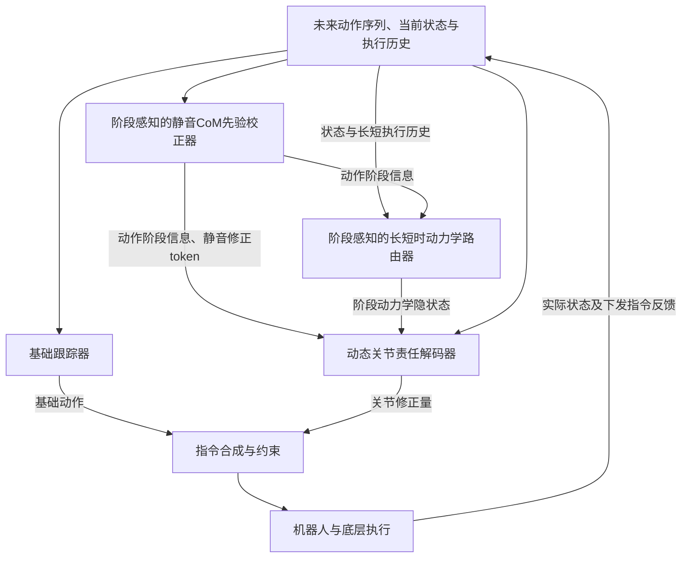
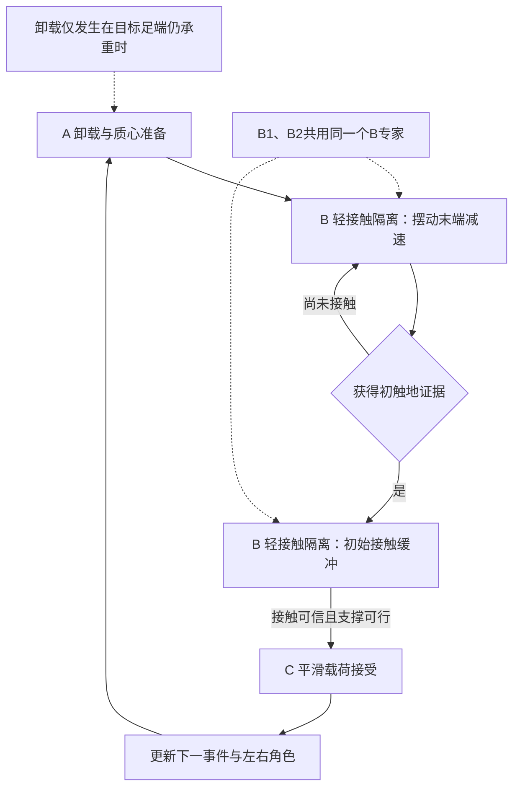
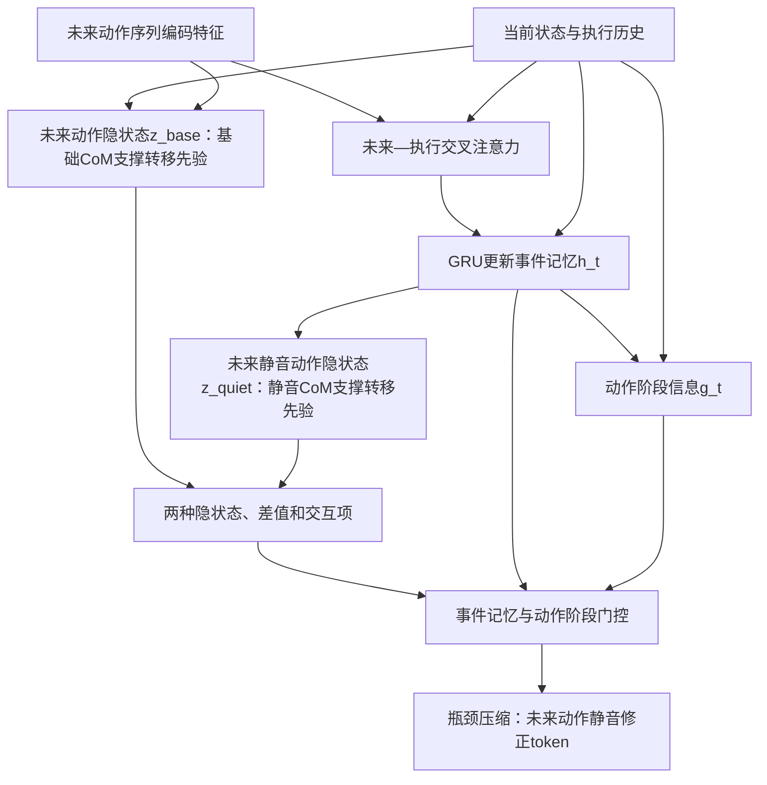
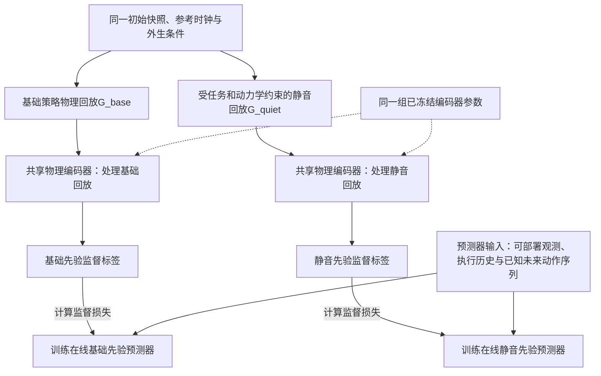
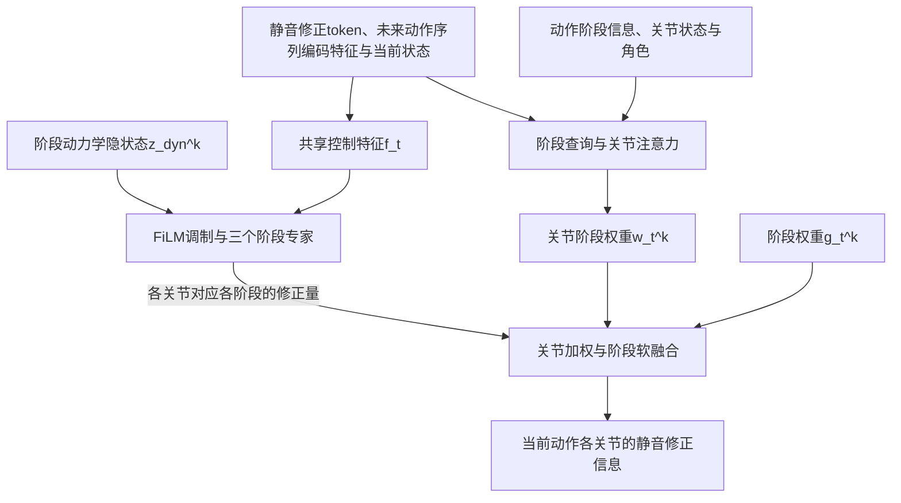
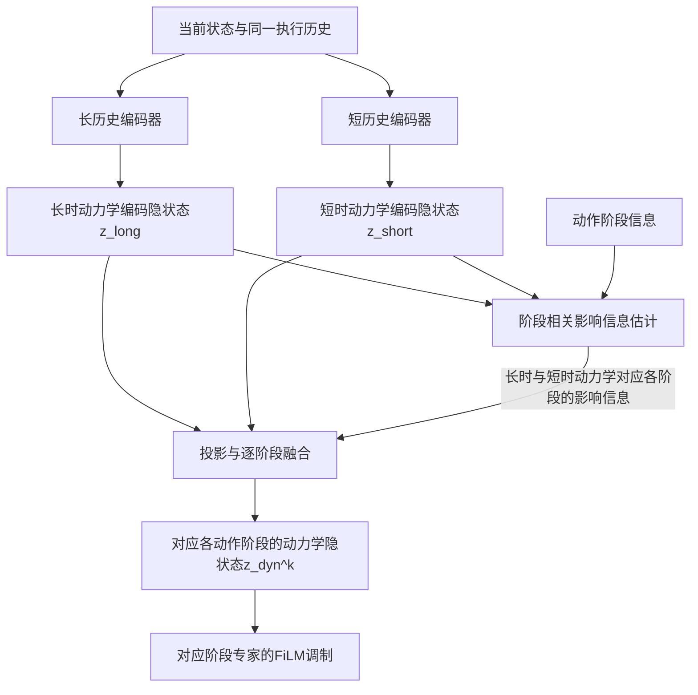

# 一种阶段感知的人形机器人静音行走控制方法

**文件编号：** BST-CMMI-V3.0-TP028  
**文档类型：** 发明技术交底书（Disclosure of Invention）  
**修订日期：** 2026年10月19日

## 发明概要

本发明公开了一种在变化执行条件下保持人形机器人静音行走的控制方法。针对未来动作序列难以直接保证低冲击支撑转移，以及负载、执行器响应和足地条件变化导致静音执行失效的问题，在基础跟踪策略之外设置静音修正分支。阶段感知的静音CoM先验校正器结合未来动作序列、当前状态和历史状态，比较基础执行与静音执行的支撑转移趋势，生成未来动作静音修正token及动作阶段信息；阶段门控的动态关节责任解码器根据卸载与质心准备、轻接触隔离和平滑载荷接受三个阶段，将修正需求转换为各关节的静音修正信息；阶段感知的长短时动力学路由器融合两类动力学编码，调节各阶段的关节修正。最后将静音修正信息与基础动作合成，形成连续反馈控制，以在保持任务要求的同时减轻触地冲击及相关脚步噪声。

# 1. 发明背景介绍

## a. 发明的技术领域

本发明属于机器人运动控制技术领域，具体涉及一种阶段感知的人形机器人静音行走控制方法。

## b. 现有技术的说明

人形机器人正在从工业环境走向家庭、医院、酒店等与人共享的生活空间。除了完成移动、搬运和递送等任务，机器人还需要尽量减少对人的日常活动产生干扰。例如，在卧室附近递送物品、夜间巡视或在办公室内移动时，反复的脚步声和地面振动可能影响人的休息、交谈与工作。因此，对于长时间在人周围运行的服务机器人，仅仅做到“走得稳、完成任务”还不够，“走得轻、少打扰人”也是需要解决的问题。

【图位：机器人在卧室附近递送物品、携物经过客厅等场景，以及脚步冲击对周围人员的影响。】

**图1 人形机器人在生活空间中静音行走的用户需求示意图**

机器人厂商已经从步态控制、驱动机构和机体结构等方面改善运动噪声。例如，索尼aibo通过步态更新降低足部落地声音，并开展了面向小型家用机器人的静音行走研究；1X NEO在家庭机器人产品中强调安静运行，并采用肌腱驱动等设计改善与环境交互的柔顺性。[3][4][5] 这些产品与研究说明，静音运行已经成为机器人进入生活空间时需要关注的能力。

然而，在实际任务中，机器人的执行条件并不固定。机器人拿起物品后，负载和质量分布会改变；执行器的响应可能存在延迟；机器人也可能在地毯、木地板等不同接触条件之间切换。在这些情况下，即使继续执行相同的行走动作，实际触地冲击与脚步声仍可能发生变化。因此，在负载、机器人响应和足地接触条件变化时保持静音行走，仍有进一步改善的空间。

## c. 现有技术问题或要改善的地方

“静音行走”（quiet locomotion）是机器人行走控制中面向足地冲击及相关噪声进行优化的一类技术。它不仅关注脚在什么位置落地，还关注脚以多大的速度接近地面、触地前身体是否已经准备好支撑、触地后新支撑脚以多快的速度开始承重。相应的改善包括触地前的足端减速、目标腿离地前的逐步卸载、质心与全身动量的协调，以及接触建立后的渐进载荷接受等。

其中，“支撑转移”是指机器人在行走过程中，将承重责任从一只脚逐步转移到另一只脚的过程。以右脚迈出一步为例，右脚离地前，需要先减少右脚承担的载荷，使左脚能够提供必要支撑；右脚再次接近地面时，需要控制接近速度，并避免身体过早依赖尚未建立的接触；右脚触地后，再根据任务逐步接受载荷。如果这几个过程衔接不当，脚部轨迹即使看起来轻柔，实际落地也可能产生较大的冲击。

需要强调的是，静音行走与一般步态稳定控制并不是相互替代的关系，而是在已有运动能力上增加对触地过程的要求。二者的侧重点主要体现在以下三个方面。

一是关注目标不同。一般步态稳定控制首先保证机器人不跌倒，能够按照要求的方向、速度和路径完成运动；静音行走则在这些要求的基础上，进一步减轻不必要的足地冲击、结构振动和脚步噪声，避免通过明显降低任务速度或破坏平衡来换取表面上的静音效果。

二是对动作执行细节的要求不同。常规轨迹跟踪重点关注关节姿态、身体位置和运动速度是否接近参考；静音行走还需要关注身体重量何时转移、目标腿何时卸载、足端何时建立接触以及新支撑脚多快接受载荷。这些因素涉及质心运动、接触状态和关节响应之间的配合，不能仅由足端位置误差是否足够小来判断。

三是在本发明采用的控制结构中，二者承担的功能不同。上层模块提供描述机器人接下来如何运动的未来动作序列，基础跟踪器负责实现整体运动；静音修正分支位于跟踪执行阶段，根据实际支撑转移情况修正基础动作。它不替代基础跟踪器，而是在允许的任务误差范围内调整关节动作，使计划中的轻柔行走在真实执行中尽可能保持低冲击。

本文所称“静音”主要针对足地冲击相关的噪声，并不表示机器人完全无声。电机、风扇和传动机构等其他声源需要分别考虑，最终声音改善仍需通过实机测量确认。

## d. 现有问题的解决方案以及本发明的目的

### 1、现有产品与控制技术方案及问题

现有降低机器人运动噪声的方案，可以从硬件改善和控制优化两个方面理解。

一类方案通过柔性驱动、足底材料和机体结构缓和足地碰撞。例如，面向家庭环境的机器人可以采用具有一定柔顺性的驱动或接触结构，减轻碰撞产生的冲击与振动。这类方案提供了机械缓冲基础，但结构本身并不负责判断下一步应该何时卸载、何时触地以及怎样转移承重。当负载、运动任务或地面条件变化时，仍需要控制器协调相应的动作执行。

另一类方案通过控制算法改善触地和承重过程。基于模型的控制方法可以利用质心、足端状态和接触力反馈进行步态与柔顺调节，相关公开方案已经涉及质心修正、落地阶段控制以及接触力参与的支撑切换。[6][7] 基于策略学习的方法则可以在训练目标中加入触地速度、地面反作用力或冲击惩罚，使控制策略同时学习运动任务和低冲击行为。索尼面向小型家用机器人的静音行走研究，以及人形机器人QuietWalk研究，均涉及此类控制思路；后者还利用本体感受信息估计分脚地面反作用力，以辅助低冲击策略训练。[2][3]

这些方案能够从不同方面改善行走过程，部分方法也考虑了接触条件变化。我们进一步关注的问题是：当机器人需要跟踪一段已经给定的未来动作序列时，如何判断该动作在当前条件下需要怎样的静音支撑转移，并将这一需求落实到当前相关的关节。尤其在侧移、转向、起步、停止和携物行走等任务中，下一次落脚位置、接触时机及承重需求会随动作变化，修正不能只依赖一套固定的落地节奏。

### 2、代表性学术技术方案及问题

论文《SONIC: Supersizing Motion Tracking for Natural Humanoid Whole-Body Control》是通用人形机器人全身运动跟踪的一项代表性研究。[1] 其运动参考与跟踪执行相结合的结构，为本方案提供了通用运动控制的参考。

在这一类跟踪结构中，推理过程可以从信息流上分为两个环节。首先，将上层提供的未来动作序列编码为运动特征，描述接下来需要实现的关节姿态、身体运动和足端运动。随后，跟踪策略结合运动特征和当前机器人状态，生成关节控制指令，在物理机器人上执行相应动作。

这种设计将“机器人接下来如何运动”与“当前怎样控制关节”分开，便于支持不同的上层任务。对于静音行走，上层也可以提供具有静音意图的未来动作序列，例如安排更缓慢的足端接近运动、更平滑的身体运动和承重转换。

【图位：上层任务或动作参考→未来动作序列及其编码→结合当前状态的基础跟踪器→关节动作→机器人执行反馈。该图说明本节讨论的跟踪结构。】

**图2 未来动作序列跟踪方案的工作流程示意图**

然而，通用运动跟踪和执行鲁棒性并不自动等同于静音触地。将这种结构用于静音行走时，还需要解决两个问题：一是未来动作序列中的轻柔运动，能否在物理上形成合适的支撑转移；二是执行条件发生变化后，原本合适的静音执行方式能否继续保持。

【图位：在同一动作任务下，对比计划的轻柔触地与实际执行中的卸载不足、接触延迟和承重过快。图中曲线如为原理示意，应明确标注，不能作为实测结果。】

**图3 计划静音动作与实际执行之间的两个问题示意图**

**问题1：计划动作与实际支撑转移不一致，即运动学—动力学鸿沟。**

原因：未来动作序列主要描述机器人各部位应该运动到哪里、以怎样的姿态和速度运动，而静音触地还取决于身体如何获得支撑、接触力如何建立以及载荷如何转移。即使参考中已经考虑部分动力学或接触约束，也不能仅凭轨迹跟踪准确就认定真实接触过程满足低冲击要求。

例如，未来动作序列要求右脚抬起，但实际右脚仍承担较大载荷，左脚尚未具备所需支撑条件。此时直接执行抬脚动作，可能需要另一侧腿和身体进行较大的补偿。又如，未来动作序列安排右脚缓慢接近地面，但身体动量和支撑分配没有准备好，右脚触地后仍可能被迫快速承重，从而产生较大的冲击。因此，静音控制不仅需要修正脚部动作，还需要提前协调质心、原支撑腿和目标落地腿之间的关系。

**问题2：执行条件变化后静音表现不一致，即执行条件鸿沟。**

原因：同一未来动作序列在不同负载、执行器响应和足地接触条件下，可能产生不同的实际运动。携物改变了质量分布和所需关节输出，执行器延迟可能使脚部动作落后于计划，不同地面则会改变初始接触及后续受力过程。因此，已经确定的静音支撑转移方式仍需要根据真实响应调整。

例如，计划已经进入向右脚转移承重的阶段，但右脚受执行器延迟影响尚未可靠触地。如果仍按计划时间推进承重，就可能使身体过早依赖一个尚未建立的支撑点，增加后续补偿和触地冲击。又如，机器人从柔软地面进入较硬地面时，相同的足端运动可能产生不同的接触响应。此时，需要利用已有状态和执行历史识别变化，并调节当前阶段的关节修正，而不是对所有阶段使用同样的补偿。

本发明公开了一种在变化执行条件下保持人形机器人静音行走的支撑转移修正方案。变化执行条件主要指负载、执行器响应、机体状态以及足地接触条件发生变化，例如家庭机器人携物行走或经过软硬不同的地面。未来动作序列跟踪是一种通用控制方式，但将其用于静音行走时，仅仅跟踪计划运动还不足以同时解决上述两个问题。

为了解决计划动作与实际支撑转移不一致的问题，本发明在基础跟踪器之外引入静音修正分支，并设计了两个组件：**阶段感知的静音CoM先验校正器**和**阶段门控的动态关节责任解码器**。前者结合未来动作序列、当前状态和历史状态，比较基础执行与期望静音执行的质心及支撑转移趋势，形成未来动作静音修正token，确定“当前需要修正什么”；后者根据当前动作阶段和关节角色，把修正需求转换为各关节的静音修正信息，确定“由哪些关节怎样完成修正”。

此外，为了解决执行条件变化导致的静音表现不一致问题，本发明设计了**阶段感知的长短时动力学路由器**，分别提取长时动力学编码隐状态和短时动力学编码隐状态，并根据当前动作阶段确定两类信息的影响程度，用于调节对应阶段的关节修正。三个组件共同作用，使静音修正既考虑即将执行的动作，也考虑机器人已经产生的真实响应，在保持原有行走任务和稳定性要求的同时，力求减轻触地冲击及相关脚步噪声。

# 2. 发明的详细说明

## a. 发明的构成

### （1）总体构成与工作过程

如图4所示，我们的方案在基础跟踪器之外增加静音修正分支，使通用运动跟踪与静音支撑转移分别得到处理。整个系统包括未来动作序列输入接口、机器人状态与历史缓冲、基础跟踪器、静音修正分支以及指令合成与约束模块。

首先，阶段感知的静音CoM先验校正器根据未来动作序列、当前状态和执行历史，判断当前支撑转移已经进行到哪一步，比较基础执行与期望静音执行的差异，输出动作阶段信息及未来动作静音修正token。

随后，阶段门控的动态关节责任解码器根据静音修正token、动作阶段信息及关节角色，决定各关节如何参与当前修正。阶段感知的长短时动力学路由器则从当前状态及不同长度的执行历史中提取执行条件信息，为不同动作阶段生成动力学隐状态，调节相应专家网络的输出。

最后，指令合成与约束模块将当前动作各关节的静音修正信息与基础动作合成，通过机器人底层控制器执行，并将实际下发指令及执行后的状态反馈给下一控制周期。

在一个控制周期内，基础跟踪器先提供基础动作；校正器判断当前阶段和修正需求；路由器提供执行条件信息；解码器把这些信息转换为关节修正量；最后与基础动作合成并经过约束处理。虽然下面按功能分别介绍三个模块，实际数据流中，路由器的输出是解码器生成修正量所需的条件之一。

**图4 本发明总体结构与执行反馈闭环**

这里的“提前”是指读取已经可用的未来动作序列，并利用历史判断当前条件下的后续需要；不需要在线运行两个完整物理世界，也不使用尚未发生的真实接触信息。

### （2）输入输出与关键术语

下面以具有躯干、腿部结构和足端结构的人形机器人为例，说明系统使用哪些信息，以及这些信息怎样成为实际动作。机器人还需要具有相应的关节驱动、控制器和状态反馈。表中的较长名称在首次定义后使用固定简称。

| 术语 | 在本方案中的含义 |
|---|---|
| 未来动作序列 $M_t$ | 当前时刻已经取得的、描述接下来如何运动的一段计划序列，不是未来真实传感器数据 |
| 当前状态 $O_t$ 与历史状态 | 当前关节、机体及可用接触等状态，以及此前各时刻的状态记录；实际估计值可能有误差 |
| 执行历史 $H_t$ | 包含历史状态和相应的实际下发动作；动作记录用于理解“发出了什么指令、设备怎样响应” |
| 通用跟踪策略／基础跟踪器 | 根据未来动作序列和当前状态生成基础关节指令的控制器；不要求必须采用SONIC或特定网络 |
| 质心 CoM | 机器人及其所携负载的等效质量中心；在线通常由模型和状态估计获得 |
| 支撑转移 | 各接触足之间的承重责任随动作变化的过程，涉及质心与动量、离地、触地及接触力建立 |
| 支撑转移事件 | 围绕某一目标足端下一次接触及随后的承重调整建立的事件；可向前追溯到该足端离地前的准备 |
| 动作阶段信息 | 当前支撑转移进行到哪一步的信息；本文采用A、B、C三个阶段及其权重，不等同于固定周期百分比 |
| 未来动作隐状态 $z_{\mathrm{base}}$ | 本文用以描述基础执行方式下预计运动情况的内部数值表示；本实施方式关注其CoM及支撑转移趋势，简称基础先验 |
| 未来静音动作隐状态 $z_{\mathrm{quiet}}$ | 本文用以描述同一任务和约束下期望静音执行情况的内部数值表示；本实施方式关注其CoM及支撑转移趋势，简称静音先验 |
| 递推记忆 $h_t$ | 记录同一次事件在连续控制步中进展的中间状态，不等同于上述两种动作隐状态 |
| 未来动作静音修正token $z_{\mathrm{corr}}$ | 从两种动作隐状态及当前阶段提取的紧凑修正特征，简称静音修正token；它不是完整未来轨迹，也不是直接下发的关节指令 |
| 当前动作的静音修正信息 | 供当前动作确定使用的调整信息；本文具体表示为各关节的有界残差，后文简称关节修正量 |
| 各动作阶段对应的权重信息 $g_t^k$ | 当前使用阶段 $k$ 的处理方式的程度，简称阶段权重 |
| 各关节对应各动作阶段的权重信息 $w_{t,j}^k$ | 阶段 $k$ 的修正对关节 $j$ 的作用程度，简称关节阶段权重；本文与阶段权重分别表示、依次使用 |
| 长时动力学编码隐状态 $z_{\mathrm{long}}$ | 侧重表征设备缓慢变化的动力学相关参数及其响应影响，简称长时编码；不是直接等于某个真实质量或延迟数值 |
| 短时动力学编码隐状态 $z_{\mathrm{short}}$ | 侧重表征设备受环境变化和／或交互接触影响变化的动力学相关参数及其响应影响，简称短时编码 |
| 长时／短时动力学对应各阶段的影响信息 | 决定两类编码在某阶段怎样参与修正的调节信息；本文用非负、归一化的影响权重表示 |
| 对应各动作阶段的动力学隐状态 $z_{\mathrm{dyn}}^k$ | 两类编码经阶段相关融合后得到的表示，简称阶段动力学隐状态，用于调节对应阶段专家的计算 |
| 特权信息 | 仿真训练时可获得、实机在线不一定可获得的真实参数、接触力或未来实际状态，仅作训练监督 |

这里的“先验”强调对后续执行趋势的预测含义，“隐状态”强调其在网络中的表示形式。本文保留CoM先验这一物理解释，不将两种动作隐状态扩展为未经说明的通用动作生成模型；具体预测内容见“基础先验与静音先验分别表示什么”部分。两种名称与实际网络输出的最终对应，需要结合本节后文的物理定义及实施例中的工程记录确认。

#### 未来动作序列与实际观测

设当前控制时刻为t。未来动作序列窗口记为M_t，可包含若干未来采样点的关节参考、根部位姿、足端位置和速度，以及可用的接触计划。当前状态输入记为O_t，由实际观测和可用的状态估计构成；执行历史记为H_t，保存截至t的观测以及此前实际下发的动作。

如果上层只提供人体关节点，需要先通过既有重定向或运动接口转换成可用于机器人控制的表示。如果上层没有显式接触计划，可以依据参考足端轨迹、接近地面的运动趋势和实际接触估计推断事件，但需要保留不确定性。未来窗口长度应覆盖相关事件的必要准备段；不足时应标记窗口有效范围，不能用未来真实观测补齐。

| 数据 | 一种可用来源 | 在线使用方式 |
|---|---|---|
| 关节角与角速度 | 关节编码器和驱动器反馈 | 基础输入，反映当前位置与响应 |
| 机体姿态、角速度和加速度 | IMU及状态估计器 | 反映身体运动，使用前进行时序对齐与必要滤波 |
| 历史关节指令 | 控制器实际下发记录 | 应保存限幅后的实际指令，不只保存网络候选值 |
| 接触状态、足部承重趋势 | 已有足底力传感器，或基于本体信号的接触估计器 | 区分测量与估计，提供可信度和有效标志 |
| 足端位置、速度及质心估计 | 运动学模型、惯性参数与状态估计 | 统一坐标系；未知负载和模型误差会影响结果 |
| 电流、力矩估计及温度 | 平台已有驱动器接口，可选 | 可增强响应辨识；缺失时不假定其可得 |
| 真值质量、摩擦、接触刚度及未来实际轨迹 | 仿真器 | 只用于训练标签或验证，不进入实机在线输入 |

“不增加传感器”应理解为：在选定平台已有信号足以支持相应估计的情况下，可以仅使用其本体观测部署。本方案不保证仅凭关节角就能准确得到每只脚的接触力。无足力传感器时，接触/受力估计器及其训练、误差和失效处理均需纳入实施记录。

#### 控制器输出

下面采用关节位置目标接口作为具体实施例：基础动作和校正量均表示对应电机关节的目标角度及其修正，单位为弧度；最终目标交给已有的底层关节控制器。关节力矩或速度接口也可采用同样关系，但需要分别训练和验证，不能将位置残差直接加到力矩指令上。

骨盆位置是全身运动状态，不应将自由浮动骨盆当成可直接下发指令的驱动关节。对骨盆运动的调节，通常通过髋、膝、踝及实际存在的腰部等驱动关节协同实现。

#### 质心与接触状态的关系

本方案将质心先验作为组织全身运动和载荷转移的线索，同时结合足端运动、接触状态和关节响应。以平地、无其他外部竖直支撑为例，两脚竖直力的总和由总质量及质心竖直加速度决定；但总和不能唯一决定每只脚的分力，更不能唯一决定碰撞瞬态。

因此，静音修正不以“让总支撑力越小越好”为目标，而是减少不必要的触地峰值、过快的载荷建立和振动，同时满足承重及运动要求。用于训练先验的支撑转移状态，除质心位置与速度外，宜包含辅助的分脚载荷、接触状态、足端接近速度和接触时序信息。

### （3）支撑转移的动作阶段

#### 先定义腿的角色

以本次右脚将要落地为例，右腿称为“目标落地腿”，左腿称为“原支撑腿”。在右脚离地准备时，右脚可能仍在承重；进入摆动后，右脚通常已不与地面接触；再次触地后，右脚逐步成为新支撑脚。下一次事件中，左右腿可交换角色。

左右电机的物理通道编号始终不变。角色变化由状态和事件表示提供给关节权重计算模块，不能简单交换电机指令数组。双脚支撑时应允许两脚同时具有承重角色。

#### 保留三个专家并区分四种物理状态

本方案采用三个动作阶段：**A，卸载与质心准备（unload & CoM preparation）；B，轻接触隔离（light-contact isolation）；C，平滑载荷接受（smooth load acceptance）。** 阶段描述的是支撑转移中的不同控制目标，不是三个固定时长的片段。

| 动作阶段 | 对应的物理状态 | 当前主要目标 | 需要避免的错误 |
|---|---|---|---|
| A 卸载与质心准备 | 目标足端离地前，以及离地后的支撑准备 | 仍承重时逐步卸载；离地后根据下一接触任务调节质心、动量和原支撑 | 不将“卸载”继续用于已离地的脚；不统一要求质心向前移 |
| B 轻接触隔离：B1摆动末端减速 | 接近计划接触，尚未确认实际触地 | 调节足端接近速度和姿态，为初触地保留缓冲余量 | 不把尚未触地的足端当成可靠承重支点 |
| B 轻接触隔离：B2初始接触缓冲 | 已获得初触地证据，接触正在建立 | 缓和仍可影响的接触响应，维持原支撑的必要支撑能力 | 不要求新脚“触地但完全无力”；不让承重责任过早整体转移 |
| C 平滑载荷接受 | 新接触已有足够可信度，并满足当前支撑可行性 | 根据任务逐步调整新旧脚承重和全身运动 | 不仅凭参考时间进入C；不强制每次都结束于新脚单独承重 |

B1和B2是**同一B阶段中的两种接触条件**，仍使用同一个B专家，不增加第四个动作阶段专家。“轻接触隔离”主要是把接触的初步建立与大幅承重转移适当分开，不是让足端与地面隔绝，也不是要求接触力严格为零。

**图5 支撑转移阶段与接触事件关系**

#### 阶段如何更新

阶段估计同时使用未来动作序列中的接触意图、当前足端运动和接触证据、近期执行偏差及事件历史。可以由递推网络输出A、B、C三个分数，再用事件有效性和接触条件限制可使用的阶段，最后归一化为阶段权重。

进入C不宜只依赖参考触地时刻。触地延迟时，若原支撑仍可维持，则保留必要支撑并调整当前动作；提前触地时，依据实际证据转入接触缓冲。对于接触抖动，可使用不同的进入/退出阈值和持续若干采样的确认条件；确认长度应与控制周期和可用反应时间匹配。

阶段A、B、C不必等长，也不要求全部动作严格循环经过三者。启动、停止和双支撑动作可以从中间阶段进入或结束。在不涉及相应支撑转移事件时，可通过事件使能量将静音修正量减小至零。事件重叠时，一种基本实现优先完成当前载荷接受，再更新到下一目标接触；若任务确实要求两个事件重叠控制，则需维护相应的多事件状态和一致的合成规则。

#### 对未知地面的因果边界

对于此前未接触过、也没有其他感知信息的地面，控制器不能保证在首次触地前准确知道刚度或摩擦。初次触地的风险降低主要依靠接触前减速、姿态和可用顺应性；触地后的反馈只能调节其后仍在发生的缓冲和载荷接受，也可为后续步态提供经验。已经发生的首次冲击不能被事后的估计撤回。

### （4）创新一：阶段感知的静音CoM先验校正器

静音触地需要提前准备。脚部接近地面之前，身体的质心运动、原支撑腿的承重情况以及目标腿的运动状态，已经影响了脚触地后能够怎样接受载荷。如果身体已经失去继续缓慢建立接触的余量，仅在最后时刻减小脚的下降速度，未必能够获得低冲击的落地过程。因此，我们设计了阶段感知的静音CoM先验校正器，在执行偏差仍有调整余量时，提前确定支撑转移需要怎样修正。

该校正器的核心思路是比较两种后续趋势： 一种是“沿用基础跟踪器，预计会怎样执行”，另一种是“在相同任务和约束下，希望怎样静音执行”。我们不把它们的全部差异一次性施加到关节，而是结合事件进度，选择当前阶段最相关的部分，再压缩成静音修正token。

CoM先验提供全身支撑准备的线索，事件记忆回答“已经进行到哪一步”，未来—执行关联回答“接下来的哪些动作对当前最重要”。它们共同决定“现在需要修正什么”。

#### 模块任务与输入输出

本模块输入未来动作序列 $M_t$、当前状态 $O_t$、执行历史 $H_t$、未来动作序列编码特征以及上一时刻的递推记忆。输出动作阶段信息和未来动作静音修正token $z_{\mathrm{corr}}$，同时保留更新后的递推记忆 $h_t$，供下一控制周期使用。

动作阶段信息在本实施方式中表示为 $g_t=[g_t^A,g_t^B,g_t^C]$。三个值非负，在有效事件内其和为1。静音修正token是一组数值特征，表示当前需要关注的修正需求，后续还要经过关节解码才能形成动作。

**图6 阶段感知的静音CoM先验校正器**

#### 未来动作序列与执行历史如何对应

先将未来动作序列窗口内各采样点转换为运动特征，并保留相对时间和接触任务信息。历史编码器则把近期状态与实际执行指令转换为执行特征。这两类特征分别表示“计划接下来怎么动”和“设备实际已经怎样动”。

一段未来动作序列中，不是所有时刻都同样影响当前修正，因此我们采用未来—执行交叉注意力选择当前相关的运动信息。例如机器人动作落后于计划时，尚未完成的支撑准备和即将发生的触地要求，比更远处的转向动作更值得优先关注。交叉注意力以执行特征为查询，从未来动作序列中提取与当前有关的信息。它建立信息关联，不直接更改上层参考时钟，也不自动表示接触时刻已被修正。

同一次支撑转移跨越多个控制周期，因此我们采用门控循环单元GRU保存连续执行中的事件进度。只看一帧状态，不容易区分“正接近地面”与“刚接触后再次抬起”等不同过程。GRU把当前观测、上一周期实际下发动作和参考关联特征，与此前的事件记忆合并，形成新的 $h_t$，保留事件的连续进展。

阶段预测头利用 $h_t$ 及接触上下文生成阶段权重，再由“支撑转移的动作阶段”部分的事件有效性与接触条件约束。普通换步更新角色和事件信息，不直接交换电机通道。GRU也可由其他具有记忆能力的模型替代，关键是当前修正能够利用同一事件的执行历史。

这里的 $h_t$ 是维护进度的中间记忆；它与表示后续静音执行趋势的 $z_{\mathrm{quiet}}$ 含义不同。未来动作序列的初步编码特征也不直接等于下一节的基础先验，后者还包含对执行趋势的预测。

#### 基础先验与静音先验分别表示什么

我们用两个可以比较的内部表示来描述后续支撑转移：

| 名称与本文简称 | 它回答的问题 |
|---|---|
| 未来动作隐状态 $z_{\mathrm{base}}$，简称基础先验 | 从当前状态出发，在当前可推断的执行条件下，继续使用基础跟踪器，预计会形成怎样的质心及支撑转移趋势？ |
| 未来静音动作隐状态 $z_{\mathrm{quiet}}$，简称静音先验 | 在相同任务意图和可行约束下，采用低冲击执行方式，期望形成怎样的趋势？ |

“未来”指它们描述的是后续执行趋势；“隐状态”指这些信息以网络内部的数值向量保存；“CoM先验”说明本实施方式重点关注质心及其相关的支撑转移，而不是表示一段已经生成并可以直接执行的完整新步态。

两个先验需要使用共同的表示坐标、预测范围和尺度。优选采用以当前预测起点为基准、重力对齐且航向固定的局部坐标系；在该短窗中，不因左右支撑角色变化突然更换原点。否则，两组数值的差异可能来自坐标变化，而不是需要修正的运动差异。

训练数据除质心位置和速度外，还可包含分脚载荷趋势、接触状态和足端接近速度等辅助信息。因此，本方案采用的是“以质心为核心的支撑转移先验”，并不认为仅凭质心轨迹就能唯一确定每只脚的接触力。

如果网络实际只预测较粗略的隐特征，应按其能力解释，不把静音先验说成精确的未来质心轨迹，也不把隐向量中的某一数值直接解释为需要移动多少厘米。需要检查物理含义时，可以通过训练期的物理解码器恢复对应状态。

#### 如何从两种先验得到当前修正信息

差异编码器同时读取z_base、z_quiet、两者之差以及逐元素乘积。前两项保留两种状态本身；差值提供相对偏差线索；乘积提供两种表示之间的交互线索。采用共同且固定的物理表示后，这些量才具有稳定的学习语义。

差异表示还不能直接作为所有时刻相同的动作。上下文门控进一步利用h_t和g_t选择当前阶段相关的信息。例如，同一事件早期可以突出支撑预调偏差，临近触地时突出接触准备偏差，触地后突出载荷接受偏差。最后通过瓶颈投影压缩为z_corr，送往下游解码器。

瓶颈的作用是限制校正通道只保留有助于当前控制的紧凑信息；它本身不保证解释性或降噪效果。差值的正负方向由统一定义和训练约定确定；由于它是送入网络的特征，不应直接当成无需变换的电机增减指令。

#### 静音先验的训练来源

静音先验不能仅通过名称指定，也不能将参考中的质心轨迹人工画得更平滑就认为获得了可执行的静音目标。本文沿用原版中的建议训练实施方式：从同一仿真快照出发，分别生成基础策略回放G_base和满足约束的低冲击回放G_quiet。其具体求解器和有效轨迹来源仍需由实际工程记录确认。

通俗地说，训练时允许仿真把“两种做法接下来会发生什么”分别演示出来，为预测器提供答案；部署时，预测器只根据已经获得的计划、状态和历史去估计这些答案，不在线执行两次完整物理回放。

G_base由固定的基础跟踪器在当前参考下执行产生。G_quiet可通过有限时域的动作序列优化获得：以基础动作序列为初始解，在有界修正范围内搜索动作；每个候选必须经过动力学执行，满足任务跟踪、运动进度、关节和接触可行性约束；在合格候选中，选择接触冲击代理目标更优的轨迹。

一种明确的排序方式是：以接触建立窗口内、经固定尺度归一化的法向力峰值与正向加载率的固定加权和作为目标。窗口定义、归一化和权重在同批数据中保持一致；仅接受该目标低于基础回放且满足其余约束的候选。目标接触必须在规定的时序容差内发生，并在展开范围内完成相应观察窗口，避免通过推迟到窗口之外或不触地取得表面改善。

两种回放共用初始位置和速度、执行器内部状态、参考起点、展开时长、动力学参数、地面空间分布及外生扰动设置。展开后各自的状态、接触时刻和接触力由各自动作产生，不强行保持一致。尤其不能把基础分支的接触力当成静音分支的外加输入。

配对起点还保存并复用已有观测与实际动作历史，以及影响本次展开的状态估计、滤波和延迟缓冲状态；基础跟踪器若带有递推状态，也应保持一致。分支展开后的历史随各自执行结果独立更新。

若约束下找不到更好的可行轨迹，应记录“未找到可行静音改进”。可保留基础轨迹并给出零残差目标，或屏蔽该样本的静音改进监督。不能为使两种先验不同而捏造一条静音标签。

**图7 基础与静音回放的训练监督结构**

#### 共享特权编码器如何避免无意义表示

下面同样是一种建议训练安排，作用是让两种先验的数值具有可检查的物理含义，而不是仅让两个网络输出相似的数。

首先，用仿真可得的物理状态轨迹训练共享编码器和物理解码器，使编码结果能够恢复变化的质心、载荷与接触状态。解码器不能绕过隐向量直接读取完整原轨迹。确认物理重建误差和隐向量变化达到设定要求后，冻结该编码器，生成固定的基础与静音监督特征。

然后，让在线先验投影器只根据可部署观测、执行历史和已知参考去预测上述固定特征。训练可以同时采用隐向量预测误差和物理量重建误差。这样可以避免两个在线投影器与教师编码器一起输出常数，从而在没有学到实际物理信息时取得很小的对齐损失。

训练时实际未来轨迹、真实接触力和真实动力学参数仅作为标签。部署时移除物理回放、特权编码器及标签通路；在线网络仍只读取截至当前时刻可获得的信息。也可以采用直接预测物理状态向量的替代实施方式，不要求必须使用特定维度的隐空间。

#### 对应的技术作用

本模块将校正依据从单一瞬时跟踪误差，扩展为“当前实际执行进度下，基础支撑转移与低冲击支撑转移的条件差异”。预期作用是在接触前尚有调整余量时提出支撑准备修正，并随事件推进改变当前优先关注的偏差。该作用需通过先验预测误差、提前校正时刻及去除成对差异的对照实验验证。

### （5）创新二：阶段门控的动态关节责任解码器

静音CoM先验校正器确定了“这次支撑转移需要怎样调整”，但其输出的静音修正token还不是关节指令。要使修正在机器人上真正执行，还需要确定哪些关节参与，以及各关节应当修正多少。为此，我们设计了阶段门控的动态关节责任解码器，将修正需求转换成关节层面的控制信息。

这样设计的主要原因是，同一个关节在不同动作阶段承担的功能并不相同。 卸载与质心准备需要全身协调支撑；轻接触隔离重点处理目标足端的接近与初始接触；平滑载荷接受又需要新旧支撑腿共同调整承重。因此，我们用阶段专用专家学习不同阶段的修正方式，再用随状态变化的关节阶段权重分配其作用。

这里的“关节责任”是指允许某个关节承担多少该阶段的修正，不是断言它产生了多少噪声，也不是将某一阶段固定绑定到单个关节。

#### 模块任务与输入输出

本模块输入静音修正token、动作阶段信息、未来动作序列编码特征、当前状态、关节角色以及阶段动力学隐状态。输出当前动作各关节的静音修正信息，在本实施方式中具体表示为与基础动作同维度、同单位的关节残差。

普通全身残差网络也可以学习不同关节的不同输出。我们进一步显式组织“动作阶段—关节角色—关节修正量”的关系，使三个阶段的目标具有结构上的分工，并便于通过消融检查这种分工是否有用。

**图8 阶段门控的动态关节责任解码器**

#### 阶段条件关节责任分配

关节/角色编码器为每个驱动关节建立表示，包含关节身份、所属身体部位、当前关节状态，以及本次事件中所属腿的功能角色。角色可包含原支撑、摆动、初始接触和新承重等概率或标记。

阶段查询编码器将当前阶段与修正信息转换为查询特征；阶段—关节注意力根据查询与各关节表示，输出A、B、C各自的关节阶段权重w^A、w^B、w^C。每组权重与动作向量逐关节对应。

一种实现可将每个关节的权重限制在0到1，使多个关节同时参与。若采用跨关节归一化，需要明确其尺度补偿，避免因关节数增加而无意缩小整体残差。权重较大表示允许更多该阶段的修正通过，但实际作用仍由残差的方向、幅值和全身协同共同决定。

例如，在A阶段，髋、膝、踝以及腰部可以协同调整支撑和机体姿态；在B阶段，目标腿关节共同影响足端接近速度与初始接触；在C阶段，新旧支撑腿协同调整承重。上述是功能示例，不将某一阶段固定绑定为只使用某一个关节，也不把骨盆状态误认为独立电机通道。

#### 阶段专用残差专家

共享特征编码器将未来动作序列编码特征、机器人状态和z_corr融合为控制特征f_t。每个阶段设置一个残差专家：A专家侧重卸载与质心准备，B专家侧重摆动末端减速及初始接触缓冲，C专家侧重平滑载荷接受。

对于阶段k，对应的动力学隐状态z_dyn^k通过特征调制层FiLM对f_t进行缩放和偏置，形成适应当前响应条件的阶段特征，再由该阶段的解码头输出残差动作。可以把FiLM理解为：依据当前执行条件，调整控制特征中不同信息对后续计算的作用程度，使同一修正需求在不同条件下得到不同的关节输出。FiLM在这里改变的是网络内部特征，不直接代表改变电机刚度或阻尼；只有底层接口另外输出或设置这些参数时，才可描述为直接进行阻抗参数调节。

三个专家共享部分输入，同时各自学习阶段目标。这样的结构预期有助于减少不同阶段目标互相影响，但不能预先保证互不干扰或训练必然收敛；其作用应通过共享专家与分阶段专家的对照验证。

#### 阶段与关节权重的合成

先将各阶段专家的残差与该阶段的关节阶段权重逐元素相乘，再按阶段权重求和，得到总关节修正量。也就是：阶段权重决定当前使用多少某一阶段的策略，关节阶段权重决定该策略对各关节的作用程度。

这两层权重分别输出和使用：$g_t^k$ 表示阶段参与程度，$w_{t,j}^k$ 表示该阶段对各关节的作用程度。$w_{t,j}^k$ 不预先包含 $g_t^k$，每层权重各使用一次，避免重复缩放。最终公式见实施例四的计算关系。

在没有额外限幅触发的名义情况下，最终动作等于基础动作加上总关节修正量。完整部署还应加入事件使能、残差强度、动作幅值和变化率限制，具体公式见实施例四的计算关系。

软融合有助于减少专家切换的跳变，但不自动保证相邻控制周期的指令连续，也不构成闭环稳定性证明。实施时应对残差幅值、最终目标变化率和接触切换进行约束。携物场景中，还需限制手部与物体姿态偏差，避免下肢修正通过躯干或手臂破坏操作任务。

#### 对应的技术作用

本模块将先验差异转为关节层面的可执行调节，显式体现同一关节在不同支撑阶段承担不同角色的关系。预期作用是减少对当前任务无关关节的扰动，改善全身支撑与足端接触的协调。应通过残差分布、任务误差和固定关节权重消融进行验证，不能只用注意力图证明物理贡献。

### （6）创新三：阶段感知的长短时动力学路由器

即使当前动作阶段和修正需求相近，实际需要的关节修正也可能不同。例如，同样是准备轻柔触地，持续携物引起的响应偏差和刚发生的地面接触变化，需要控制器利用不同的信息。因此，我们设计了阶段感知的长短时动力学路由器，使关节修正能够结合当前执行条件进行调整。

我们的思路是：先用长短执行历史分别提取两类动力学信息，再由当前动作阶段决定怎样使用它们。阶段A通常更需要提前考虑持续的负载和执行器响应，阶段B通常更敏感于近期接触变化，阶段C则往往需要同时考虑两者。这些是设计直觉，不是预先写死的控制规则。

#### 模块任务与输入输出

输入来自同一本体观测与实际指令流，包括当前状态、长历史、短历史及动作阶段信息。长短历史编码后，分别得到长时动力学编码隐状态z_long和短时动力学编码隐状态z_short；路由器再形成对应各动作阶段的动力学隐状态z_dyn^A、z_dyn^B、z_dyn^C，送往相应专家。

“路由”在这里不是把某类信息完全开关，而是按照阶段调整它的影响程度。在本实施方式中，这种影响用连续权重表示。

**图9 阶段感知的长短时动力学路由器**

#### 长短历史分别提供什么信息

**长时动力学编码隐状态**侧重表征设备缓慢变化的动力学相关参数及其响应影响。例如，在相似动作下反复出现跟踪滞后，或携物后持续需要更大的关节补偿，可能与载荷、质量分布、执行器响应和长期不对称等有关。较长历史有助于识别这些持续性线索。

**短时动力学编码隐状态**侧重表征设备受环境变化和／或交互接触影响变化的动力学相关参数及其响应影响。例如初触地时机变化、接触状态改变、机体瞬态响应或滑移迹象。较短且密集采样的历史，有助于保留这些变化发生时的细节。

长短历史长度和两类动力学的含义不是一回事：使用长窗口并不自动证明已经识别了缓慢变化的参数，使用短窗口也不代表获得了所有快速变化的原因。需要通过训练目标及变化工况检查两个编码器是否学到了预期信息。短历史不是把所有瞬时变化不加区分地归为同一类。

两类信息也不必互斥。例如，拿起物体这一交互动作产生的近期响应可先被短历史观察，物体持续被携带后的影响再由长历史累积；同一地面条件持续多步时，也可能在长历史中留下稳定响应。长短时分支保留各自的建模侧重，再由路由器决定如何使用重叠信息。

短窗宜密集采样，长窗可适当下采样，但两者均需保留真实时间间隔和动作—响应关系，避免把采样方式变化误解为动力学变化。

#### 按动作阶段选择信息

相关性估计器读取z_long、z_short、动作阶段信息及必要的有效性标记，为每个阶段输出两类影响信息：**长时动力学对应各阶段的影响信息**和**短时动力学对应各阶段的影响信息**。在本实施方式中，两者是非负且和为1的权重。

随后将两类编码投影到兼容维度，按影响权重融合，形成阶段动力学隐状态。这里需要同时保留“动力学内容”和“影响权重”：前者说明观察到了怎样的执行条件影响，后者决定当前阶段应如何利用它；只有权重本身，不足以重建动力学内容。

| 动作阶段 | 常见的关注重点 | 为什么仍需自适应 |
|---|---|---|
| A 卸载与质心准备 | 持续负载、质量分布和执行器响应对支撑准备的影响 | 此时也可能发生新的交互或接触变化，不能只使用长时编码 |
| B 轻接触隔离 | 足端接近、实际初触地和接触变化 | 身体惯量与执行器响应仍会影响足端动作，不能只使用短时编码 |
| C 平滑载荷接受 | 身体承重需求与接触响应共同作用 | 不同条件下两类信息的相对影响可以不同 |

阶段动力学隐状态送往对应专家的FiLM层，也可参与关节阶段权重计算。因此，相同未来动作序列、相同阶段和相近修正需求，在不同执行条件下仍可产生不同的关节修正幅度与协同方式。

#### 训练时如何形成两类动力学编码

在仿真中，针对长时分支设置持续存在或缓慢漂移的动力学相关参数，针对短时分支设置与环境变化、交互接触有关的响应变化。可以用相应的参数组、事件标签和动力学响应作为辅助监督，使两类编码具有稳定的侧重，而不只是复制同一历史特征。

具体变化应符合任务中的物理过程。持续参数可在回放开始设置；载荷突变通过与实际任务相符的附着或外部作用模型产生，避免任意修改质量却忽略伴随过程；不同地面按空间区域和接触位置设置，避免逐控制周期随机改变地面属性而产生不真实的力跳变。

参数名称并不唯一决定时间尺度，同一参数可能持续存在，也可能在某次交互后改变。训练记录需要同时说明“改变了什么”和“怎样随时间或事件改变”。如果使用可学习的特权动力学编码器，也需要固定物理监督或冻结教师，防止教师和在线编码器共同形成无信息的表示。

#### 可辨识性和适应范围

有限历史不一定能唯一分辨负载、地面刚度、足底柔性和执行器误差。原版引用的摩擦辨识研究也区分了不同接触状态下可获得的信息条件。[8]

因此，长时、短时动力学编码隐状态是与相应参数及响应影响有关的内部表示，不自动等于精确的质量、刚度或摩擦参数测量。只有经过相应验证后，才能进一步将某些输出解释为具体参数估计。

历史不足或接触证据不可靠时，可以降低修正强度、使用训练得到的保守响应或依照已有控制规则运行。对首次未知地面的判断仍受“对未知地面的因果边界”部分的因果边界约束。

#### 对应的技术作用

本模块通过统一的动作阶段接口，将两类执行条件信息连接到关节修正。预期作用是提高携物、执行器响应变化和足地接触变化下的静音执行一致性。

需要与单历史编码器、固定长短时融合以及不使用阶段动力学隐状态的版本比较，确认收益来自“两类动力学信息怎样随阶段参与修正”，而不只是增加了网络容量。

### （7）在线动作生成与控制闭环

以下步骤采用关节位置目标作为统一动作接口，描述一个完整控制周期。具体控制频率根据平台能力确定；所有模块使用相同时间戳约定。

**S101 初始化或更新状态。** 首次启动时，将递推状态初始化为训练约定的初值，建立历史缓冲，并记录有效历史长度。每个周期采集当前关节、IMU和可用接触等信号，与上一周期实际下发动作对齐。历史不足可以按既定方式填充，但同时提供有效性掩码。

**S102 读取未来动作序列并生成基础动作。** 读取截至当前时刻已经可用的参考窗口M_t，统一参考与机器人的坐标、动作单位和时钟；基础跟踪器生成a_base。对参考末端、丢帧或过期情况按明确规则处理。

**S103 更新事件记忆。** 历史执行特征查询未来动作序列特征，取得当前有关的参考信息；使用当前观测、上一周期实际动作和参考关联特征更新GRU状态h_t。普通换步保留连续记忆并更新事件角色；任务重启、参考不连续或状态异常后的重置条件另外规定。

**S104 估计阶段并生成静音修正token。** 根据实际接触证据及未来接触意图估计g_t；预测z_base与z_quiet；编码二者的差异和交互，经事件记忆与阶段门控生成z_corr。无有效事件时减小事件使能量。

**S105 估计执行条件并按阶段融合。** 从当前状态和长短执行历史计算长时编码z_long与短时编码z_short，确定两类编码对应各阶段的影响信息，再融合为阶段动力学隐状态z_dyn^k。记录历史有效性及必要的估计质量信息。

**S106 生成各关节残差。** 根据固定关节身份与动态功能角色生成各阶段的关节权重；利用各阶段动力学隐状态调制共享特征，由阶段专家输出对应残差，再进行关节加权和阶段融合。

**S107 合成并下发动作。** 依据事件使能和可靠性设置整体强度，对缩放后的残差限幅，再与基础指令叠加；约束最终关节目标及其变化率，通过已有底层控制器执行。驱动器的电流、力矩和速度限值使用平台既有保护机制。

**S108 接收反馈并更新下一周期。** 保存实际下发指令和后续观测，在下一周期更新阶段、先验和长短时响应。接触事件结束后更新下一目标接触及左右角色；正常换边不交换电机通道。若当前目标超出可行范围，按预定规则降低校正或进入已有稳定/安全控制，并向上层报告任务偏差。

## b. 发明的实施例

### 实施例一：训练、部署与配置

#### 训练流程与部署分离

以下流程是对原有训练期监督思路的一种可执行展开，具体求解器、网络尺寸和参数需要结合拟使用机器人确定。

##### T1 建立基础控制和有效任务范围

建立机器人、执行器、足底和地面的仿真模型，明确关节接口、底层控制、通信延迟、状态估计与采样处理。接入或训练基础跟踪器，确定可以稳定执行的参考范围。先保存基础运动表现，作为后续校正的比较对象。

为参考设置任务允许误差，例如根部运动、步速、落脚位置和携物姿态误差。对在给定执行条件下本身不可行的动作，不通过强行提高残差幅度实现；应记录为任务不可行或需要上层重新规划。

##### T2 生成配对物理回放并训练共享表示

按照“创新一”所述训练方式，从同一快照展开G_base和G_quiet。优化只在实际可执行的动作范围内进行，并约束相同的参考时钟、任务进度和展开时间。保存轨迹、真实接触事件、优化是否成功、机械代理目标以及相应首步动作。

将物理轨迹转换到统一局部坐标和尺度，训练可以重建物理量的共享编码器及解码器，验证后冻结，生成固定先验标签。噪声、随机化和外部扰动须可复现，配对分支使用相同的外生设置。

##### T3 训练在线状态和动力学预测模块

各模块按照前文的数据流使用可部署输入：事件记忆和先验预测结合已知未来动作序列、当前状态及执行历史；长短时动力学编码从相应历史中学习执行条件影响。训练阶段预测、两种先验预测和动力学编码时，不因此向在线网络输入未来真实观测。实际阶段标签由产生该样本的执行轨迹计算，不直接复制参考时钟上的接触状态，也不将基础分支事件复制到静音分支。

同一配对起点的当前阶段，由共同的当前观测和事件历史确定；两分支不同的未来接触用于各自的轨迹标签。从后续时刻抽取训练样本时，应使用该分支截至该时刻的动作和观测历史，不给完全相同的当前输入配置互相矛盾的当前阶段标签。

辅助训练目标包括阶段/接触预测误差、基础先验和静音先验预测误差、物理状态重建误差，以及动力学参数组或响应特征的预测误差。隐向量维度和各损失权重作为具体实现参数记录。

##### T4 训练完整残差分支

可先使用静音教师首步动作与基础动作之差，初始化残差分支，再以完整闭环展开训练。本实施例在配对监督和残差训练期间固定基础跟踪器，将可训练参数集中在三个校正模块，便于区分基础能力与增量校正的作用。若其他实施方式更新基础策略，应同步更新其对应的基础预测目标和配对标签。

控制目标同时包括任务跟踪与进度、触地冲击代理、接触滑移、残差幅值和变化率，以及平台允许的姿态和执行约束。强化学习可采用PPO等方法；也可采用监督学习与闭环优化结合的方式。奖励中增加冲击惩罚不等同于硬性保证稳定，任务与保护条件需独立检查。

为防止控制器仅通过停顿或明显减速获得更低冲击，应固定参考时钟，并评价同样任务进度下的结果。为了避免新状态分布偏移，应从当前残差策略实际到达的仿真状态补充配对样本，而不始终只使用基础策略早期轨迹。

##### T5 使用真实部署输入完成定型

最后阶段应让控制策略使用在线网络预测的先验与动力学特征，而不是直接使用仿真真值特征，并覆盖估计误差、历史不足和传感器噪声。如果训练曾采用特权特征引导，需在此阶段消除该输入依赖。

随后固化网络、归一化尺度、窗口长度、阶段阈值、动作缩放和约束参数，完成仿真与实机的一致性核对。离线优化教师、特权编码器、仿真真值以及实验用麦克风均无需成为在线控制的必需组件。

#### 一种实施配置

为使撰写人员能够理解参数如何落地，下面给出可选配置的示例。它们仅用于解释实现方式，不代表已经采用的设备参数或已经验证的最佳值。

| 配置项 | 可选示例 | 最终需要记录的信息 |
|---|---|---|
| 策略周期 | 20 ms，即50 Hz | 实际测得的推理、通信及动作生效时间 |
| 底层关节周期 | 2 ms，即500 Hz | 设备实际接口与目标保持/插值方式 |
| 未来动作序列窗口 | 约1 s，并检查是否覆盖必要的事件准备段 | 实际帧数、采样间隔、参考更新率与有效掩码 |
| 短历史窗口 | 0.2 s，密集采样 | 对初触地响应的时间分辨率与延迟 |
| 长历史窗口 | 2 s，允许带时间戳的下采样 | 持续响应信息、计算成本及启动处理 |
| 阶段表示 | A、B、C三个软权重，B内使用接触状态区分B1/B2 | 事件定义、接触进入/退出条件和异常处理 |
| 动作接口 | 关节位置目标及同单位角度残差 | 各关节顺序、缩放、上下限和底层力矩约束 |
| 先验表示 | 可重建物理状态的固定维度隐向量 | 维度、监督物理量、坐标系、归一化和验证误差 |
| 残差强度 | 事件使能与0到1的整体调节系数 | 上限依据、变化率、历史不足及异常时的规则 |

策略频率较低时，对已经发生的快速碰撞可调整的时间有限；因此必须结合接触前准备和更快的底层控制响应确定效果边界，不能仅靠提高网络复杂度弥补不可用的反应时间。

### 实施例二：典型行走情境

以下情境用于说明模块如何协作，均为拟验证的控制过程，不代表已经获得的实验结果。

#### 携物后执行器响应与机体动力学改变

**场景：** 机器人携带物品从客厅向卧室行走，上层已经提供未来动作序列。下面以右脚离地、摆动、再次触地并接受载荷为同一次事件，说明三个模块如何连续协作。这是原理性情境，不假定负载增加一定产生某一种固定偏差。

**事件开始前，先观察实际响应。** 物体改变了总质量及质量分布。如果相似动作持续出现跟踪滞后或补偿需求，长历史编码器可以逐步形成相关长时编码；刚拿起物体的交互响应，也可能在短历史中留下线索。控制器并非先被告知一个精确负载值，而是利用可获得的状态和指令历史判断其影响。

**进入A阶段，确定支撑准备需要怎样修正。** 此时右脚可能仍在承重。校正器结合后续右脚离地要求及当前执行状态，形成基础先验与静音先验。假设二者表明支撑准备仍有偏差，事件记忆和阶段门控就把与当前准备相关的部分保留在静音修正token中，而不是把以后载荷接受的全部调整立即施加出去。

解码器根据左腿当前支撑角色、右腿将要离地的角色以及关节状态，确定关节阶段权重。A专家结合阶段动力学隐状态输出修正，由原支撑侧及相关腰、髋、膝、踝关节协同调整。目标是先形成可行支撑，再让右脚离地，而不是固定要求身体向前移动或直接抬高某个关节角。

**进入B阶段，重点转到轻接触隔离。** 右脚接近地面时，修正重点变为足端接近速度、姿态及原支撑的保持。如果实际运动落后于计划、右脚尚未可靠接触，阶段判断应使用真实证据，不因计划时间已到就直接把主要承重交给右脚。B专家在当前可行范围内修正目标腿动作；初触地后，短历史中的接触变化用于调整仍可影响的缓冲过程。

**进入C阶段，重点转到平滑载荷接受。** 当新接触已有足够可信度且支撑可行时，C阶段权重逐步增加。此时既要考虑携物造成的承重需求，也要考虑足地响应，路由器为C专家提供相应融合信息。新旧支撑腿共同调整承重过程，手部及物体姿态仍受任务约束。

**每个周期，修正都落实为实际指令再反馈。** 三个专家的输出经关节阶段权重和阶段权重融合，形成当前各关节的静音修正信息；在位置目标接口中，它是角度残差。残差经过限幅后叠加到基础目标，再限制最终目标及变化率。下一周期读取的是实际下发指令与真实响应，而不是假定候选修正已经完全实现。

这个过程体现了三个模块的关系：校正器不断回答“这一步还有什么需要调整”，解码器把调整分配给当前相关关节，路由器则让调整方式适应实际执行条件。需要验证的证据包括步速、位移、真实接触时刻、足端接近速度、载荷建立及携物姿态，不能仅凭上述解释认定效果已经实现。

#### 从柔软地面进入硬地面

机器人从地毯进入硬地面。如果没有预先地面感知，首次硬地面接触前只能利用当前信息和训练经验安排较稳妥的足端速度与姿态；不能假定短历史编码器已经知道即将遇到的刚度。

触地后，接触信号、机体响应和关节误差出现变化，短历史编码器提取新的响应特征，路由器提高与当前接触相关信息的作用。B专家可调节检测之后仍能影响的接触缓冲，C专家调节后续承重建立；持续多步的硬地面响应再进入长历史表示。

验证时应分开统计“首次遇到变化的那一步”和“获得接触历史后的若干步”。只有后续步改善，不能写成系统已经预测并抑制首次未知地面的全部冲击。

#### 执行器延迟导致计划与实际触地不一致

参考已经进入准备承重的时间段，但目标脚尚未可靠接触。控制器从关节误差、足端状态和接触证据判断执行落后，在可维持的支撑范围内保留原支撑，限制过早的承重转移，同时修正目标腿动作。实际接触建立后，再提高C阶段的作用。

若延迟过大、原支撑已无法维持，则应由既有稳定控制或上层重规划处理，允许暂时牺牲静音目标。残差分支不承诺在任何延迟和任何参考下都能完成静音修正。

#### 侧移转向与正常换边

上层参考要求侧移或转身时，校正器根据该动作的目标落点、支撑关系和质心趋势生成差异，不套用固定向前移动的规则。各关节权重随着原支撑腿和目标落地腿的角色更新。

在一次事件结束、下一次事件开始时，保持电机通道顺序和全身历史的一致性，将新的角色与事件信息输入递推模型。验证需检查左右交替、连续双支撑和参考切换时是否出现权重错配或残差跳变。

### 实施例三：约束、异常处理及安全控制

#### 校正范围与任务保持

上层未来动作序列保持原有任务意图，实际执行允许在事先定义的误差范围内变化。约束可以包括：根部位置和速度误差、足端落点误差、身体姿态范围、手部或携物姿态误差、关节活动范围和执行器能力。静音修正量只在这些边界内争取更低冲击。

在线指令处理直接执行残差幅值、关节目标范围和变化率限制。速度、落脚和携物姿态等全身任务条件，通过教师优化与训练中的约束、在线误差监测和既定异常处理共同落实，不能仅由关节限幅推导其在所有时刻严格满足。

当实际运动需要超出边界才能继续，系统应报告参考或执行条件不适配。减小残差不是万能的稳定措施：若基础策略在当前条件下也无法维持平衡，必须进入机器人已有的恢复、停止或保护流程。

#### 接触和历史信息不足

对于启动时没有足够历史、传感器丢帧、接触信号矛盾或参考不连续的情况，输入有效性标记参与估计，并按既定规则降低校正强度。若采用学习可靠度，其训练标签和标定方法需要记录。A、B或B、C在正常过渡中同时有较高权重，不应只因阶段分布较分散就判断系统失效。

#### 指令平滑与底层保护

对每个关节分别规定残差幅值上限、最终目标范围和变化率上限；必要时对强度系数和平滑滤波状态连续更新。底层仍执行平台已有的速度、电流和力矩限制。所有实际限幅后的动作进入下一周期历史，以便估计器学习真实执行后的响应。

这些是使控制链条完整的实施措施。限幅、软融合或回退机制不能单独证明稳定性，需在相应工况和任务范围内验证。

### 实施例四：关键计算关系

下面结合前述控制过程，给出静音修正信息的具体计算关系。网络层数、隐向量维度、控制周期和阈值由实际实现确定，不从以下符号自动得出。

| 符号 | 含义 |
|---|---|
| $M_t, O_t, H_t$ | 未来动作序列、当前状态输入、执行历史 |
| $C_t, h_t$ | 未来—执行关联特征、GRU更新后的事件记忆 |
| $z_{\mathrm{base}},z_{\mathrm{quiet}}$ | 未来动作隐状态、未来静音动作隐状态；本文分别作为基础CoM先验和静音CoM先验 |
| $d_t,z_{\mathrm{corr}}$ | 两种先验的差异表示、未来动作静音修正token |
| $g_t^k,w_{t,j}^k$ | 阶段权重、阶段 $k$ 对关节 $j$ 的权重，二者分开计算 |
| $z_{\mathrm{long}},z_{\mathrm{short}}$ | 长时动力学编码隐状态、短时动力学编码隐状态 |
| $\beta_{\mathrm{long}}^k,\beta_{\mathrm{short}}^k$ | 两类动力学对应阶段 $k$ 的影响权重 |
| $z_{\mathrm{dyn}}^k$ | 对应阶段 $k$ 的动力学隐状态 |
| $\Delta a_t^k,\Delta a_t^{\mathrm{quiet}}$ | 阶段专家输出的关节修正量、融合后的当前关节修正量 |
| $a_t^{\mathrm{base}},a_t^{\mathrm{exec}}$ | 基础动作、最终实际下发动作 |
| $k\in\{A,B,C\}$ | 卸载与质心准备、轻接触隔离、平滑载荷接受三个阶段 |

#### 事件记忆与静音修正token

当前递推状态使用当前观测和上一周期实际下发动作更新：

$$
h_t=\operatorname{GRU}(h_{t-1},[O_t,a_{t-1}^{\mathrm{exec}},C_t])
$$

其中C_t是执行历史查询未来动作序列后得到的关联特征。a_exec表示实际下发动作，区别于尚未执行或限幅前的候选动作。阶段预测头及接触事件规则使用更新后的h_t和可用接触信息形成g_t；h_t不与z_quiet混用。

两种先验以相同表示构成差异特征：

$$
d_t=E_{\mathrm{diff}}([z_{\mathrm{base}},z_{\mathrm{quiet}},z_{\mathrm{base}}-z_{\mathrm{quiet}},z_{\mathrm{base}}\odot z_{\mathrm{quiet}}])
$$

再根据当前记忆和阶段筛选差异，并压缩为静音修正token：

$$
z_{\mathrm{corr}}=P(\sigma(G(h_t,g_t))\odot d_t)
$$

E_diff为差异编码器，G为门控网络，σ将门控值限制在0到1，P为瓶颈投影，⊙为逐元素相乘。该差异为网络输入特征，不直接等同于质心位移或关节角度。

#### 长短时动力学与特征调制

对于每个阶段k，先将长时编码和短时编码投影到兼容维度，再按相应影响信息融合：

$$
z_{\mathrm{dyn}}^k=\beta_{\mathrm{long}}^k P_L(z_{\mathrm{long}})+\beta_{\mathrm{short}}^k P_S(z_{\mathrm{short}})
$$

两类影响权重均非负且和为1，由相关性估计器根据两类编码、动作阶段信息及必要有效性信息确定。每个阶段可使用不同权重。P_L与P_S是投影映射。该式同时使用编码内容及影响权重，不能只根据两个权重生成完整动力学表示。

阶段专用FiLM调制为：

$$
f_t^k=\gamma^k(z_{\mathrm{dyn}}^k)\odot f_t+b^k(z_{\mathrm{dyn}}^k)
$$

γ与b是由阶段动力学隐状态生成的特征缩放和偏置，不是底层电机刚度或阻尼参数。阶段解码头读取f_t^k并生成该阶段各关节的修正量。

#### 残差与最终指令

三个阶段专家输出的残差经关节阶段权重和阶段权重融合。w_t^k不包含g_t^k，故两者在下式中各使用一次：

$$
\Delta a_t^{\mathrm{quiet}}=\sum_{k\in\{A,B,C\}}g_t^k(w_t^k\odot\Delta a_t^k)
$$

实际下发动作包括事件使能和约束处理：

$$
a_t^{\mathrm{exec}}=\mathcal{Q}(a_t^{\mathrm{base}}+\operatorname{clip}_{\delta}(\eta_t e_t\Delta a_t^{\mathrm{quiet}}))
$$

e_t表示当前事件的使能程度，η_t表示整体校正强度，二者可取0到1。clip_δ按各关节允许幅值对缩放后的残差限幅；Q对最终关节目标范围和变化率进行约束，并利用上一周期实际目标计算变化率。全身任务条件另由训练约束、在线监测和异常处理落实，Q不代表已经实现严格的全身动力学可行域投影。正常工作且约束未触发时，式子退化为基础动作与有界残差相加。基本位置接口中的所有动作项均使用同一角度单位。

#### 支撑分配的辅助物理量

在平地、两脚提供竖直支撑的实施例中，可用新接触脚的竖直载荷比例辅助描述载荷接受：

$$
\rho_t=\frac{F_{\mathrm{new},z}(t)}{F_{\mathrm{old},z}(t)+F_{\mathrm{new},z}(t)+\varepsilon}
$$

其中F_new与F_old使用同一竖直方向和同一时间基准，ε为很小的正数，用于数值保护；总接触力不足或接触无效时，比例应标记为无效，不能仅靠ε将其解释成可靠支撑。仿真可使用真值，实机可使用已有足力测量或经过验证的估计。

该比例在目标脚仍承重的离地准备期可以先下降，在再次触地后的载荷接受期再按任务上升，不应假定整个事件内始终单调增大。它是辅助状态，不是所有实施方式必须单独测量的输入。

### 实施配置的工程记录

上述配置和控制情境用于说明一种实施方式，具体网络、参数与实际验证结果仍需结合机器人平台记录。其中，需要确认未来动作隐状态和未来静音动作隐状态分别对应网络的哪些输出，以及它们所监督的质心、接触和载荷等物理量；静音回放G_quiet实际采用何种教师或求解方法生成；接触和载荷信息由哪些传感器或估计器提供；关节修正最终使用位置、速度还是力矩接口。

长短时动力学编码在本实施方式中从当前状态及相应执行历史提取信息。实际是否另外引入未来动作序列作为条件，应以所采用的网络输入为准，不能仅通过名称替换增加输入通路。基础跟踪器版本、网络输入输出尺寸、阶段判据、历史长度、动作单位与限值、随机化范围，以及推理、通信和动作生效时间也应随实施配置保存。

本文的基本实施方式以双足交替支撑为对象，可用于有效任务范围内的起步、停止、侧移、转向和携物行走。对于跑跳腾空、手臂显著承担外部支撑等动作，需要另行定义接触事件和可行性约束，不直接套用前述双足载荷关系。

## c. 发明的效果

### 预期技术效果及对应原因

本发明的预期效果包括三个方面。

首先，阶段感知的静音CoM先验校正器将静音修正从单纯的瞬时轨迹误差扩展到后续支撑转移差异，使机器人能够在触地前尚有调整余量时准备质心与支撑状态，而不是只在落地时才降低脚部速度。

其次，阶段门控的动态关节责任解码器将修正需求分配给当前动作阶段中相关的关节。卸载与质心准备、轻接触隔离和平滑载荷接受分别使用相应专家网络，并结合关节阶段权重和阶段权重进行融合，预期减少对无关关节的扰动，改善全身支撑与足端接触的协调。

最后，阶段感知的长短时动力学路由器将持续的机器人响应与环境、交互接触引起的变化按阶段融合，使同一修正需求能够适应不同执行条件，预期改善携物、执行器响应变化和软硬地面切换时静音表现的一致性。

以上效果均为根据技术机制提出的预期效果。当前资料没有可填写的定量仿真或实机结果；触地冲击与脚步噪声是否实际降低，以及降低幅度，需要通过以下试验确认。

### 机械冲击与声音分别验证

触地声与碰撞激励、足底/地面材料、结构振动和声音传播有关。机械指标可作为训练代理，但不会与声压级形成固定的一一对应关系。因此，应分别记录机械响应和声音，在同一机器人与可比条件下分析二者是否同时改善。

机械验证重点包括：目标脚首次触地前的法向相对速度、接触建立窗口内的法向力峰值、正向加载率、分脚载荷比例和滑移。力峰值同时报告牛顿值及按机器人与负载总重量归一化的结果。力导数对采样和滤波敏感，需预先固定处理方法和接触窗口，避免改变滤波设置产生虚假的峰值改善。

声音验证可记录A计权等效声级、每步最大声级，以及固定事件窗内的声暴露量等。需要保存麦克风与声学校准、安装位置、背景噪声、地面与足底材料、行走路径和实际速度。多次试验使用一致的录音与计算方法；dB属于对数表示，不使用“声压级降低百分比”描述改善，也不把dB差值直接解释为主观响度减少比例。

实验用麦克风或外部测力装置用于验证，不因此成为本发明在线控制的必需传感器。仿真器若未包含经过验证的声学模型，只能报告其机械代理结果，不能输出虚构的实机dB结论。

### 建议的对照与消融

| 方法组 | 主要用途 |
|---|---|
| 仅使用基础跟踪器 | 确认增量校正整体是否有收益 |
| 基础跟踪器加可调的触地减速/载荷斜坡规则 | 判断简单控制修改能解决多少问题 |
| 相同观测与目标的普通残差策略 | 判断收益是否主要来自增加容量或静音奖励 |
| 本发明完整三模块 | 评价整体执行效果 |
| 去掉基础/静音配对差异，保留相近容量的单先验 | 验证条件差异表示的作用 |
| 使用共享专家，或固定关节阶段权重 | 分别检查阶段分工和关节角色分配 |
| 使用单历史编码器，或固定长短时融合权重 | 分别检查时间尺度分工和阶段路由 |

各组保持同一参考、传感器集合、底层接口、动作约束和扰动设置，尽量匹配训练预算与模型规模。实际步速、位移和任务完成率须达到预先规定的可比条件。以失败、停顿或明显降低任务进度获得的低冲击结果，应计入任务失败，不作为有效静音改进。

### 建议的工况与统计

测试至少覆盖标称条件、持续负载变化、执行器延迟变化、首次接触变化、持续软/硬地面以及接触条件与负载同时变化。额外加入“交互导致的负载突变”和“地面条件长期稳定”两类情况，用于检查长短时分支是否保留各自的动力学建模侧重，以及信息重叠时路由是否合理。

可从若干固定参考和三个训练随机种子开始，使用预先固定的测试工况与配对重复试验，报告每组试验数、均值或中位数、离散程度以及配对改善。该数量是起步建议，并非现有实验记录。完整保存失败步和保护触发，避免只展示成功且安静的片段。

结果记录表建议采用下列字段，验证后补入数值：

| 工况与重复数 | 方法 | 任务成功率及实际速度 | 触地峰值与加载率 | 声学指标与测量设置 | 保护触发及失败原因 |
|---|---|---|---|---|---|
| 待实验填写 | 基础/简单残差/本方案 | 待实验填写 | 待实验填写 | 待实验填写 | 待实验填写 |

正式效果图可以沿同一真实时间轴展示参考事件、实际接触证据、两脚接触力、阶段权重、关键关节残差和对应声音。若绘制原理示意曲线，应显著标注其为示意，并与实测结果图分开。本稿附图只表示技术结构和事件关系，不使用假设曲线充当验证结果。

### 应用场景

本方案可用于家庭机器人在人员休息时的低干扰移动；用于配送、递送和协作备餐等携物行走；也可用于医院、酒店和办公环境的服务移动。不同场景需要根据机器人形态、行走任务和足地条件，重新确定可接受的速度、声音和稳定性边界。

#### 附图与试验记录

图1至图3是背景部分的图位，分别用于说明生活空间需求、未来动作序列跟踪结构以及两类执行问题，尚未提供独立图片。图4至图9保留内嵌Mermaid流程图，依次说明总体控制闭环、动作阶段、静音CoM先验校正器、训练监督、动态关节责任解码器和长短时动力学路由器。这些流程图表示技术关系，不是实验结果。

实测效果图应将实际接触时刻、接触力、关节修正和声音记录放在一致的时间基准下。原理示意曲线与实测曲线分别标注，验证结果不由网络结构图或注意力权重图替代。

#### 参考资料

以下资料及其作者、版本、日期信息沿用指定的2026年10月19日原版完善稿。本轮依据所提供的DOI和写作范文进行叙述修改，未重新检索核验这些外部资料，也不据此更新公开时间、技术排名或法律状态。正文中的编号引用指向原版保留的来源入口；本发明的拟实施机制和预期效果另行说明。

**[1]** Zhengyi Luo等. *SONIC: Supersizing Motion Tracking for Natural Humanoid Whole-Body Control*. arXiv:2511.07820，2025年11月11日首发；本文参考v4，2026年8月13日修订。期刊页面登记为Science Robotics 11(117), eaed4592, 2026。原文：[arXiv摘要与版本](https://arxiv.org/abs/2511.07820)；[v4全文](https://arxiv.org/html/2511.07820v4)。

**[2]** Hanze Hu等. *QuietWalk: Physics-Informed Reinforcement Learning for Ground Reaction Force-Aware Humanoid Locomotion Under Diverse Footwear*. arXiv:2604.23702，2026年4月26日。原文：[论文](https://arxiv.org/abs/2604.23702)。本稿使用其方法和研究范围作技术对照，不迁用其结果数值。

**[3]** Ryo Watanabe等. *Learning Quiet Walking for a Small Home Robot*. arXiv:2502.10983，2025年2月16日首发，ICRA 2025。原文：[论文](https://arxiv.org/abs/2502.10983)；[Sony官方项目](https://sony.github.io/QuietWalk/)。研究对象为aibo小型四足机器人。

**[4]** Sony. *aiboの歩き方*；*aiboシステムソフトウェア バージョン5.00 アップデートのお知らせ*. 升级公告日期2023年3月7日。原文：[功能说明](https://aibo.sony.jp/feature/walking.html)；[升级公告](https://info.aibo.sony.jp/info/2023/03/systemsoftware-500.html)。

**[5]** 1X. *NEO Home Robot*. 发布日期2025年10月28日。原文：[官方发布页](https://www.1x.tech/discover/neo-home-robot)。驱动和声音表述为原稿保留的厂商资料；本版正文不引用其声压级数值，也不据此进行跨产品定量比较。

**[6]** *Whole-body compliance control method applied to rapid walking of biped robot*. 公开文本WO2024146206A1，2024年7月11日；同族公开文本包括CN115933723A。原文：[WO公开文本](https://patents.google.com/patent/WO2024146206A1/en)。本稿引用其公开技术内容，不评价其法律状态。

**[7]** *Method for controlling biped robot, biped robot, and readable storage medium*. US20240051121A1，2024年2月15日；同族KR20240021674A，2024年2月19日。原文：[美国公开文本](https://patents.google.com/patent/US20240051121A1/en)；[韩国同族公开文本](https://patents.google.com/patent/KR20240021674A/en)。

**[8]** *Online Friction Coefficient Identification for Legged Robots on Slippery Terrain Using Smoothed Contact Gradients*. arXiv:2502.16843，2025年。原文：[v1全文](https://arxiv.org/html/2502.16843v1)，参见III-C关于无滑移历史的信息条件及置信度更新。

**[9]** Zizhuo Wang等. *TactileStep: Sole Tactile Learning for Regulating Foot-Terrain Interaction in Humanoid Locomotion*. arXiv:2609.28959，2026年9月24日。原文：[论文](https://arxiv.org/abs/2609.28959)；[作者项目页](https://tactilestep.github.io/)。作为阶段相关接触调节的补充对照资料。